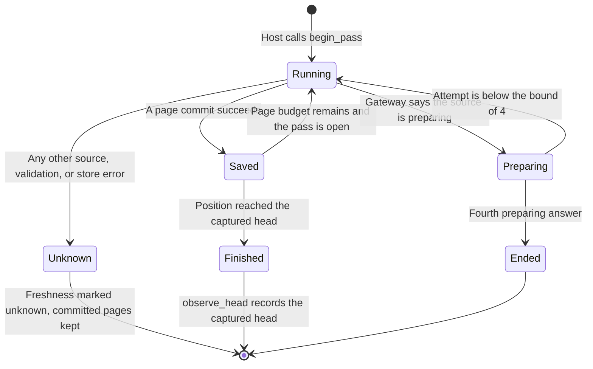

# Failure and retry

A failed pass keeps every page whose store commit succeeded and stops the in-memory pass. The library documents that contract on `step`: a failure leaves `Pass.next` unchanged, and after an uncertain commit the host discards the pass and calls `begin_pass`. Nothing in `nessa-sync` sleeps, subscribes, or tries again.

This repository adds a few bounded retries around that contract. Everything else waits for a later explicit command, a later follow trigger, or the peer poller's next scheduled read.

## What the driver does on an error

`run_records` runs `begin_pass` and then `step` inside one closure. The first error returns `RecordDriverError`. The closure's `Err` path calls `mark_unknown` on the cache. If that second call also fails, `freshness_failure` carries it. `captured_check` still reports the head and the clock time when `begin_pass` had already captured a target.

`run_catalogue` returns the `CatalogueError` directly. It has no `mark_unknown` twin in the driver. Catalogue progress stays at the last `apply_page` that committed.

Page budget is a normal stop, not an error. `complete: false` means the caller may invoke the driver again. The next `begin_pass` loads `downloaded` and continues.

## Preparing is the automatic record retry

`follow::discover` and the follow loop treat `RecordReadErrorCode::SourcePreparing` as retryable on the same session. `PREPARING_ATTEMPTS` is 4, counting the first answer. Further preparing answers warn with limit `client.preparing_attempts` and end the run. The module comment says the gateway keeps preparation progress between those attempts.

`keeps_connection` in `session.rs` keeps the socket for `SourcePreparing`, `WrongOwner`, any `GatewayError::Subscription`, and a held-file `TemporarilyUnavailable`. Other gateway errors take the socket (`fail` drops it). A dropped socket is not reopened inside the pass. The next command or poll connects again.

`GatewayError::TimedOut` while `follow` is waiting for a view ends the loop as `Idle`. That idle end is `clean`: the owner treats it as a finished bound, not a failed copy. Timeouts during the pass itself are failures.

The example CLI's cancellation flag stays false. There is no cancel path in that standalone command. Retained reads honor a stop flag; a read that saves nothing and then runs out of budget is a failure, and a read that saved something and runs out of budget ends incomplete.

## Deadlines

Each `GatewayConnection::run` arms one absolute deadline from the moment that operation begins. The read-only composition builds that budget with `GatewayPolicy::new(5000, PASSIVE_MIN_REQUEST_TIMEOUT_MS, 16)`. `PASSIVE_MIN_REQUEST_TIMEOUT_MS` is 45000. Discovery and the driver are separate `run` calls, so each gets its own budget. A long catalogue or record walk can therefore outlive a single 45 second window by using several operations, and it can also stop mid-pass when one operation's clock expires. Confirmed pages remain the resume point.

## Enrollment, offline, and reset

`application/device.rs` keeps the cache when authentication is refused. Terminal enrollment is the path that purges the receiver before the credential is removed. An ordinary offline close leaves the SQLite rows.

`ResetRequired` from the retained reader means the scope or the head is incompatible with the replica. The peer poller, on `ResetRequired` or `CacheDamaged`, empties that peer's cache and reads once more in the same turn. `CacheUncertain` does not take that branch. It is reported as an unread failure and waits for a later cadence. That later read calls `run_records` again, which starts at `begin_pass` and loads the durable checkpoint.

`CacheError::Uncertain` is how the cache reports a SQLite commit whose outcome it will not claim. The matching library error is `StoreError::Uncertain`. Retrying `step` on the same `Pass` after that error is outside the contract. The driver returns instead.

## What does not retry

| Outcome | Next action in this repository |
| --- | --- |
| `Denied`, `Unverifiable`, `WrongAccessScope` | The pass stops. Follow may ask pinned enrollment status again when `asks_status` says so. The cache is not purged for an ordinary refusal. |
| `IdentityChanged`, scope mismatch, head behind checkpoint | Retained read returns `ResetRequired`. The example command surfaces the error. No automatic scope rewrite. |
| `Stale` or `ConflictingRecord` | The transaction does not commit the new plan. A later explicit pass can load the winner and continue, or conflict again. |
| `Fenced` | The receiver stays fenced. The page is refused. |
| Validation errors (`EmptyPage`, `Noncontiguous`, `WrongRequest`, bounds) | The pass stops. The source page is not written. |
| `LinkSchedule` / `run_quantum` | Used by `measure.rs` and link tests. `follow` and the poller do not call it, so a weak link has no separate paced retry. |

Grant frames queued on the session are capped (`QUEUED_GRANT_FRAMES` 8, `QUEUED_GRANT_BYTES` 512 KiB). Overflow closes the connection. The follow comment says the next attempt retries from the committed grant cursor rather than inventing the dropped frame. View parking keeps at most `QUEUED_VIEWS` (4) and drops the oldest.

## Open questions

- The poller reschedules `CacheUncertain` instead of reloading in the same turn. The next `begin_pass` is the recovery the library asks for. How long the peer stays on backoff after an uncertain commit depends on the poller's failure pace, which this page did not time.
- Held-file `TemporarilyUnavailable` keeps the record session's socket because `busy` shares `keeps_connection`. That coupling is visible in `session.rs`. Whether a held-file busy answer can prolong a record follow that should have dropped is an open question; the match is unconditional.

## Further reading

[Follow loop](../../../../crates/nessa-client-core/src/read_only_sync/application/follow.rs) · [Session retention](../../../../crates/nessa-client-core/src/read_only_sync/infrastructure/gateway/session.rs) · [Peer poller](../../../../crates/nessa-peer-gateways/src/infrastructure/poller.rs)
