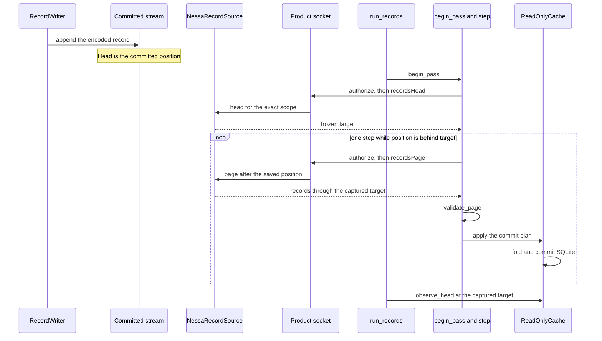

# One record change, end to end

This page follows one new physical record for a single conversation. The gateway commits it first. A follower learns the new head only when it asks, or when a subscription view reports a new cursor and the follow loop asks. The desktop can show a new view of the same conversation without running this pass.

The pass copies from the follower's saved position up to the head captured at the start. Records written after that capture stay on the gateway until another `begin_pass`.

## The gateway commits the record

`RecordWriter` in `crates/nessa-sdk/src/infrastructure/session_storage/record_writer.rs` is the exclusive semantic save owner. Units stay private until a durable completion. The physical append goes through the event stream (`record.rs` `append_encoded_batch`, and the batch helpers beside it). After that commit, `NessaRecordSource::head` can return the new position. `RecordChanges` wakes local subscription tasks. The wake is a signal that something committed. It does not carry the record body to followers.

A passive read is a separate request. `conversation.recordsHead` and `conversation.recordsPage` are admitted on the product socket, then `ReadRecords` reads `NessaRecordSource` for the authorized scope. The source enqueues `Command::Head` or `Command::Page` onto its worker and waits for that worker. The page is committed frames only.

## The follower captures a head

`run_records` calls `begin_pass`. Inside the library that function authorizes the exact scope, loads the local checkpoint, then reads `head`. A missing checkpoint starts at position 0. A saved checkpoint with a different scope is `ScopeMismatch`. A head older than the local position is `SourceBehindCheckpoint`. Otherwise the pass freezes `target` and sets `next` to the loaded position.

In this repository the authorizer and the record source are both the gateway session. `GatewayAuthorizer::authorize` calls `discover`, which performs `conversation.recordsHead` and checks that the origin is this gateway and the schema is the physical record schema. `RecordSource::head` discovers again and returns `IdentityChanged` when the scope drifted. So the first pass pays for more than one head RPC before any page.

`check-records` uses the same begin path with `max_pages` of 0, so the loop body never calls `step`.

## One page is validated and saved

Each `step` authorizes again, builds a `PageRequest` from `next` and the frozen `target`, and calls `page`. The adapter's `conversation.recordsPage` decodes the wire page. `validate_page` then checks the echo, the bounds, and the positions. An empty page, a gap, a duplicate id inside the page, a foreign scope, or a record past `target` is a validation error. The in-memory pass does not advance.

`ReadOnlyCache::apply_plan` opens an immediate SQLite transaction. It refuses a fenced receiver, a scope change, a fact id already stored with a different meaning, and a local `downloaded` position that is not the plan's expected position. When the plan is exactly what is already stored, the call succeeds again. Otherwise it folds `plan.records()` through `TranscriptFold`, writes `downloaded`, `applied`, and `facts` from that fold, inserts the raw rows, and commits. If `candidate.downloaded()` is not the plan's next position, the cache returns `Corrupt` and does not commit.

After the loop, a successful `run_records` calls `observe_head` with `pass.target()`. A failure calls `mark_unknown`. Pages committed before the failure stay committed.

## What causes the next pass

`follow` runs a recheck pass as soon as the subscription's first view is in hand. The comment on that loop says the recheck covers at least the cursor in the first view, so a later view with the same cursor has no record the cache lacks. `wait` then returns views. A cursor that differs from the one already seen starts another pass. A view whose cursor is unchanged is a live-fact change such as title or agent state, and the loop does not copy records for it.

An incomplete pass, because `max_pages` ran out before `next == target`, sets the next trigger to `Incomplete` and continues on the same connection. The durable checkpoint is the resume point.

`RetainedCache::read` runs the catalogue pass first, then `run_records` for each live conversation. The peer poller reaches that path from `follow_grants` after a fresh active enrollment status.

## What this pass does not update

Catalogue revisions, desktop summary revisions, and webhook outbox positions move on their own reads. A new transcript record can wake a conversation view without advancing the catalogue head, and it can advance a webhook cursor only when that registration's delivery cycle pages the record.

## Further reading

[Record writer](../../../../crates/nessa-sdk/src/infrastructure/session_storage/record_writer.rs) · [Follower driver](../../../../crates/nessa-client-core/src/read_only_sync/application/driver.rs) · [Gateway record source adapter](../../../../crates/nessa-client-core/src/read_only_sync/infrastructure/gateway/sources.rs)
