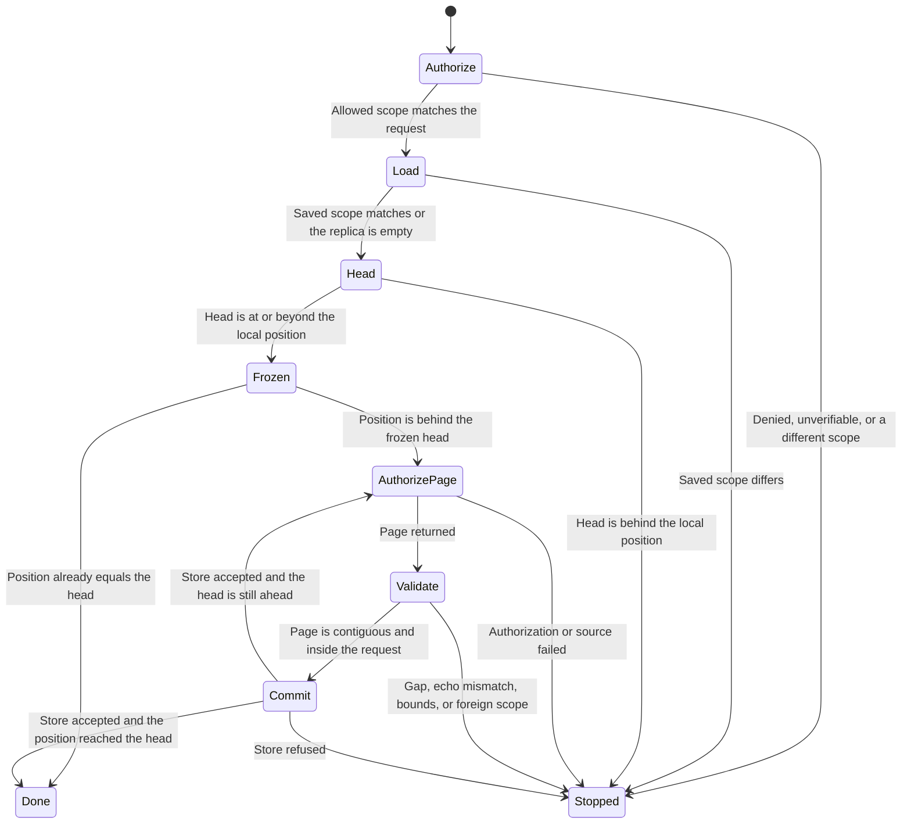

# Ordering and conflict rules

There is one order for a record stream: position 1, then 2, and upward, inside one exact scope. The follower does not merge concurrent writers. The gateway is the only origin, and the pass copies a prefix of that origin up to a frozen head.

Catalogue order is per key. A higher revision replaces the cached value. Equal revisions must agree. A deleted key stays deleted. Desktop order is a third rule, on view revisions, and it does not use these positions.

`Stopped` leaves the in-memory pass where it was. A store `Uncertain` is the exception the library calls out: discard that pass and call `begin_pass` so the next attempt reads the durable position. [Failure and retry](failure.md) covers that path.

## Authorization before a read

`check_access` in the library accepts only `Access::Allowed` whose scope compares equal to the request. `Denied` and `Unverifiable` are different errors. A different allowed scope is `WrongAccessScope`. `begin_pass` performs this check before it loads the local checkpoint, so a revoked reader does not learn about a saved scope through a mismatch error.

On every later `step`, the same check runs before `page`. The gateway adapter implements that check as a fresh `conversation.recordsHead`. A head whose scope differs from the pass is `SourceError::IdentityChanged` from `RecordSource::head`.

`step` does not call the authorizer again after `page` returns. Validation and `ReplicaStore::apply` run on the page already fetched. Catalogue `apply_next_page` does call the authorizer again after resolves and before `apply_page`. A revocation in that catalogue window refuses the page. A revocation in the record window after the page RPC can still commit locally.

Gateway admission for the RPC itself is separate and runs on each request. `validate_record_selector` and `validate_catalogue_selector` refuse the wrong owner, receiver, or epoch before the physical read. That refusal is the socket's. The follower still has to authorize on its side before it trusts the saved replica.

## Record page order

`validate_page` requires:

- The request scope and `after` match the expected checkpoint, and `target` is greater than `after`.
- The page echoes that same request.
- The page is non-empty and within the requested count and byte ceilings.
- Each record uses the request scope, carries a fact id unique in the page, and sits at `after + 1`, then `after + 2`, without passing `target`.
- A single record that cannot fit the declared byte ceiling is `OversizedRecord`, including the first record when it alone exceeds the page ceiling.

The cache adds the durable checks. `raw_records::check_ids` rejects an id already committed with a different meaning (`ConflictingRecord`). If `downloaded` is already at or beyond the plan's next position, an exact copy of the saved rows succeeds and anything else conflicts. If `downloaded` is not exactly the plan's expected position, or the loaded progress row changed, the result is `Stale`. A deletion fence returns `Fenced`.

`SourceBehindCheckpoint` is a head older than local progress. The retained reader maps that error, and `ScopeMismatch`, to `ResetRequired`. The cache is left in place until an explicit reset.

## Catalogue order

`begin_or_resume` authorizes, loads progress, and refuses a saved scope that differs from the request (`ResetRequired`). An active pass is resumed. A head older than `completed` is also `ResetRequired`. A head equal to `completed` performs no payload read. A brand-new empty catalogue (`head == 0` and no saved progress) authorizes a second time and records an empty begin.

`apply_next_page` validates the manifest request, authorizes, reads one manifest page, and validates the manifest. For each entry, a cached revision greater than or equal to the manifest revision skips `resolve`. Anything newer is resolved under another authorization. The final authorization runs before the page plan is applied. The cache accepts the page only when `current.active` is still that pass (`Stale` otherwise). The same revision with a different payload is `ConflictingRecord` in the cache adapter.

`validate_catalogue_revision_transition` is the pure rule underneath: revisions move forward, an equal revision keeps its deletion bit, and live content after deletion is a fence.

## Reset replaces identity on purpose

`CacheReset` in `domain/reset.rs` refuses a replacement that fails `same_receiver_stream`. Incarnation, schema, and access epoch may change. Receiver, origin, and stream may not. The reset is attributed: the caller, operation, and generation are part of the request. Applying a page under the new scope without that reset is a mismatch, not an automatic migration.

## Desktop revisions and webhook cursors

`supersedes` keeps an incoming view when its revision is greater than the one held for that same object. An equal revision changes nothing. `fromSource` refuses revision 0, negatives, fractions, and non-integers. `updates.ts` applies that rule to summaries and transcripts separately. A removal is a later summary revision. It is weighed against summaries only.

The webhook cursor refuses a record whose position is not `expected_after + 1` (`queue.rs`). `observe` on the cursor returns the saved position when the new scope is the same source. A different source writes a source-reset audit and returns `ResetRequired`. A cursor already marked `reset_required` stays refused.

## Open questions

- Whether every gateway record RPC re-checks Cedar at the same moment as the follower's head RPC is visible per call, and the two checks are different code. A gap between them is the record-page window described above. No single test name was treated as proof that the window is unreachable.
- The follow loop treats any cursor other than the last seen cursor as a reason to copy. The module comment describes that cursor as the committed position. A view that reported a lower cursor would still start a pass. What the gateway sends when the visible cursor cannot move backward was not re-derived here.

## Further reading

[Gateway source adapter](../../../../crates/nessa-client-core/src/read_only_sync/infrastructure/gateway/sources.rs) · [Record apply](../../../../crates/nessa-client-core/src/read_only_sync/infrastructure/cache/records.rs) · [Desktop revisions](../../../../../src/desktop/workspace/model/revision.ts)
