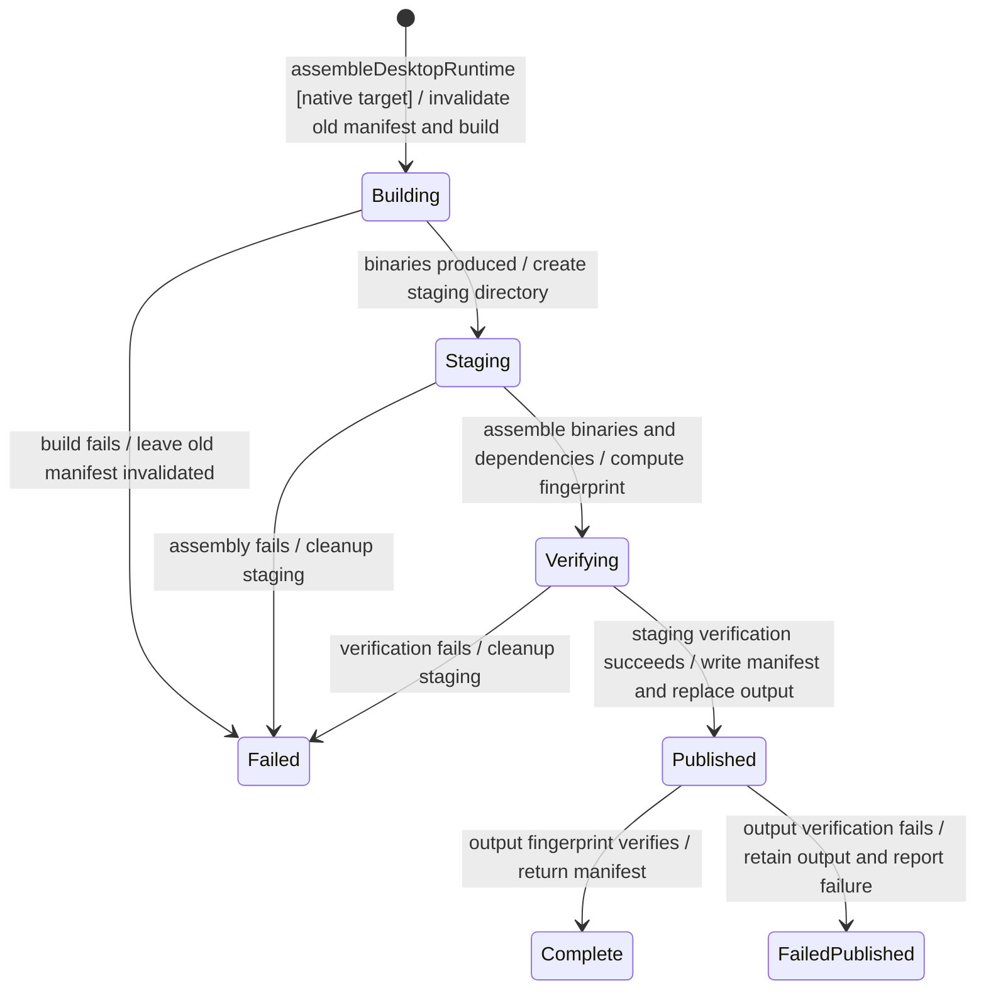
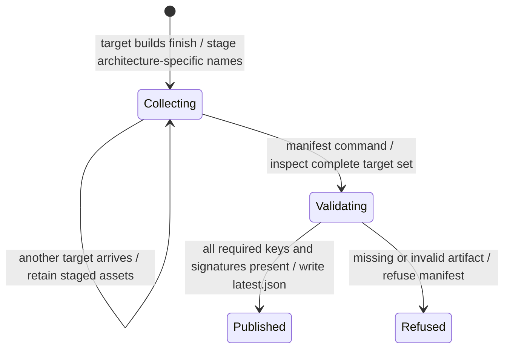

# Runtime and release assembly

Build tooling prepares the tested agent artifacts and assembles releases for each target. It validates the files before publishing the release manifest.

Preparing new output invalidates stale output instead of treating it as a fresh build. A complete manifest means all required target artifacts were assembled. It does not prove signing, upload, installation or a user's successful update. Some replacement steps are not atomic, so a failed build can leave partial output to inspect.

## Further reading

[Source](../../../../scripts/desktop/prepare-runtime.mjs) · [Related source](../../../../scripts/desktop/prepare-node.mjs)

## Model coverage

Direct model: One runtime assembly, stale manifest invalidation, staging validation before publication and final fingerprint before complete.

The finite model checks safety only. Release target-set/signature manifest validation is a separate pure contract; downloads, signing, uploads and successful end-user installation are excluded. Terminal states may stutter; no eventual completion or implementation proof is claimed.

This is a scoped source review at `77a6b620af4d94b234294f6d273fd74b3dfb44c7`. It adds the stated abstraction and does not refresh all earlier narrative claims. Existing page checkpoints are retained where present; reading regression sources is not a test run.
