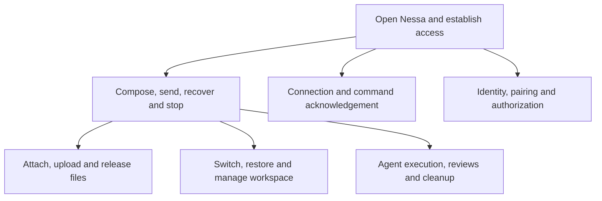
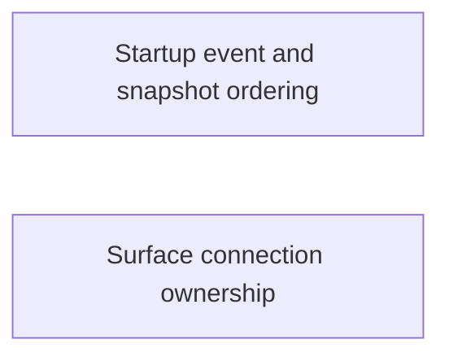

# User journeys and transition coverage

Choose a user goal to open its feature, then a flow and its detailed decisions. Each row connects a transition owner to regression evidence. A listed test means evidence is available to inspect; execution results appear separately below.

This is a risk-based inventory, not proof of exhaustive path coverage. This pass reviews frontend startup, session and conversation boundaries at the recorded revision. Backend rows route to existing maps and tests, without claiming a new Rust SDK or production-provider audit.

The arrows organize browsing, not exclusive application states. Connection recovery, queued work, a provider attachment and cleanup can coexist under different owners. An accepted send is not a completed turn. A transport failure does not prove refusal; closing a tab does not prove provider cleanup.

## Startup and access

Native host, managed gateway and authenticated connection have separate readiness facts. The surface monitor observes the host; the supervisor publishes a usable client. Browser renewal checks cookie validity without treating an outage as confirmed logout.

A stopped owner must not publish a late result into its replacement. New cases exercise application ports and the actual session React effect with its Redux reducer.

| Journey and owner | Guard, effect and boundary | Regression evidence | Remaining gate |
| --- | --- | --- | --- |
| Observe startup: monitor | Subscribe before snapshot; lifetime rejects stale callbacks; revision rejects older evidence; equal revision can restore after local failure; stop removes acquired or late listener. | [Ordering](../../src/startup/application/gateway-startup-ordering.test.ts), [existing cases](../../src/startup/application/gateway-startup.test.ts) | Native service effects remain separate. |
| Connect or recover: supervisor | Current generation publishes after connect and health; transport retry differs from authorization refusal; current-client reconnect does not spawn a competing client. | [Unit cases](../../src/session/adapters/lifecycle/supervisor.test.ts), [React/store integration](../../src/session/adapters/lifecycle/session-lifecycle.test.tsx) | Gateway E2E cannot build without Cargo. |
| Retry terminal failure: session effect | Retry counter replaces owner; old effect clears access and subscriptions; replacement publishes readiness. | [Retry/Strict Mode](../../src/session/adapters/lifecycle/session-lifecycle.test.tsx), [panel retry](../../src/panel/ui/use-panel-startup.test.ts) | Native-window acceptance unrun. |
| Renew browser access: renewal owner | Visibility and pending guard share one check; network rejection keeps scope; false result asks owner to end it; disposal removes both triggers. | [Renewal outcomes](../../src/session/adapters/lifecycle/browser-renewal.test.ts), [browser auth](../../src/session/adapters/client/browser-auth.test.ts) | Real cookie expiry/revocation requires server E2E. |
| Sign out: browser composition | Dispose local access before awaiting remote logout; lost acknowledgement remains uncertain. | [Sign-out ordering](../../src/session/application/browser-session.test.ts), [composition](../../src/composition/browser.tsx) | Retained logout recovery needs browser/server E2E. |

### Startup ordering inventory

These rows describe existing behavior before any proposed simplification. New tests preserve it without replacing the implementation.

| ID | Event order | Required observation | Test boundary |
| --- | --- | --- | --- |
| SO1 | Event before subscription acknowledgement; older snapshot follows | Retain unmanaged/starting/failed/ready; suppress duplicate revision | Monitor ordering, four states |
| SO2 | Stop and restart; old snapshot resolves or rejects | Old lifetime cannot publish, even with larger revision | Monitor ordering, two outcomes |
| SO3 | Start twice, Stop twice | One listener acquired/removed; captured old event ignored | Repeated lifecycle |
| SO4 | Strict Mode start/stop/start; old listener returns last | Old removes itself; replacement alone requests snapshot | Pending subscription |
| SO5 | Old Retry resolves/rejects after replacement | No replacement read, subscription or failure from old result | Retry lifetime, two outcomes |
| SO6 | Retry fails after newer host evidence | Retain newer projection | Retry lost acknowledgement |
| SO7 | Subscribe fails; explicit Retry succeeds | Start fresh observation lifetime | Observation recovery |
| SS1 | Consecutive transport failures | Wait 500/1000/2000/4000/5000/5000 ms; dispose cancels timer | Supervisor deadlines |
| SS2 | Overload hint below/above local backoff | Local minimum retained; larger validated hint honored | Three retryAfter cases |
| SS3 | Fail twice, connect, disconnect again | Reset delay and release retired listeners/client | Recovery reset |
| SS4 | Dispose before connection rejection | No failure publication or recovery timer | Late rejection |
| SS5 | Captured state/close callbacks after disposal | No readiness, reconnect or timer | Stale callbacks |
| SI1 | Mounted effect reconnects and returns | Shared handle and Redux readiness agree | Session integration |
| SI2 | Terminal close followed by explicit Retry | Fresh effect owns readiness | Session integration |
| SI3 | Strict Mode duplicate mount; first connect resolves last | Late client closes; replacement stays current | Session integration |
| BR1 | Focus and timer race during pending renewal | One check; valid/invalid/outage outcomes stay distinct | Three renewal outcomes |
| BR2 | Dispose during renewal; outcome arrives late | Remove both triggers; no obsolete sign-out callback | Three renewal outcomes |

## Conversation journeys

A draft becomes a local sending turn before gateway acknowledgement. Certain refusal can restore the draft for explicit retry; an unknown outcome retains its prepared identity for recovery. A replacement view can arrive before or after the acknowledgement. The local owner reconciles these separate facts.

The following conversation tests existed at the mainline baseline and participated in the full frontend run. This slice changes only composer observation ownership, not message admission or scheduling.

| Goal and risk | Owning regression evidence | Browse |
| --- | --- | --- |
| First send or unknown-receipt retry: retain prepared command identity rather than infer refusal from timeout | [Prepared operations](../../src/conversation/adapters/store/prepared-operations.test.ts), [unsent](../../src/conversation/adapters/store/unsent.test.ts) | [Send](services/desktop/chat/compose-and-send-the-first-message.md), [recover](services/desktop/chat/recover-a-refused-or-unconfirmed-send.md) |
| Read and reconnect: obsolete follow tokens cannot revive retired views | [Effects](../../src/conversation/adapters/gateway/effects.test.ts), [replacement](../../src/conversation/adapters/store/follow-replacement.test.ts), [terminal reconciliation](../../src/conversation/application/usecases/apply-view-terminal.test.ts) | [Read response](services/desktop/chat/read-a-conversation-and-watch-the-response.md) |
| Queue/reorder/steer/remove: captured execution identity must not retarget newer work | [Reorder](../../src/conversation/adapters/store/reorder.test.ts), [prepared operations](../../src/conversation/adapters/store/prepared-operations.test.ts) | [Follow-ups](services/desktop/chat/send-and-manage-follow-ups.md) |
| Stop active/queued work: admission acknowledgement and later cancellation differ | [Control failure](../../src/conversation/adapters/store/control-failure.test.ts), [prepared operations](../../src/conversation/adapters/store/prepared-operations.test.ts) | [Stop](services/desktop/chat/stop-active-and-queued-work.md) |
| Answer review/question: target identity, consumed/pending selection and diagnostic uncertainty differ | [Permission targets](../../src/conversation/adapters/store/permission-targets.test.ts), [question targets](../../src/conversation/adapters/store/question-targets.test.ts), [effect translation](../../src/conversation/adapters/gateway/effects.test.ts) | [Runtime](services/sdk/runtime/README.md) |
| Switch/close/restore tabs: view detachment differs from server stop | [Restored lifetimes](../../src/conversation/adapters/store/restored-lifetimes.test.ts), [saved tabs](../../src/conversation/application/saved-tabs.test.ts) | [Tabs](services/desktop/chat/close-switch-reopen-and-restore-tabs.md) |
| List/archive/delete: active/archived follows have separate owners; erasure and audit can fail after deletion | [List follow](../../src/conversation/adapters/gateway/list-follow.test.ts), [history follow](../../src/conversation/adapters/store/history-follow.test.ts), [effects](../../src/conversation/adapters/gateway/effects.test.ts) | [Catalogue](services/desktop/chat/find-archive-or-delete-a-conversation.md) |

## Attachments and workspace

Gestures, upload attempts and server-held bytes have separate owners. Removing a tile retires its placement; a late picker or upload result must not attach to a replacement draft. Ticket acknowledgement proves neither message admission nor later cleanup.

Workspace panes and sessions retain their own identities. Fixture controls do not establish gateway execution. Their feature pages retain that distinction.

| Journey | Existing regression evidence | Remaining integrated boundary |
| --- | --- | --- |
| Pick/paste/drop | [Picker](../../src/panel/ui/use-file-attachments-picker.test.ts), [races](../../src/panel/ui/use-file-attachments-races.test.ts), [upload pump](../../src/panel/ui/use-attachment-uploads.test.ts) | Native gesture callbacks, real focus and [gateway attachment lifecycle](services/gateway/attachments/README.md). |
| Upload and release previews | [Upload](../../src/panel/application/upload-image.test.ts), [resource ownership](../../src/conversation/application/queries/attachment-resources.test.ts), [tickets/retry](../../src/conversation/adapters/gateway/effects.test.ts) | Normalization, audit and physical byte release. |
| Split/move/close panes | [Pane commands](../../src/desktop/workspace/adapters/store/pane-commands.test.ts), [session commands](../../src/desktop/workspace/adapters/store/session-commands.test.ts) | Geometry, focus and frame budgets in [workspace](services/desktop/workspace/README.md). |
| Pair/approve/revoke devices | [Reducer cases](../../src/desktop/settings/model/linked-devices.test.ts), [rendered settings](../../src/desktop/settings/ui/linked-devices-tab.test.tsx) | [Linked-device flow](services/desktop/workspace/linked-devices.md); native activation and later revocation admission remain separate. |
| Share/change/revoke conversation grants | [Store orderings](../../src/desktop/workspace/adapters/store/sharing-commands.test.ts), [gateway pages](../../src/desktop/workspace/adapters/gateway/sharing-gateway.test.ts) | [Sharing flow](services/desktop/workspace/conversation-sharing.md); fresh list versus acknowledged change and dialog/window ownership. |
| Revoke remembered permission rules | [Request-owner regressions](../../src/desktop/settings/ui/permission-rule-rows.test.tsx) | [Revoke flow](services/desktop/workspace/permission-rule-revocation.md); focus cannot retire an in-flight command or its reread. |
| MCP Apps/reviews | [Bridge](../../src/desktop/widgets/app/application/bridge.test.ts), [review notices](../../src/desktop/workspace/adapters/gateway/review-notices.test.ts) | Real iframe origins, stale calls and gateway permission/audit E2E. |

## Runtime and backend boundaries

Existing charts separate provider attachment, admission, execution outcome, physical cleanup and audit acknowledgement. This pass routes readers to those owners; it does not refresh their source checkpoints.

The related simplification branch is `codex/simplify-submit-admission` at `152ce03894db62f044885a57db9c5d7e72482bf6`. Its latest commit changes SDK recovery/scheduling and gateway resumption. This slice leaves those files and `docs/state/services/sdk/scheduling.md` untouched. The coordinator confirmed separately active Mac SDK work is in `nessalabs/workspace-sdk`, so that work has no file overlap with this repository.

| Owner | Existing evidence map | Explicit exclusion |
| --- | --- | --- |
| SDK attachment/scheduling/reviews/cleanup | [SDK](services/sdk/README.md), [scheduling](services/sdk/scheduling.md), [runtime](services/sdk/runtime/README.md) | New Rust coverage and dynamic provider execution not established here. |
| Gateway commands/deletion/resources | [Gateway](services/gateway/README.md), [command boundary](services/client/commands.md) | No production accounts or live provider calls. |
| Pairing/retained reads/storage recovery | [Auth](services/auth/README.md), [storage](services/storage/README.md), [record reads](services/gateway/record-reads.md) | Existing links do not establish new cross-process fault coverage. |

## Executed checks and remaining gates

Runs use Linux, Node 24.19.0 and pinned Nessa UI `d550fac7a59b8f9b6c9d6f1e7dced07ca38ee35b`. Source and tests are committed at the checkpoint on `codex/1087-user-flow-regressions`. Documentation is a dependent slice for [issue 1087](https://github.com/nessalabs/nessa-agent/issues/1087). The runtime changes are limited to the three reproduced frontend ownership defects; no SDK or gateway source changed.

- Initial lifecycle batch: **48 passed / 5 files**.
- Startup/session/panel after renewal additions: **88 passed / 14 files**.
- New React/store integration: **3 passed / 1 file**.
- Full frontend before the three integration additions: **5122 passed, 2 failed / 388 files**. Failures are private-file acceptance fixtures in unchanged `local-credential-source.test.ts` and `local-gateway-endpoint.test.ts`. This environment reports `/` and `/tmp` owned by uid 65534; the acquisition contract accepts only root/current-user ancestors. Preserve that security assertion.
- Scripted E2E: **could-not-run, exit 2**, because Cargo is absent. All four checks in both Chromium/WebKit remain unrun. Stress defaults, raised counts and chaos also require the missing gateway binary and are **not run**.
- Explicit two-engine fixture run: Chromium **6 checks held**, WebKit **could-not-run** because its executable is absent (aggregate **6/7 held, exit 2**). The full desktop run-all gate remains unrun.
- Browser installation: **denied** (`403 Domain forbidden`, `cdn.playwright.dev`). No alternate download route attempted. Installed system Chromium can independently verify docs; this does not replace gateway E2E.
- GitHub listing and issue creation: **denied** (`POST https://api.github.com/graphql: Forbidden`), including one issue-creation retry after user direction. The parent subsequently created [issue 1087](https://github.com/nessalabs/nessa-agent/issues/1087). The source branch was then created and pushed through normal Git transport. GraphQL operations were not retried again; the parent owns draft-PR creation and project updates.

Verification history (full source checks at `4d718da047acbcf200c10feab62cb45b097ee939`; the later test-import correction is recorded below):

- **41 added regression cases** across monitor ordering, supervisor timing/cleanup, browser renewal, mounted React/store lifetime and the three audit findings, including the qualified actual-store composer case.
- **142 passed / 20 targeted files**, **401 passed verification-library tests**. TypeScript, changed-file ESLint, formatting and production build passed.
- **5138 passed, 2 failed / 390 frontend files**. The same two private-file fixture failures remain; security checks were preserved.
- Initially **107 architecture tests passed, 1 failed to execute Cargo metadata** (`spawnSync cargo ENOENT`). After normal Rust installation and the CI-discovered import correction, **108/108 architecture tests and the actual repository scanner passed** at `7f434845423686cdd01a17300c47d10d46911f50`.
- Chromium ordering script after the revoke follow-up: **7/7 checks held**. Both uncertain outcomes retained **0 stale Download buttons and 1 dispatch**, then **1 button after a fresh check**. Both composer ownership checks held. The permission-rule case retained one revoke dispatch and disabled controls through its reread, then enabled recovery.
- Revert probes: original download hook gives **2 failed / 9 passed**; original composer hook gives **2 failed / 1 passed**. Both original hooks in the browser give **2/6 held**, with the four ordering checks failing. Fixed source restored and browser 6/6 held.
- Nessa Docs validation accepted **126 pages / 0 catalog issues**; installed Chromium rendered **25 diagrams on all 14 changed pages**, opened **35 detail bindings** and followed **11 drill-down paths** with **0 page errors**. All **181 relative Markdown links** resolve. Changed-chart rendering, detail bindings, drill-down counts and source-review checkpoints are recorded in [the committed verification evidence](../../verification/desktop/evidence/user-flow-ordering/README.md) and the documentation handoff.

The [design table](../design/user-flow-ordering.md) preserves the corrected orderings and precise frontend scope. The actual-store composer counterexample requires send and tab switch in the same task. Ordinary separate-click reachability remains unverified. The permission component adds seven regression cases; its baseline gives **6 failed / 6 passed**, and its Chromium baseline permits a second frontend dispatch (**6/7 held**). The actual-store composer file with the original hook gives **1 failed / 7 passed**. No duplicate physical effects or speculative logic simplification are claimed. Exact-head CI and independent review remain separate gates; the parent owns merging.

## Separate focus triage

The independent audit reported a system-Chromium overview focus result of 15/17. The [separate focus diagnostics](../reviews/user-flow-focus-triage-1087.md) record an initial 16/21 run with contention/reload exclusions and a frozen-source quick run at 18/21. The latter retains two assertion failures and one could-not-run result. No overview focus owner is changed by these fixes, and no causal attribution has been established. This finding remains for coordinator disposition; it is not a passed gate or an excuse to weaken assertions.

## Exact-head CI correction

The parent retained failed CI run `39919232935` at `4d718da047acbcf200c10feab62cb45b097ee939`. Frontend, gateway-contract and the three local-auth platform jobs failed the same actual architecture scan: the new TSX composer test mocked the conversation testing entry instead of using public contracts. The correction removes that mock, preserving the checker and assertions. At `7f434845423686cdd01a17300c47d10d46911f50`, **23/23 affected regressions**, TypeScript, lint and formatting passed, followed by **108/108 architecture tests and the actual scanner** with Rust stable 1.99.1 installed under `/tmp`. Gateway compilation is now being attempted; earlier missing-Cargo E2E results remain historical and no E2E success is claimed. Independent review of the earlier runtime fixes was clean; parent review/CI at the final head remains the merge gate.

## Gateway-backed follow-up

After Rust 1.99.1 was installed normally under `/tmp`, the gateway built at source `7f434845423686cdd01a17300c47d10d46911f50`. All four signed-out scripted Chromium groups passed: resize-observers, MCP Apps over the gateway, the gateway window, and scripted permission/failure/cancellation scenarios. Each WebKit launch could not run because the browser executable remains absent. The aggregate command therefore reports **could-not-run, exit 2**, not a two-engine pass. [Runner summary and counts](../../verification/desktop/evidence/user-flow-ordering/scripted-e2e-summary.md) preserve the result; stress defaults/raised counts, chaos, native macOS and the full desktop run-all remain unrun.
