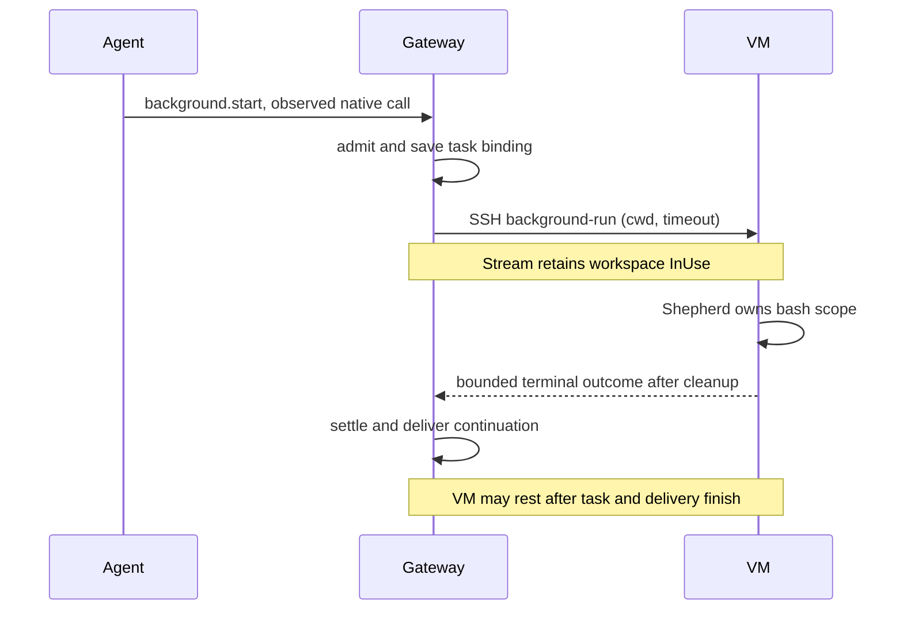

# Run cloud background commands in their thread's VM

**Before:** `background.start` in a cloud thread is refused because it has no local workspace.

**After:** the command runs under Shepherd in the thread's existing VM, keeps the VM in use, and settles its original task with bounded output and cleanup evidence.

Closes #1218.

## The change

The admitted lease supplies a typed local/VM target and the VM's reported cwd. The VM runner opens the existing workspace without provisioning, installs the verified helper build, and retains `InUse` through an independent SSH command stream. Existing native-call correlation, channel/allocation checks and authorization remain in place. The task's conversation and immutable placement identify where it ran.

A stop during successful preparation settles cancelled before command launch, while accepted preparation remains owned until it answers. Once launched, a stop byte or closed SSH stdin asks Shepherd to clean up. Missing or invalid terminal evidence settles interrupted with cleanup unconfirmed. Gateway restart interrupts saved unfinished tasks without replay.

This branch integrates main `19d631ebd34c6ece0062cbd0edbbd5e269d54c1d`, preserving its saved-login wiring. The background helper does not distribute agent logins. The lease fingerprint inputs, worker-image pin, consent and Cedar policies are unchanged by this PR.

## Verification

Code checkpoint: `0b93e7c525e1c4720913493772d1006bab2b5225`. [Exact commands, logs, manifests and review](verification/conversation/evidence/1218-vm-background/README.md).

- 37 background, 86 workspace, 130 SSH-adapter and 31 CLI tests passed. The opt-in real-SSH test remains ignored.
- Both real helper-binary tests passed: open stdin, cleared synthetic secrets and a large record on shared socket stdio.
- Server clippy on all targets with warnings denied, Rust formatting, 68 focused Node tests, 108 architecture tests, architecture checks, driver lint and formatting passed.
- The conversation stress driver's `vmBackground` step passed at one and three repetitions per engine in Chromium and WebKit, columns, dev mode: 10/10 and 14/14 checks. It sends through the composer and checks unchanged live Boat lease, running row past idle, admitted cwd, completion, one continuation and subsequent rest. The fake provider and scripted in-process agent lease use the real helper and workspace holds. Only the initialized test composition accelerates cloud idle to three seconds; production remains five minutes.
- Six original revert probes and the follow-up startup-stop/browser-admission probes failed as expected; sources were restored byte for byte. The probed fix hunks remained unchanged after main integration. The CLI stdin hang and truncated socket output were also reproduced before their fixes.
- Independent review has no remaining confirmed correctness findings.

## Limits and rollout

The gateway installs its exact helper build even when an older VM image speaks the same lease protocol. Terminal output is delivered with the final record. Unconfirmed cleanup retains existing ownership and can keep the VM from resting; automatic reconciliation is unchanged. Command timeout measures execution; there is no overall preparation deadline.

The browser runs selected the VM step, not the full conversation plan. Sidebar, real Boat/SSH and OS-level SSH teardown, native macOS/Windows and minimum-Rust checks were not run locally. WebKit used workspace-owned runtime libraries; its system-ldconfig host check was skipped, while browser launch and all assertions ran. No paid resources or real credentials were used. Exact-head CI remains pending; this PR stays draft.

## CI follow-up

CI on `ff2471f3616dad5d3a89341777c70f19c2893aeb` passed frontend,
gateway-contract and release-profile desktop compilation. Windows clippy found
two unused imports in the Unix VM stress fixture. Source correction `8fb90870e6cb63fe7a6f5ad982301fd46883b1bc`
guards those imports; warnings remain denied. Independent review confirmed the
guards and checked the remaining imports. This changes no production source or
test bodies relative to the verified checkpoint. New exact-head Windows and
full-plan CI confirmation remain required.
