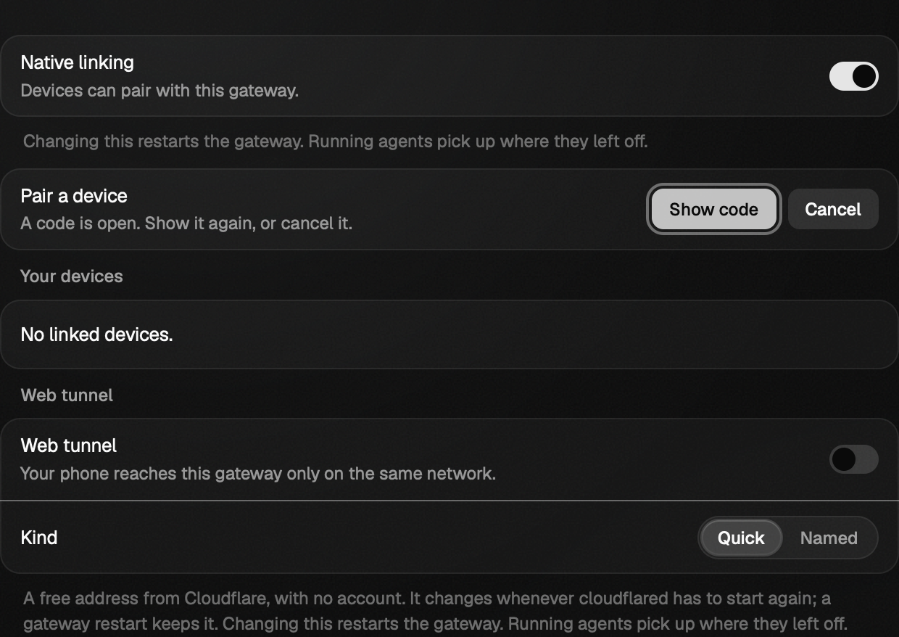

# Desktop matrix repair (#1203)

The repaired fixtures reach the existing UI through visible controls. Pairing
dialog closure now returns focus explicitly to its row in WebKit, where a pointer
click can leave the previous settings control focused. Pane lifecycle is unchanged. The earlier tooltip, home-shape and sideways-drag
reports are resolved by the intervening workspace change (#1197).

## Source and environment

- Base: `c92faad8e3ea1667ef7b9f5bf5d1847b32a57f19`.
- Executable verification changes: `2e8e26ee1b011ab781bdc67cac04ca7eff4bb42e`.
- Initial narrow-fixture review: `094019a712bf596eba7e1f712e0274f340f6c85b`.
- Final reviewed source: `30a58f4e25121a2f503dc3c3c1ed30ffa1a432f7`, including pairing
  focus and the additional fixture repairs found by the complete matrix.
- macOS, isolated Vite cache and loopback port; Playwright Chromium and WebKit.
  These are browser results, not native WKWebView or performance measurements.

## Reproduction and repair

| Case | Before | Restored fix |
| --- | --- | --- |
| Split motion, columns at 760×700 | Split refused because side columns leave insufficient room | Reclaim side-column room, then measure the admitted split |
| Retain reply, columns at 760×700 | Click times out on hidden composer | Reclaim room before opening and typing into the two-pane fixture |
| Retain reply/Stop, sidebar at 760×700 | Hover times out on folded session rows | Reveal the rows before using removal controls |
| Session-list requests in sidebar layout | Intentional `CannotRun` although that layout has no session list | Explicit inapplicable result, excluded from pass totals |
| Exclusion summary | Every reason is called “dev server only” | Count not run; each result retains its actual reason |

Each setup fix was individually reverted, with the changed hunk printed before
the probe. The original failure returned. Restoring the code passed the same
narrow scenarios. The summary regression likewise failed with the old reporter
and passed after restoration. Assertions about animation, closing-frame content,
removal identity and final pane count remain intact.

## Results

- Before this patch on current main: smoke **33/33**, icon buttons **13/13**,
  home-shape **3/3**, targeted drag **25/25**, focus **93/93**.
- Restored narrow matrix: **15/15** applicable checks across both browsers and
  layouts; two session-list cases are explicitly inapplicable.
- WebKit selected matrix at 1440×900, 1000×700 and 760×700: **27/27** applicable
  checks; nine session-list cases are explicitly inapplicable.
- Verifier unit suite: **538/538**. ESLint, Prettier, architecture, and documentation
  catalog validation passed. Documentation catalog: **137 pages, zero errors**.
- Independent second review: clean; independently ran **54/54** focused tests
  and four combinations of exclusions and failures.

The initial narrow repairs merged in [PR #1204](https://github.com/nessalabs/nessa-agent/pull/1204).
The additional repairs, full-matrix report, and current CI results are recorded on
[PR #1205](https://github.com/nessalabs/nessa-agent/pull/1205).

## Fixture surfaces

The narrow fixture reaches two readable panes before typing an unsent reply:

It reveals the session list before hovering the removal actions:

## Additional matrix repairs

The complete run exposed stale committed-review/question fixtures, missing
channel-list and tunnel responses in strict gateway mocks, and a tunnel check
that sampled its loading state. The fixtures now use the current published
contracts and wait for the state they assert. Restored committed controls pass
121/121; unread-conversation checks pass 5/5; linked-device checks pass 19/19.

The pairing focus regression fails before the runtime fix (17/18 unit tests)
and with that fix reverted in a separate checkout. The restored suite passes
18/18. WebKit now places focus on Show code after Escape closes the modal:

The subagent panel check now measures the existing toolbar boundary and opaque
theme background, as the production styles and their test require; its four
browser/layout cases and console check pass 5/5. Strict mock responses preserve
the unexpected-method assertion; share-dialog passes 27/27 after answering the
channel-list and tunnel reads. Linking stress setup handles a vault unlock prompt
before selecting a conversation after a prior engine restarted the gateway.

The pane and pairing state documentation was reviewed. Pairing's existing
Shown/Hidden transitions remain unchanged; its focus destination is now explicit.
The other repairs change verification data and preconditions, so they introduce
no product state transitions requiring another state-diagram update.
