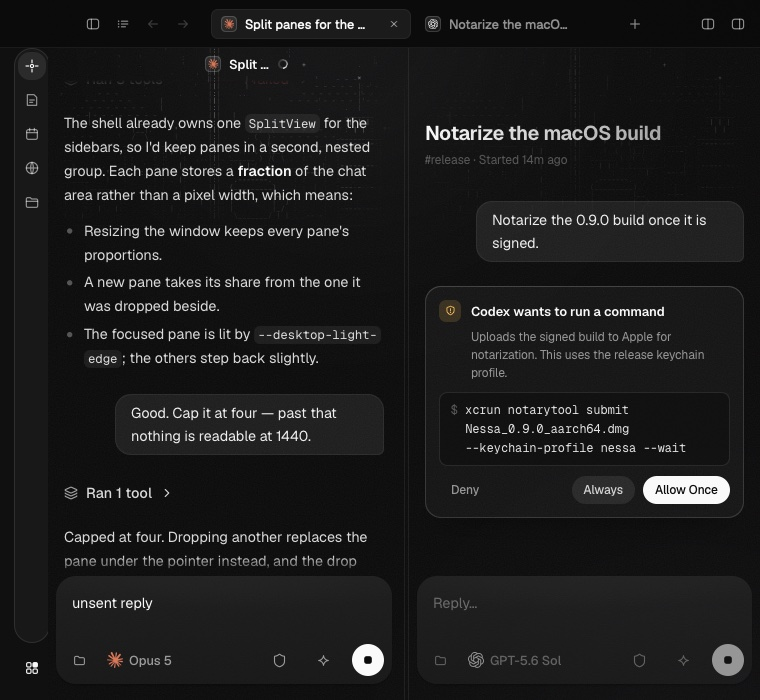
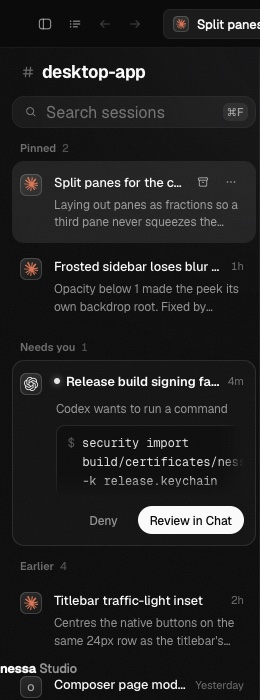

# Desktop matrix repair (#1203)

The repaired fixtures reach the existing UI through visible controls. No product
UI or pane lifecycle changed. The earlier tooltip, home-shape and sideways-drag
reports are resolved by the intervening workspace change (#1197).

## Source and environment

- Base: `c92faad8e3ea1667ef7b9f5bf5d1847b32a57f19`.
- Executable verification changes: `2e8e26ee1b011ab781bdc67cac04ca7eff4bb42e`.
- Final reviewed head: `094019a712bf596eba7e1f712e0274f340f6c85b` (later commits
  only correct explanatory wording and documentation checkpoints).
- macOS, isolated Vite cache and loopback port; Playwright Chromium and WebKit.
  These are browser results, not native WKWebView or performance measurements.

## Reproduction and repair

| Case | Before | Restored fix |
| --- | --- | --- |
| Split motion, columns at 760×700 | Split refused because side columns leave insufficient room | Reclaim side-column room, then measure the admitted split |
| Retain reply, columns at 760×700 | Click times out on hidden composer | Reclaim room before opening and typing into the two-pane fixture |
| Retain reply/Stop, sidebar at 760×700 | Hover times out on folded session rows | Reveal the rows before using removal controls |
| Session-list requests in sidebar layout | Intentional `CannotRun` although that layout has no session list | Explicit inapplicable result, excluded from pass totals |
| Exclusion summary | Every reason is called “dev server only” | Count not run; each result retains its actual reason |

Each setup fix was individually reverted, with the changed hunk printed before
the probe. The original failure returned. Restoring the code passed the same
narrow scenarios. The summary regression likewise failed with the old reporter
and passed after restoration. Assertions about animation, closing-frame content,
removal identity and final pane count remain intact.

## Results

- Before this patch on current main: smoke **33/33**, icon buttons **13/13**,
  home-shape **3/3**, targeted drag **25/25**, focus **93/93**.
- Restored narrow matrix: **15/15** applicable checks across both browsers and
  layouts; two session-list cases are explicitly inapplicable.
- WebKit selected matrix at 1440×900, 1000×700 and 760×700: **27/27** applicable
  checks; nine session-list cases are explicitly inapplicable.
- Verifier unit suite: **538/538**. ESLint, Prettier, architecture, and documentation
  catalog validation passed. Documentation catalog: **137 pages, zero errors**.
- Independent second review: clean; independently ran **54/54** focused tests
  and four combinations of exclusions and failures.

Full-matrix and CI results are recorded on [PR #1204](https://github.com/nessalabs/nessa-agent/pull/1204).

## Fixture surfaces

The narrow fixture reaches two readable panes before typing an unsent reply:

It reveals the session list before hovering the removal actions:

