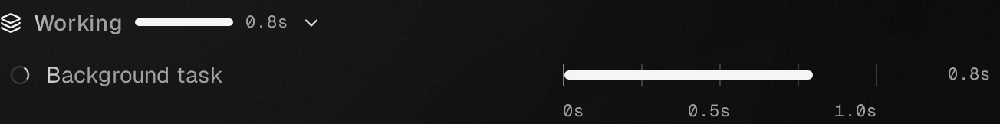

# VM background tasks (#1218)

Code checkpoint: `0b93e7c525e1c4720913493772d1006bab2b5225`, based on main
`19d631ebd34c6ece0062cbd0edbbd5e269d54c1d`.

The conversation stress `vmBackground` step ran through the composer in dev
mode, Chromium and WebKit, columns, 1440×900. The default one-per-engine run held
10/10 checks; the raised three-per-engine run held 14/14. Background traffic and
two followers remained enabled. The command was gated past the test-only cloud
idle limit (3 seconds); production keeps 5 minutes.

The driver currently uses only the first requested layout, so the command's
`--layout columns,sidebar` qualified columns. Sidebar was not run. There is no
claim of real Boat/SSH or native macOS/Windows behavior. The fixture's agent lease
and VM provider are substitutes; the helper is the actual CLI under Shepherd.

The running shot shows the existing background row after its calling turn ended.
The finished shot shows the collapsed waterfall after completion. The checks
assert the original row's final status, retained stdout/cwd, unchanged live Boat
lease while running, one continuation, and the VM's subsequent rest. Structured
lease and event witnesses and exact commands are under
`verification/conversation/evidence/1218-vm-background/followup/`.

Playwright 1.63.0 used its pinned Chromium/WebKit downloads. WebKit's missing
system libraries were unpacked into workspace-owned runtime paths. Host
validation was skipped because its dlopen check consults the system ldconfig
cache; real browser launch and all assertions ran. No test assertion was skipped.

