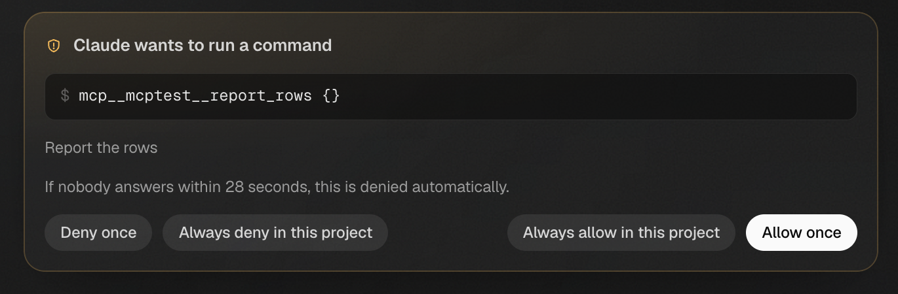
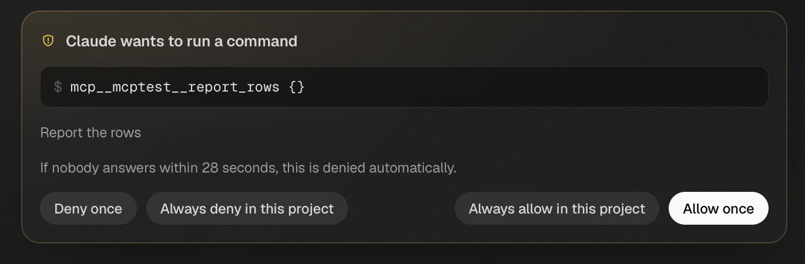

# Backend live controls verification

Checked runtime source: `555d0631917de2ebc5983f1bea2068960482c9d3`
(base `416ccd7e1`, tree `a7348298b5bc1d88b8c7adaf4e4a745fcbde92dc`).
This packet adds evidence only; it does not change checked runtime source.

The signed-out canonical command `CARGO_INCREMENTAL=0 pnpm test:e2e:scripted -- --evidence /tmp/nessa-975-scripted-e2e` built this checkout's gateway and passed all three programs in Chromium and WebKit:

| Check | Chromium | WebKit |
| --- | --- | --- |
| mcp-apps-gateway | pass | pass |
| gateway-window | pass | pass |
| scripted-scenarios | pass | pass |

Short result: `Verdict: pass`; `scripted-scenarios: 9/9 held`.
The shared recorder reports only known harmless Chromium favicon404 and aborted-after-204 browser-check noise. No authenticated vendor CLI is involved. These screenshots show the existing permission review compatibility journey; visible model controls are a separate UI follow-up.

The two screenshots are exact rectangular crops (x1320/y700,1370×450) of this run's permission screenshots, inspected after cropping. They retain all permission options. Original screenshots and complete logs remain in the temporary run directory; no pixels were synthesized.

Full seven-package unfiltered qualification on the same source:6,659runtime tests passed,35existing ignored,69doctests passed. Strict all-target seven-package Clippy, formatting and SDK docs pass. Focused before/fixed/omission proofs cover saved retry identity, pending-input configuration ownership and correlated restored model timing. All159feature source hashes stayed unchanged through the browser run.

Native ACP acknowledgement over real SSH and authenticated vendor journeys are not claimed. Existing SSH grant/lease/echo lifecycle and separate native profile stand-ins are covered by their own source-qualified tests.
