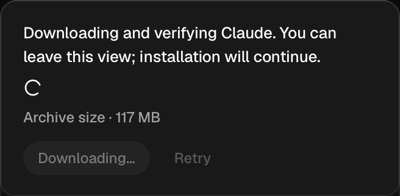
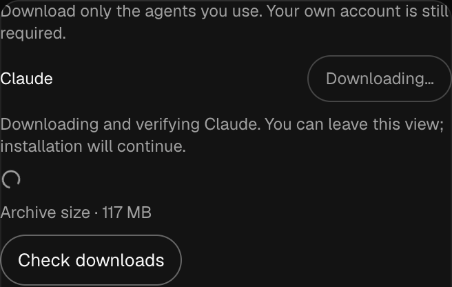

# Agent download progress (#942)

Source base: `3197cb6e4f769ecd78ebfd2d2564c7d2df0c7d7c` plus this PR's
onboarding UI, fixture, checks and module-map changes. Screenshots are the real
setup/download-list components over a controlled installation port, at 360px.
They contain fixture data, not an owner account.

- `pnpm frontend:check`: format, lint, architecture, protocol, client docs/types,
  application types, 352 frontend test files / 4,645 tests and production build
  completed. Supporting scripts: 425 total, 423 passed, two existing skips;
  desktop-library tests 200 passed; architecture tests 104 passed.
- Focused progress/setup tests: 27 passed.
- `send-failure.mjs`: 15/15 held, Chromium and WebKit, setup, first-use and
  downloads at 360px; no numeric completion value, known archive size,
  visible animated indicator, reduced-motion stop, no replay, terminal removal.
- `pnpm test:e2e:scripted`: passed all three gateway checks in both engines;
  [summary](scripted-summary.md).
- Five source mutations were verified applied and failed their checks: invented
  numeric completion, wrong known archive size, invented unknown archive size,
  missing animation, ignored reduced motion. Source was restored with a fresh
  modification time and the targeted browser suite passed again.
- Fresh FULL review round 2 found no findings at any priority. Round 1 found
  native progress painting as a solid rectangle; the shared component now uses
  the existing reduced-motion-aware spinner and its browser check observes a
  changing transform.

The complete functional desktop run at source `b53628a9` finished with 26
held groups, six failed groups and two groups that could not complete. The
changed `send-failure` group held 15/15. The full run is **not a pass**, and
this PR remains draft. There is no new performance-budget scenario.

| Group needing qualification | Held | Result |
| --- | --- | --- |
| focus | 62/65 | could not run |
| drag | 166/181 | failed |
| responsive | 31/35 | failed |
| safe-area | 66/93 | failed |
| columns | 132/133 | could not run |
| share-dialog | 20/22 | failed |
| mcp-apps | 100/101 | failed |
| message-sync | 9/15 | failed |

The remaining results include page-load/readiness timeouts, layout and focus
assertions, one MCP-message assertion, and message-update frames exceeding
50 ms (maximum observed 122 ms). Their causes are not established by this
run. Raw results are retained locally in `/tmp/nessa-942-all.json` and
`/tmp/nessa-942-all.log`.

Additional verification used the UI from main `cf551b6a` with the same
progress implementation and its pinned UI dependency `d8e1fb9`:

- Targeted download checks held 14/14 in Chromium and WebKit.
- Share focus also failed without this progress change: 21/22 held on the
  main UI. That separate defect is tracked in
  [#963](https://github.com/nessalabs/nessa-agent/issues/963).
- A further focus check held 79/84; five overview-readiness cases could not
  run. The extra diagnostic sweep was stopped after that result, during
  drag; it does not qualify the remaining groups or a full current-main run.

These results keep the targeted behavior distinct from the unresolved desktop
qualification. No error filter or timing assertion was weakened.

