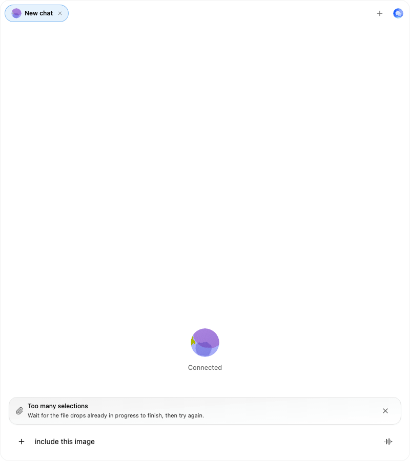
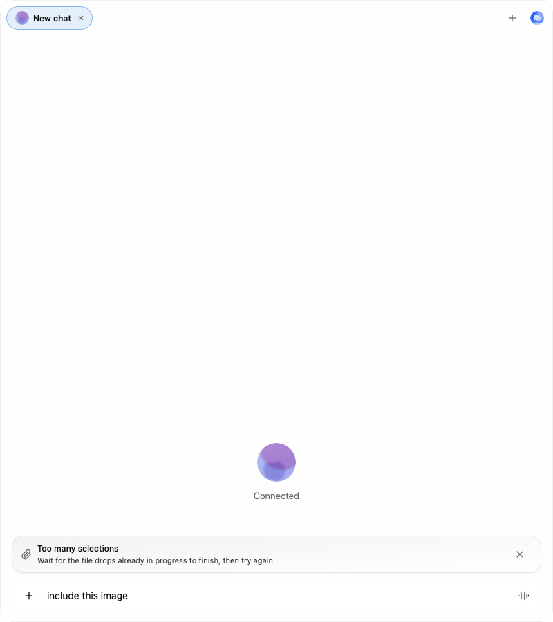
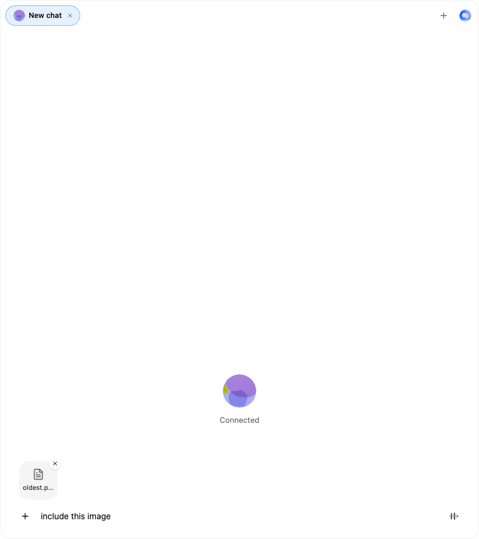
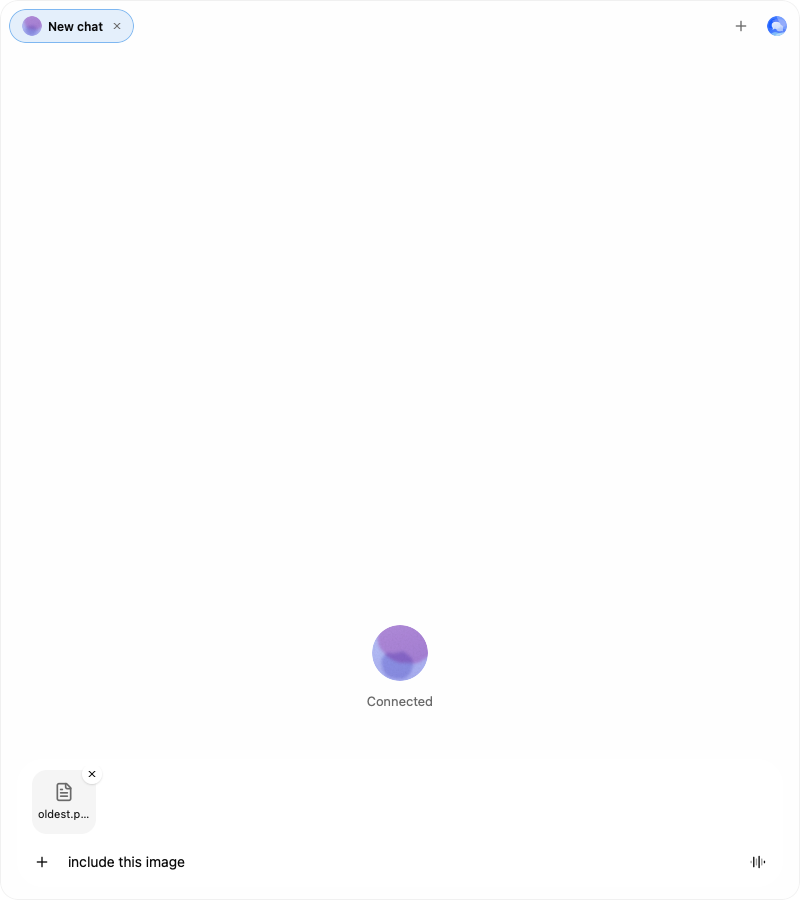
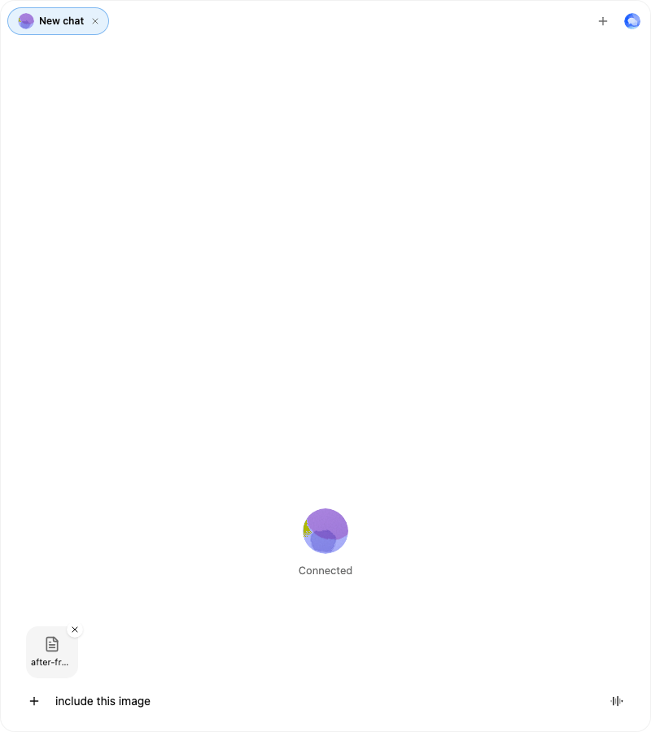

# Attachment drop capacity evidence

The browser run exercises product source `f7fb12c2de2a9a39c025a32d7fd7b555ea8196d6`.
The verification-only change adds the `drop-capacity` case to the existing
actual-App harness; it does not change production source.

Chromium and WebKit each began 64 drops in A/c0, replaced the provider with an
empty B/c0, and began a 65th drop. The actual notice **Too many selections**
appeared once in B, whose draft remained empty. The rejected overflow result,
an unknown result, and a duplicate terminal result were ignored. The oldest
accepted result produced one visible `Open oldest.pdf` tile in A and no tile in
B. After that result freed capacity, B accepted and displayed
`Open after-free.pdf`. The two drafts and the refusal are asserted in the
browser DOM and fixture store snapshots; both engines reported zero page errors.

The captures show B's visible 65th-drop refusal:

The oldest terminal result appears in A exactly once:

B accepts a new drop after the terminal result frees a slot:

[check.log](check.log) records the final 26-case matrix and concise quality
checks. [revert.log](revert.log) records the expected failure after temporarily
restoring oldest-entry eviction; the source was restored before the final
matrix. The design contract is [AG15](../../../../docs/design/attachment-gestures.md).
