# Attachment gesture owner evidence

Issue #824. Product source was frozen at `7870e750b7483772ebe4ba1a66546660493ef568`,
against #816 source `22f76f61886b05cc598b37ddf3fb3acd9ce124e5`.
The later evidence commit adds these files only.

The actual panel fixture holds two native picker calls across Redux providers
with the same local `c0`, announces their readiness in reverse order, and
asserts the visible provider shows only its own file. It then switches back,
checks the original provider's tile, resolves both results in reverse order,
and checks each store's draft. These cropped screenshots show provider B's
own `b.pdf` tile. They are supplemental visual evidence; the assertions prove
routing and cleanup.

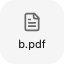
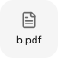

[check.log](check.log) records only the short gate and revert results. The full
source ordering table and public regressions live in
[attachment-gestures](../../../../docs/design/attachment-gestures.md).
These controlled host tests do not establish native platform support or server
authorization; current-main assembly and CI remain separate gates.

## Historical review handoff

Current product source: `a9ae357fbcd4372e2af264706bc2cf907dc92fa9`. The screenshots above remain captures of `7870e750`; they are not claimed to capture the later fixes.

The final source adds stable listener/cleanup ownership and preserves same-owner closed-tab notices while suppressing redirection into replacement providers. Author checks passed 4,193 tests in 322 files, TypeScript, ESLint, formatting and architecture. Both closed-target regressions fail when the owner guard is removed and pass after restoration. The private current-main assembly `9859c46f` passed 4,326 tests in 333 files, TypeScript and ESLint after integrating this source.

Fresh R5 found no remaining source correctness finding. A suggested comment finding was withdrawn after checking the actual historical wording and host event order. Browser gate 17 remains open: the combined matrix at `c82a58e7` timed out on WebKit's second Add attachment control after replacement-owner selection. The author also reported this full-matrix timeout on Chromium. Later passing 24-case runs and isolated passing scenarios do not explain the original failure. [The preserved combined failure](owner-swap-timeout.log) includes the UI text, no page errors, and the exact failing line.

The original combined failure is retained above as historical evidence. Follow-up investigation captured the actual control and provider state: the old transition entered the upload-owner fixture, which seeds `replacement.png`; that changes the control from “Add attachment” to “More options.” The helper also did not wait for the replacement provider to commit before the next interaction. The source-asserted reversion recorded in `/tmp/nessa-838-old-upload-fixture-probe.log` restored the seeded upload and failed the new empty-draft assertion, while the dedicated `swapPickerOwner` transition in `b49e780` uses a fresh empty store and waits for its committed owner marker. This closes the historical timeout as a verification-transition defect; it does not treat an isolated passing rerun or a longer wait as proof of a product fix. The current matrix keeps the owner transition explicit and asserts both providers' results.

## R2 regression evidence

The `pathless-host-drop` case delivers prose and an image URL without a batch
beginning, then changes providers while the image fetch is held. The actual App
pastes the prose and attaches the image to the provider captured when the result
arrived. The `browser-picker-fallback` case cancels and reopens the browser input,
changes providers before the delayed `change`, and verifies that the original
provider receives the file. Screenshots show the result in the owning provider:

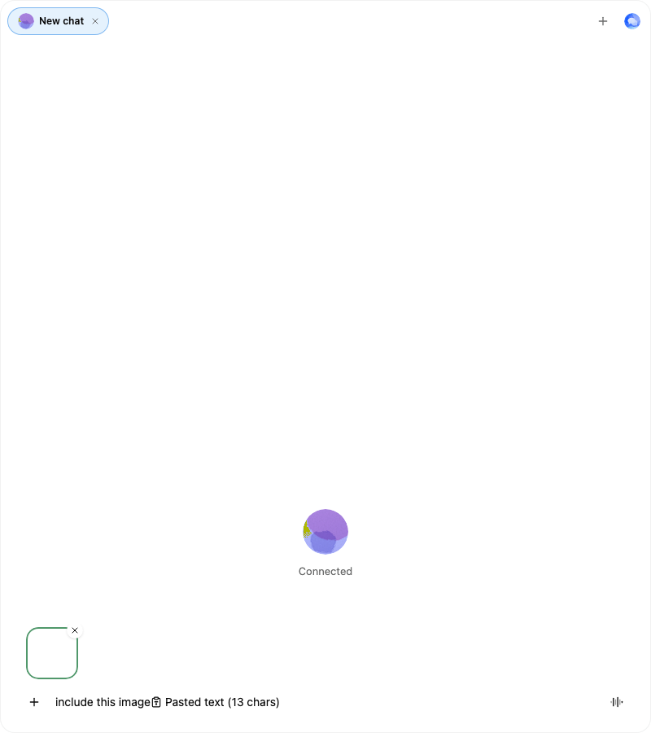
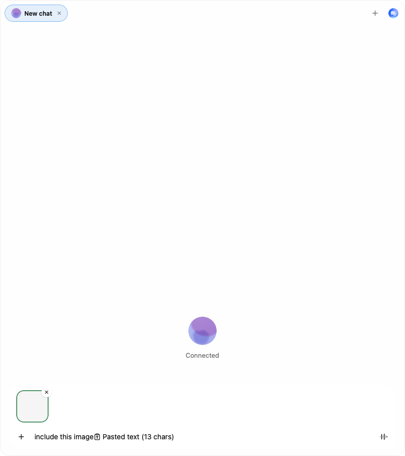
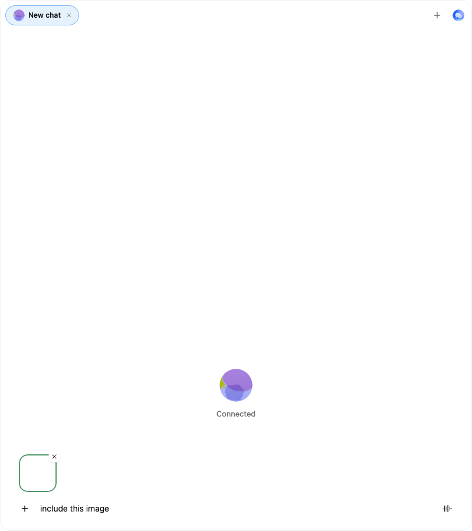
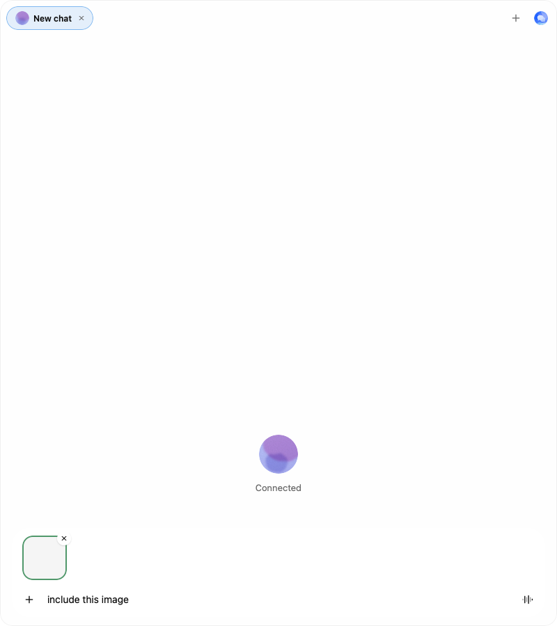

The expanded attachment matrix passes 30/30 engine/scenario pairs. The focused
test count, type, lint, architecture, format, fixture-build and source-revert
results are in [r2-check.log](r2-check.log). The screenshots are supplemental;
the browser assertions prove the owner routing and result delivery.

## R3 per-conversation refusal evidence

R3 product source is frozen at
`172804abf08aeec8534563b95e528438cf9df798`.

R3 adds one read-only refusal map per mounted hook, keyed by local conversation
ID and carrying the actual store/resource owner. Its update and cleanup paths
keep open tabs independent, answer only the addressed tab, and prune entries
when a tab closes or the provider scope retires. The picker hook regression
checks delayed A refusal while B is active, both notices across tab switches,
answering A without clearing B, same-ID provider replacement, and close cleanup.
The actual App browser case repeats the visible two-tab flow in Chromium and
WebKit; these four screenshots show the two conversations' separate notices.

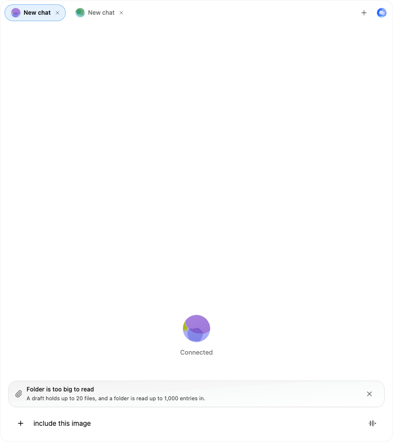
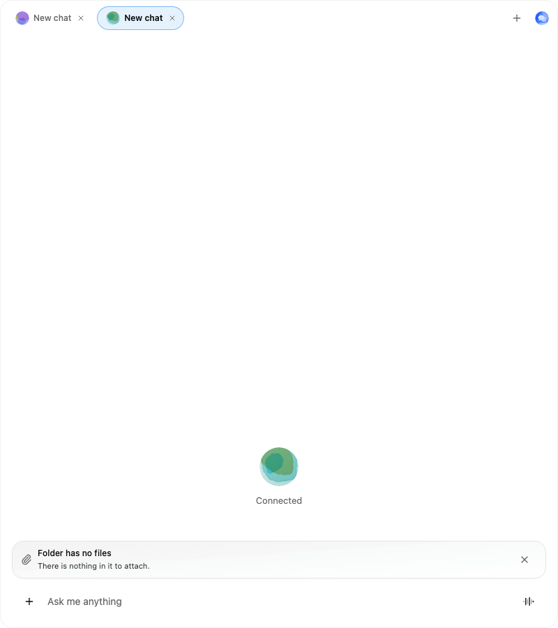
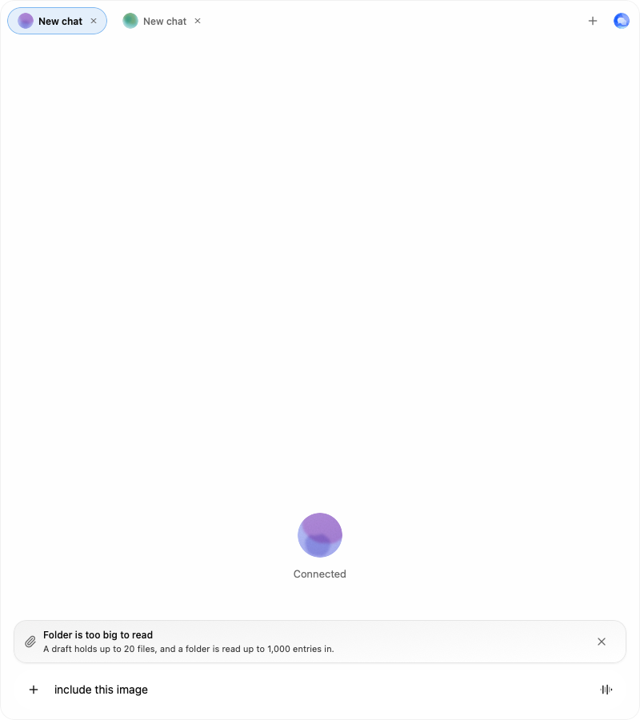
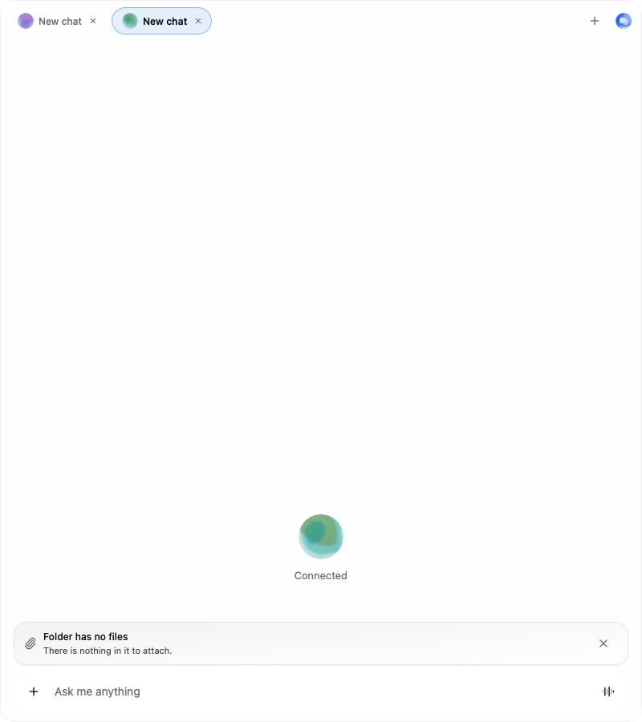

The host batch, drag and drop listeners now live for the mounted component.
Their callbacks read layout-updated current refs. Hook regressions hold listener
registration pending through provider replacement, prove the batch beginning
still binds to the replacement owner without registering twice, and prove a
retained terminal callback is ignored after unmount.

[r3-check.log](r3-check.log) records direct-Node type, lint, formatting,
architecture, full test, browser matrix and source-revert results. It supersedes
the historic R2 verification counts above. The R2 log is retained as written;
its recorded `pnpm exec` command has no preserved raw shell output, so execution
provenance is unverified. The R3 results use direct Node binaries and resolve
their TypeScript, Vitest, Prettier, ESLint, Vite, `@nessa-ui/react`, Geist and
Geist Mono dependencies inside this checkout.

## R5 folder-operation scope

R5 product source is frozen at
`3930817d8456cef018d19039891d361e06f45e36`.

The `folder-owner-send` and `folder-owner-drop` cases keep A's folder traversal
pending while replacing the provider with B's store and resources under the
same local `c0`. The next committed B render can send immediately and start its
own folder walk; each traversal's eventual result remains in its captured
provider. The new screenshots show the send and B folder gesture in B, and both
settled folder tiles in their respective providers:

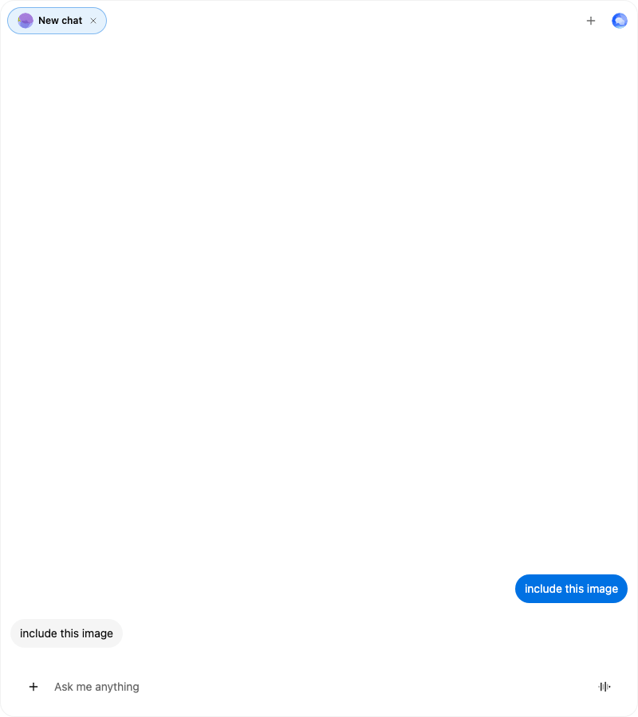

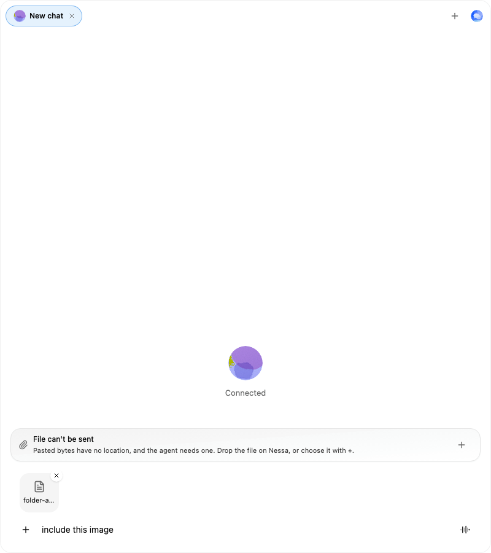
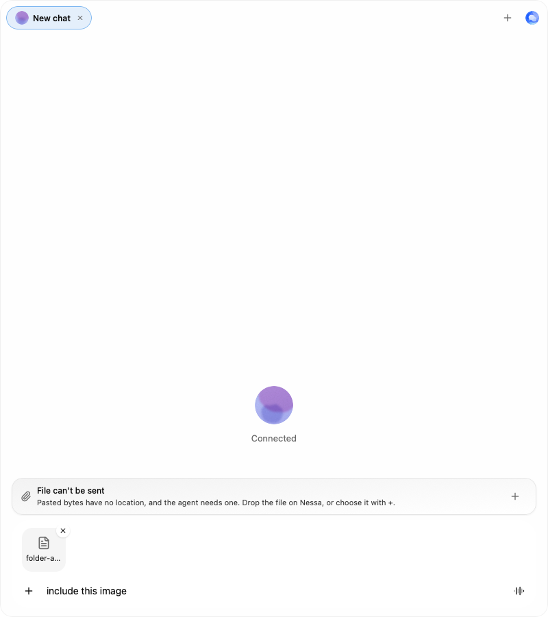

The full actual-App matrix passes 36/36 engine/scenario pairs. The two folder
scenarios also pass 4/4 isolated engine/scenario pairs after the screenshots
were captured. The actual-App regressions both fail when `app.tsx` captures the
folder destination during render, reproducing the stale owner at the provider
swap. [r5-check.log](r5-check.log) records the frozen source, full tests, static
checks, browser assertions, and source-revert result. The screenshots supplement
the assertions; they do not replace the cross-store routing checks.
