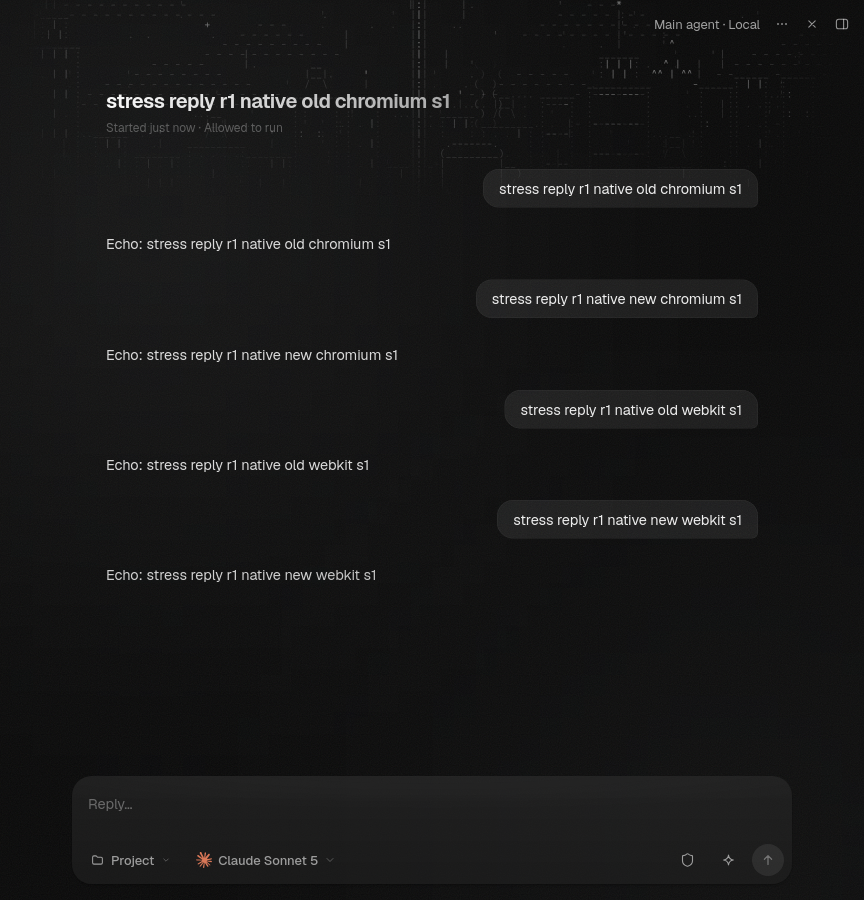

# Durable sessions qualification

SDK source: `ae6e33529887746079702d4eca5f528ec42146bd`, on main `56c3c475a47b87d1c9ec26ba648f59cdab47b47e` (#1217 Devices and #1215). This one draft PR implements #1164. #1003, #762 and #934 remain plan-only until #981 merges and the gated phase resumes. No approval, merge, worker resource or release-pin change is included.

SessionManager persists native ID and admission watermark together, capturing the terminal prefix before awaiting native opening. Admission during opening continues to count after withdrawal. Same-context reuse preserves its watermark. The local credential wrapper delegates the pure restoration query without reading credentials. Used native contexts require exact restoration; missing history produces a typed refusal without reset or replay.

## Completed checks

| Check | Result and receipt |
| --- | --- |
| Complete unchanged eight-package CI selection, doctests | Exit 0 at ae6; server 4409, SDK 1576/application 632/domain 278, client-core 481, storage 39. Existing ignores remain explicit. [Full receipt](qualification/eight-package-all-ae6-host.log). |
| Strict eight-package Clippy | Exit 0, `--all-targets -- -D warnings`. Existing lease-protocol constant-evaluation diagnostics remain visible. [Receipt](qualification/clippy-ae6-final.log). |
| SDK Rustdoc, format, lint, architecture | Exit 0. [Rustdoc](qualification/sdk-docs-ae6-final.log), [format](qualification/format-source-final.log), [lint](qualification/lint-final.log), [architecture](qualification/architecture-c13-final.log). |
| SDK domain coverage | Hosted [CI run 41150440773](https://github.com/nessalabs/nessa-agent/actions/runs/41150440773) succeeds in every job at ae6, including coverage with unchanged 100% line/function/region thresholds. Local 6d report measures domain source unchanged at ae6 and reports 7721 lines, 1032 functions, 9974 regions, all 100%. [Local report](qualification/domain-coverage-final.log). |
| Node scripts | All 474 pass using standard `TMPDIR=/tmp`. The configured hidden temp path produced two unchanged Tailwind watcher timeouts; the same tests pass under `/tmp`, with no test or deadline modification. [Full selection](qualification/scripts-standard-tmp-final.log), [controlled temp-directory check](qualification/tailwind-standard-tmp.log). |
| Desktop verification framework | 547 pass; one existing macOS Bonjour check skipped on Linux. [Receipt](qualification/desktop-framework-final.log). |
| C13 helper/wiring/plan, full scripted-agent fixture | 20/20 and 36/36 pass. [Helper receipt](qualification/c13-node-checks.log). |
| Scripted product aggregate | All four suites pass in Chromium and WebKit: resize, MCP apps, gateway window and scripted scenarios. [Summary](qualification/scripted-final/pr-summary.md). |
| Focused C13 fixed → mutant → restored | Fixed and freshly rebuilt restored binaries pass both browsers (9/9 reported checks). The sole nine-line wrapper-delegation removal compiles and fails the intended cold-unused-ID boundary in each browser, exit 1, actual wire error `-32002`, zero new admissions. [Proof](qualification/c13-negative-proof.json), [restored receipt](qualification/c13-restored-positive/c13-restored-positive.json). |
| Codex-led C13 with handoffs disabled | Exit 0, including explicit selection of its dedicated Claude model. [Receipt](qualification/c13-codex-positive/c13-codex-positive.json). |

The C13 run uses real server composition, UI sends/reopens, native ACP subprocesses and persisted storage. Its fixture owns native-history existence only. Exact execution IDs, focused-pane old/new exchanges, fresh audit identities, zero pre-send admissions and native prompt counts are asserted. The isolated mutant has the same lease protocol as the fixed binary. Probe source was restored with a fresh mtime, hash-checked, rebuilt and rerun. No private LeaseFence constructor or alternate production provider was introduced.

## Earlier regressions and controls

- [C11](qualification/c11-race/manifest.json): unchanged production compiles and fails at watermark 2 versus expected 1 after verified withdrawal/cleanup; [corrected six-scenario ACP suite passes](qualification/c11-race/corrected-current-context.log).
- [C12](qualification/c12-wrapper/README.md): wrapper/Agent/RecordStorage tests pass 8/8. Its override-removal control compiles and causes exactly the two intended failures; pristine restoration passes 8/8. C13 adds executable composition coverage.
- [Domain controls](qualification/domain-mutants-c11/README.md): five actual-source mutants compile and fail intended regressions; pristine/restored controls pass 10/10. A stale-rlib compile attempt did not run a mutant and is retained separately. Generated binaries/caches were pruned after receipts were preserved.
- `qualification/application-mutants` retains four earlier controls at a4. Their old publication-length control is superseded by C11; these are labeled historical evidence.
- Three old CI expectations were validated before correction: abandoned cancellation retains the entire admitted snapshot; three current-context JSON occurrences add exactly 81 payload bytes (1403 → 1484), with all other measurement fields unchanged; golden output changes only the context Debug wrapper. [Validation](qualification/expectation-validation.json).
- The intermediate 6d shipping-worker failure came solely from an unnecessary comment edit in a hashed binding. Restoring the accurate base comment makes all 45 protocol sources byte-identical to base and restores `a8e6fff6643172a9`, matching the unchanged pin. The shipping gate now passes. [Review](qualification/worker-comment-restoration.json).

## Full stress and publication checkpoint

The complete CI-core default and raised `drifts=2` plans use the existing CI `--inputFiles 0` exclusion; no native-phone runtime pass is claimed. The focused diagnostic is not substituted for either full plan.

The first full default attempt completed exit 1: C13 passed in Chromium, but existing linking step 49 failed because its cancelled pairing-code modal stayed open and Pair a device was not offered again. Subsequent Chromium steps did not run; WebKit's first menu check then failed. Overall: 55/113 reported checks held. The screenshot confirms a real pairing modal, with no observed vault dialog or refusal. Available receipts do not establish the RPC cause, baseline status, parallel-run cause or C13 causality. This remains a failed attempt, not a #1164 negative control. The raised attempt also completed exit1, holding81/116 checks: every Chromium step and guard passed, including both C13 repetitions and linking. WebKit steps1–19 passed (including C13); step20 timed out waiting for the overview completion marker. Its screenshot shows the overview opened with visible rows. Later WebKit steps did not run. See the [boundary review](qualification/stress-boundary-review.md), [default summary](qualification/stress-default-summary.json) and [raised summary](qualification/stress-raised-summary.json). The [one isolated unchanged default retry](qualification/stress-default-retry-summary.json) completed exit1,60/113: every Chromium plan step and guard passed, including linking and C13; WebKit first-menu completion-marker readiness timed out and its later steps did not run. No further retry, timeout change or production pairing/overview fix was attempted. Complete default/raised qualification has not passed.

Two state pages were reviewed at exact SDK source ae6: 47 source references, 13 links/anchors and three diagrams validated statically. No rendered-diagram pass is claimed. The previous source review found no further findings after C11/C12; fresh final combined source review found no new actionable findings and supports draft publication with the full-plan limitations retained; see [review](qualification/independent-final-review.md). Fresh GitHub reads show no review threads or substantive comments, only CodeRabbit's draft-skip notice.

`scripted/` preserves the old ffe aggregate **could-not-run** attempt. The later bootstrap attempt was stopped after an HTTP 500 from an out-of-date UI checkout; standard pinned preparation fixed it, and the final aggregate passes. Early C13 draft/vault/setup failures were corrected and are not counted as native-restoration negative proof. The sandbox-mapped root-owner storage failures are retained separately; unchanged host-context checks pass all 39.

Tests run under `docker-init -s` with owned cleanup. No cleanup assertion, coverage threshold or access policy was relaxed. No real provider credential or external event recipient was used. Project-board lookup was denied (`Resource not accessible by integration`) and not retried; interrupted issue-status writes and unidentified denied operations were not retried.

The evidence-local `.gitattributes` preserves captured `.log`, `.patch` and `.diff` bytes (including output blank lines and patch context). It disables whitespace diagnostics only for these receipt formats beneath this directory; source whitespace checks remain enforced.
