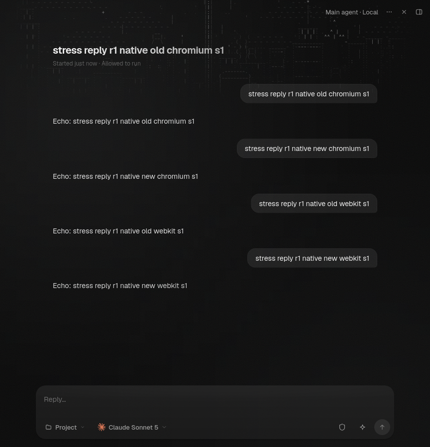

# Durable session restoration

Cold Claude restoration used to treat earlier conversation work as proof that a newly opened native context had been used. Closing before the first prompt on that context, then reopening, tried to resume a native ID Claude had never saved.

SessionManager now saves the native ID and the admission watermark together. The watermark is the terminal prefix captured before native opening. Work admitted while opening is in progress still counts after it is withdrawn. A used context still requires that exact native ID. Missing native history is a typed provider failure. Nessa does not reset the conversation or replay old prompts.

The screenshot is the focused WebKit transcript after that cold reopen: the earlier exchange is still there, and the first message on the new context completed without resuming the unused ID.

The conversation-stress drift step is the ordering this screenshot comes from. Full logs and traces stay with the CI run that produced them; they are not stored in the repository. The WebKit overview Show All marker timeout reproduces on unchanged main and is tracked in #1249, separately from this change.
