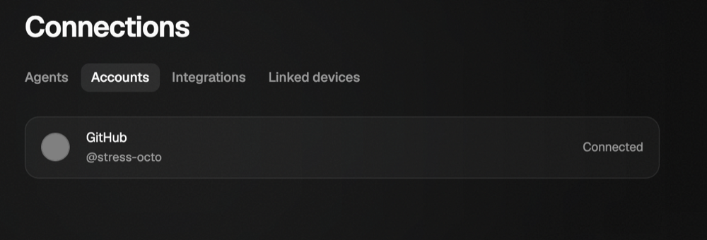

# GitHub credential containment evidence

The connected row uses the fake GitHub account in the conversation stress fixture:



Historical checks at `bc85988eb333e518e1308eea7375acc4a959ec4e`, before the
vault/live-event integration below. These results do not qualify the integrated tree:

```text
conversation-stress: 53/53 held
ok    042 github [chromium columns]
conversation-stress: 6/6 held    # two GitHub cycles, Chromium
conversation-stress: 5/5 held    # two GitHub cycles, WebKit
mcp-apps-gateway: 16/16 held
gateway-window: 15/15 held
scripted-scenarios: 9/9 held
Verdict: pass
```

The two-cycle stress run asserts that neither an agent process nor the managed shell receives Nessa's `GH_TOKEN` or git credential helper, and that the broker makes one authorized repository read per cycle. The full default run also reaches Connect, Disconnect, and the remaining conversation steps. The scripted suite covers Chromium and WebKit. The standalone image is a crop of the Chromium connected-state screenshot; the fake account has no real credential.

Revert probes: allowing `GH_TOKEN` into the managed shell made `commands_drop_the_github_sign_in_and_other_credentials` fail with `left: ["PATH", "GH_TOKEN"]`; allowing `/` in a repository segment made `repository_paths_have_only_fixed_segments_and_positive_numbers` fail on `repo/other`. Both rules were restored and their focused tests passed.

## Integrated source checkpoint

The published implementation and test checkpoint is
`25f1e3526bd9dda8668c299bf7e40e5bdf22e28f`, with tree
`442038a5bf159f15222f36c5e52414363511a157`. Local reviews and executed checks used
`499b5afd7e34f50e425302b6c951b0d817cd8cdd`, which has exactly the same tree.
The published source commit's merge parents are the original
PR head `bc85988eb333e518e1308eea7375acc4a959ec4e` and main
`d8a6c0f7b104126124b7b645f77fbf2f1ce0a8ba`. Documentation-only follow-up does
not change that source checkpoint. See the [independent reviews and dispositions](integration-review.md)
and [the read lifecycle](../../../../docs/state/services/gateway/github-reads.md).

Executed in the managed Debian 13 Linux workspace, with synthetic credentials
and loopback HTTP only:

```text
GitHub-focused tests: 88 passed; 0 failed
nessa-mcp: 12 unit + 4 stdio integration tests passed
Rust Clippy, full CI package selection, all targets, -D warnings: passed
nessa-mcp Clippy, all targets, -D warnings: passed
cargo fmt --all -- --check: passed
Changed JavaScript: Prettier and ESLint passed
Architecture check: passed
Scripted scenario, gateway-stack, stress-plan and vault setup fixture tests: 47 passed
UI dependency check: passed
```

The focused command was
`target/debug/deps/nessa_server-766054ecb0470d49 github --test-threads=2`.
That binary was compiled from the frozen source above by the full package
selection, including the added simultaneous-readiness regression. It includes
`cancelled_http_read_and_queued_read_release_disconnect` against a real socket.
The original unfixed integrated method failed four regressions (82 passed,
4 failed); swapping HTTP-answer priority ahead of stop failed the added
simultaneous-readiness test. The fixed source was restored before final checking.

The complete package selection was attempted without skipping failed tests:

```sh
cargo test -j2 --no-fail-fast -p nessa-local-storage -p nessa-auth \
  -p nessa-server -p nessa-protocol -p nessa-client-core -p nessa-device-client \
  -p nessa-sdk -p nessa-vault
```

It is **not green** in this workspace: 16 tests failed across four targets.
Eight local-storage tests reject this image's `nobody`-owned `/` before reaching
their injected failure paths. Seven SDK process/ACP tests and one server Codex
cleanup test report unconfirmed process cleanup or related barrier assertions.
The server library result is 4382 passed, 1 failed, 13 ignored; the SDK library
is 1546 passed, 7 failed, 16 ignored. The failing source files, local-storage and
SDK crates, and Cargo.lock are unchanged relative to the main parent. No separate
main baseline execution was performed. No storage trust rule or cleanup contract
was weakened to make this environment pass; fresh CI on supported hosts remains
required.

WebKit could not launch locally because the image lacks `libgtk-4.so.1`,
`libgraphene-1.0.so.0`, `libharfbuzz-icu.so.0`, `libmanette-0.2.so.0`,
`libhyphen.so.0` and `libGLESv2.so.2`. Chromium's bundled engine launches.
This is not a WebKit pass. The state page's source paths, relative links and
checkpoint were checked; the separate Nessa Docs renderer was unavailable, so
its rendered appearance was not checked.

## Rebuilt Chromium GitHub flow

The rebuilt source passed two complete GitHub Connect/read/Disconnect cycles in
Chromium, columns layout, with the bundled browser: **5/5 held**. Seed was 1;
all knobs except `githubs=2` and the seed were zero. Each cycle asserts one
broker GET, no Nessa token or helper in the provider and managed shell, encrypted
persistence without a plaintext sign-in file, and sign-out/audit cleanup. The
final conversation, background and follower checks were at rest. Evidence was
written to `/tmp/1196-github-stress` and `/tmp/1196-github-stress.json` in the
selected workspace. This is a focused raised-count flow, not a full default
conversation cohort or a WebKit pass.

The full-window connected screenshot remains in the selected workspace at
`/tmp/1196-github-stress/github-connected.png`. This follow-up changes backend
read/cancellation behavior and preserves the existing Settings UI; it adds no
new layout or visual contract.

## Scripted desktop suite on rebuilt source

Command:
`pnpm test:e2e:scripted -- --channel bundled --evidence /tmp/1196-scripted-e2e`.
The gateway and managed-shell build completed successfully before browser work.

**Verdict: could-not-run** (exit 2). All 21 Chromium browser assertions passed,
plus the two shared gateway setup checks. WebKit's four launch attempts could
not run because of the missing host libraries listed above.

| Check | Chromium | WebKit |
| --- | --- | --- |
| resize-observers | pass (2 assertions) | could-not-run |
| mcp-apps-gateway | pass (8 assertions) | could-not-run |
| gateway-window | pass (7 assertions) | could-not-run |
| scripted-scenarios | pass (4 assertions) | could-not-run |

Relevant recorded lines:

```text
launch webkit: webkit did not launch (browserType.launch: )
console chromium: requestfailed: /browser/check net::ERR_ABORTED (aborted after a 204 response, #485) (harmless)
console chromium: requestfailed: /mcp-resources net::ERR_ABORTED (consumed EOF, verified length/SHA256, same uncanceled live mount at browser observer cutoff, #996) (harmless)
```

The two request lines above omit only their ephemeral loopback host/port. The
suite's original summary is `/tmp/1196-scripted-e2e/pr-summary.md`; per-check
JSON, gateway logs and browser evidence are in that evidence directory.
No full default conversation cohort or supported-platform CI result is claimed
by this local run. Fresh CI at the eventual published head remains outstanding.
