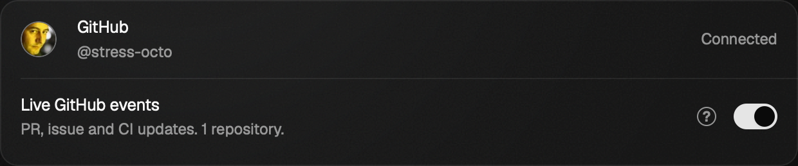
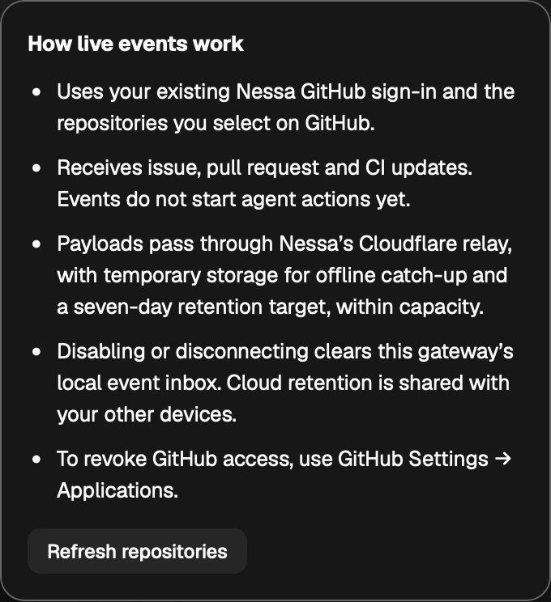

# GitHub live events in Settings

Source reviewed: `46361a93bc9b421a8d50b64a95eef2b71721610b`. A loopback GitHub provider supplies device sign-in
and App repository selection to a real gateway in an isolated development
namespace. Mainline’s account-avatar and hover-action presentation is preserved.
No real GitHub account is authorized and no agent turn is run by
this check. The namespace is removed after shutdown.

`github-live-events.mjs --channel bundled` passed in Chromium and WebKit. The
separate row is below 100 CSS pixels high at 1000px width. Each help popup has
five bullets, stays anchored and within 600px and 1000px windows, and Escape
returns focus while Settings remains open. The switch is 34 × 20 CSS pixels.
The check exercises persistence on reload, failed enable, retry, cleanup-audit
failure preserving sign-in, and simultaneous enable/sign-out leaving zero
repositories. Numeric receipts are in [summary.json](summary.json).

The [scripted gateway baseline](scripted-summary.md) also passed both engines.
Real private App-token delivery is covered by provider fixtures, not a real
private GitHub repository. Worker deployment version:
`06df8c42-0291-4e9a-a894-ba48b7947df5` on the existing dev Worker and Free plan.

The later `4a93a0775` platform-only correction fixes a misplaced composition
guard found by Windows CI. Its local Cargo package-selection check passes;
the hosted Windows rerun remains pending. These UI receipts name `46361a93b`.
The broad desktop baseline remains failed on channel naming (#1129) and pane
focus (#1130); it is not claimed green, and the remaining broad run was stopped
after those confirmed failures. No GitHub setting or help-popup failure remains.
