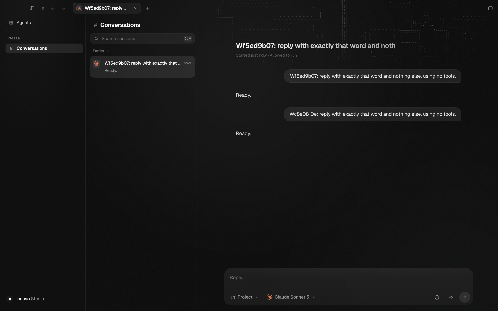
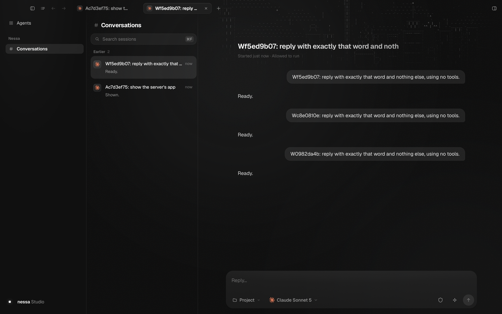

# GitHub relay gateway baseline

The scripted desktop checks passed in Chromium and WebKit at source
`34a6c508da0285108bcab82012c8da97487e5f71`. This baseline covers existing UI, permissions and gateway
behavior alongside the new optional relay; it does not turn GitHub events into
conversation turns. The dedicated relay tests and live restart check cover the
provider inbox.

[Short verdict and relevant lines](pr-summary.md), [per-check results and timings](summary.json).
The original complete ephemeral run is `/tmp/nessa-github-relay-scripted`.
Raw provider/protocol logs and credentials are deliberately not copied here.

