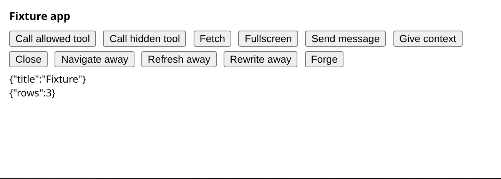
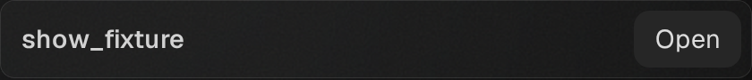

# MCP single-view handoff (#1327)

## Stress fixture failure ordering

The exclusive section owns background draining; its 120-second bound is unchanged.
The huddle's diagnostic capture precedes navigation back to the main conversation.

| Event | Fixture action | Release and evidence |
| --- | --- | --- |
| Background turns drain | Start the huddle once | Resume background work after the step |
| Drain expires or throws | Do not start the huddle | Resume background work and report the failure |
| Browser assertion fails | Retain its failures | Capture the fixture before returning to main |
| Browser action throws | Retain that exception | Capture the fixture before returning to main |
| Screenshot fails | Keep the original step result | Still return to main |
| Step and cleanup both throw | Retain both errors in an aggregate | Report both through the canonical CLI formatter |
| Cleanup alone throws | Retain that cleanup error | Report a failed step |
| Step throws a falsy value | Retain the caught outcome, independently of its value | Emit a nonempty failure through the CLI result owner |

These are harness contracts, separate from app transport delivery and the
historical lifecycle model. They do not change workload counts or deadlines.
The evidence helper records one returned-or-thrown outcome before cleanup; it
does not throw from a finally block. The stress loop uses `resultOfThrown`, the
existing CLI result owner, rather than classifying a caught value by truthiness.

## Original transport and live-view evidence

The product source is `8ed0b24db6de14b836894cf5262c1dbc8225537d`, based on
`edf3e028bf48748147ad2a0a35d028e2fc7cfca1`. Production changes post the original
request's reply before opening the panel can retire the inline bridge. They do
not establish that the retiring document consumes the posted reply. The live
panel's own fullscreen request/reply is separate browser evidence.

Before opening (fixture, Chromium columns):

The sole panel mount and its Open row:

[Chromium panel](panel-chromium-columns.png),
[WebKit Open row](open-row-webkit-columns.png),
[WebKit panel](panel-webkit-columns.png). The corresponding sidebar images are
also retained here. These are disposable sample workspaces, not real pairing
or account access.

## Executed checks

- App/bridge/places and related widget unit suites: 25 files, 344 tests pass.
  The 84 bridge/places tests are included in 344, not added to it.
- Browser-app helper unit tests: 23 pass.
- Full restored MCP browser suite: 100/100 rows held, both engines/layouts.
  It covers replacement identity, same-panel focus, current-mode replies,
  no app window offer, teardown and fresh reopening, plus existing security
  and cleanup checks. Focused changed cases initially held 24/24 rows.
- [Scripted gateway flow](scripted-summary.md): all five checks pass in both
  engines, signed out, dev build, isolated real local gateway and fixtures.
- Native server/MCP build passes on Linux; Rust source is byte-identical to
  the base. Docs validation reports 179 documents and zero issues.
- Smoke is **28/32 held**, failing the existing Advanced settings copy check
  in all profiles. This is an open gate, not a waiver. Native WKWebView and
  the full functional/performance matrix have not been rerun for this repair.

## Fail / restore probes

[Probe receipts](probe-receipts.json) retain commands, exit codes, mutation
hashes, restored-source confirmations and browser result rows. Their absolute
log paths identify the original private local receipts; the executable tests
and screenshots here are the reviewable repository evidence.

| Rule changed on purpose | Observed failure | Restored result |
| --- | --- | --- |
| Reply after host open | L17a sees no original reply when open closes the real transport | All 84 bridge/places tests pass |
| Wrong reply request id | Both engines' panel callers have no correlated output | 4/4 reply profiles held |
| Two live app copies | Both engines report original inline still live and no retained Open row | 4/4 single-view profiles held |
| Offer an app window | Both engines report the forbidden app window action | 4/4 window profiles held |

Assertions, request identities, deadlines and teardown waits are preserved.
In particular, a replacement iframe's initialized state is not treated as an
answer to the original caller.

## Documentation boundary

The two state pages receive a partial prose addendum. Their historical source
checkpoint and 19-state TLC result are retained. That model covers abstract
initialization eligibility, terminal release initiation and inline teardown
refusal. It does not prove transport identity/order, document consumption,
single-view host projection, completed server cleanup or physical erasure.
TLC was not rerun. The ADR's ordering table and executable tests own the new
handoff evidence; no unrelated source/model checkpoint is advanced.

## Huddle stress: background drain and fixture lifetime

The default columns run held 10/10; the sidebar-only default first could not
select a row because main's helper was columns-only. The existing helper from
our #1296 (`1ec76890a3fb11de784ceab35d34c89b87324f1a`) was used as a declared,
restored test overlay; default sidebar then held 10/10. This dependency is not
silently included as another navigation implementation in this branch.

Raised runs use `--huddles 3 --parallel 6 --turns 4 --followers 4 --rounds 40
--seed 7`, both engines, each layout, with the three-second idle setting and
all app waits unchanged. Before the fixture repair, columns held 10/14; both
engines' second huddle had no app, and the third could not run. Old bridge
order also reproduces this failure (9/14). A diagnostic captured the actual
huddle before cleanup: the correct conversation is selected, its tool is
complete, and the UI says Paused while idle. The retained
[diagnostic capture](huddle-failure-before-cleanup.png) is from the last
(WebKit) engine; the old shared failure filename overwrote the earlier engine. The fixture created/finished its
turn before waiting for background work to drain.

Moving fixture create/submit/settle inside its existing exclusive section makes
raised columns **14/14 held** and raised sidebar **14/14 held**. This preserves
the workload, drain, idle limit, assertions and deadlines. The fixture is fresh
when opened; it no longer expires while waiting for its setup's drain. The
[stress summary](huddle-summary.json) retains failures and counts. The verifier
overlay was restored after both runs. New failure screenshots include engine
and step identity and are taken before cleanup returns to the main conversation.

Independent product review found no remaining findings. The separate huddle
review requested unique failure-image names; that correction is reflected in
the final fixture. Browser execution above preceded that filename-only edit.

## Reconciliation checkpoint

The source branch now includes main's webhook extraction at
`0fb335a488917b6b6e67f88e50d4d4c8f0f7d41f`, merged as
`cb12f3448964ed142bd73f05ae19782c7d04284f`. This adds no MCP host, app bridge or
browser-fixture changes from main. The native build, scripted gateway and full
MCP browser results above were executed before that reconciliation, with
native source at `8ed0b24d`; they are not an exact-head CI result for the merged
tree. Final native/CI qualification remains pending. The raised fixture runs
preceded both reconciliation and the failure-filename-only correction.

## November13 qualification repairs

Main `826ea15fb` is integrated without replacing the composer/voice changes.
Independent review at `75b51293` found that an expired background drain still
started its body, and a thrown browser error lost its fixture screenshot.
The run coordinator now refuses an expired drain and releases waiting work;
the evidence helper captures both assertion failures and exceptions before
navigation. Their owning modules and eight focused regressions replace the
previous inline coordinator. The 120-second drain bound is unchanged.

The canonical sidebar conversation helper and its tests are now included from
#1296, not supplied as a verifier overlay. Exact identity and visible composer are
observed together, and the helper discloses the actual sidebar tree and older
rows before selecting it. Fixture/navigation tests pass 22/22. Removing the drain
refusal, thrown-error capture, or sidebar route fails its regression; restoring
each passes. [Probe summary](fixture-failure-probes.json).

The current title-only Settings masthead shipped in #1282. The smoke assertion
now uses #1296's exact-title/extra-copy contract: before 29/33, fixed 33/33,
injected unexpected copy 29/33 (all four Settings profiles fail), restored 33/33.
No deadline was extended. The initial mutation command used an unsupported
`--only` option and did not execute; it is excluded from the semantic probe.
Browser checks used headed bundled Chromium and WebKit with a user-local
runtime library and Xvfb. The system-only dependency preflight could not see the
user-local library; its native load and actual browser launch were verified.
This is Playwright evidence, not native WKWebView.

CI at source `8b5bc4b35` passed its required aggregate after the two DNS-failed
jobs were retried: [run 43034036328](https://github.com/nessalabs/nessa-agent/actions/runs/43034036328).
That result predates these repairs and current-main integration. New publication,
exact-head CI, raised real-gateway stress, full browser and native qualification
remain pending. The initial broad integration run's GitHub WebKit reload timeout
is retained; later isolated headed execution passed, without establishing a cause.

## Structural step-failure closure

The next independent round at `d080fc820` found two related boundaries:
cleanup could replace a browser exception, and the outer loop classified a
falsy thrown value as success. The failure path was revised as one explicit
returned-or-thrown outcome, followed by capture and cleanup. When both action
and cleanup throw, an aggregate retains both identities and the action cause.
A cleanup-only exception retains its original identity.

Step reporting now goes through the existing CLI result owner. It emits a
nonempty failure for falsy and unprintable throws, retains both aggregate
members, and keeps typed RPC codes and immediate causes. Fatal recovery
causes retain their existing representation. The measured step duration is
captured before diagnostic formatting. No workload or deadline changes.

The focused CLI/run/evidence/navigation/app suites pass 97 tests. Six deliberate
mutations separately remove double-failure retention, falsy classification,
aggregate reporting, empty-message classification, typed code retention and
immediate-cause retention. Each fails its intended regression and passes after
restoration. [Step-reporting probes](step-reporting-probes.json). This source
review and unit evidence do not substitute for pending browser/native runs or
exact-head CI. Historical receipts above retain their source cuts.
