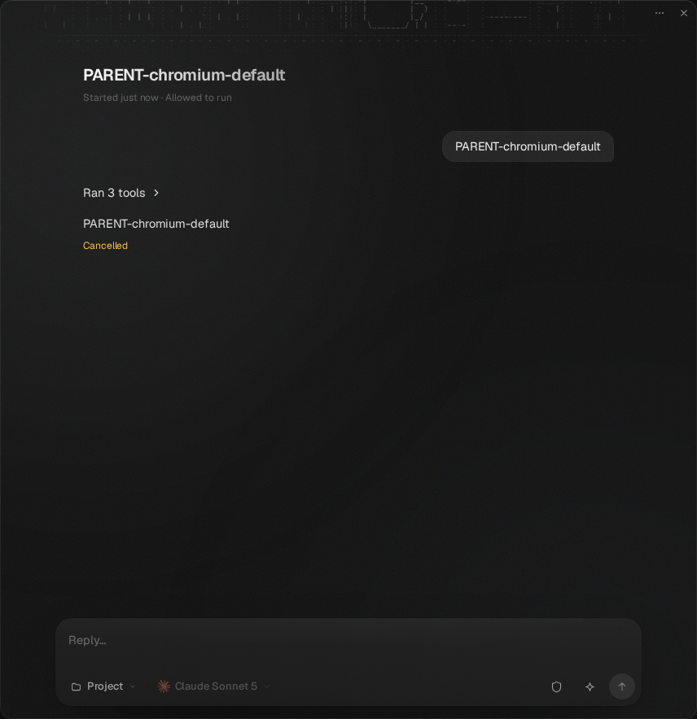
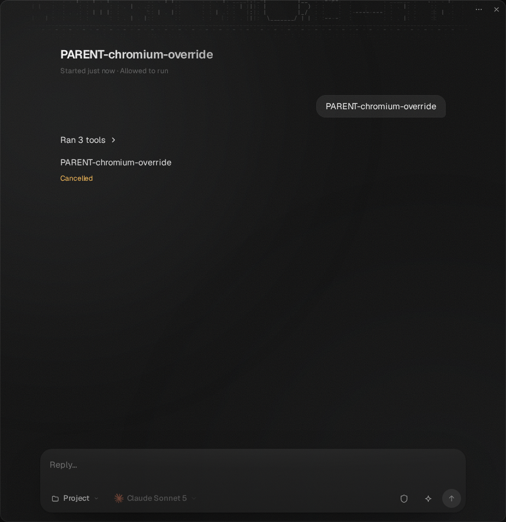
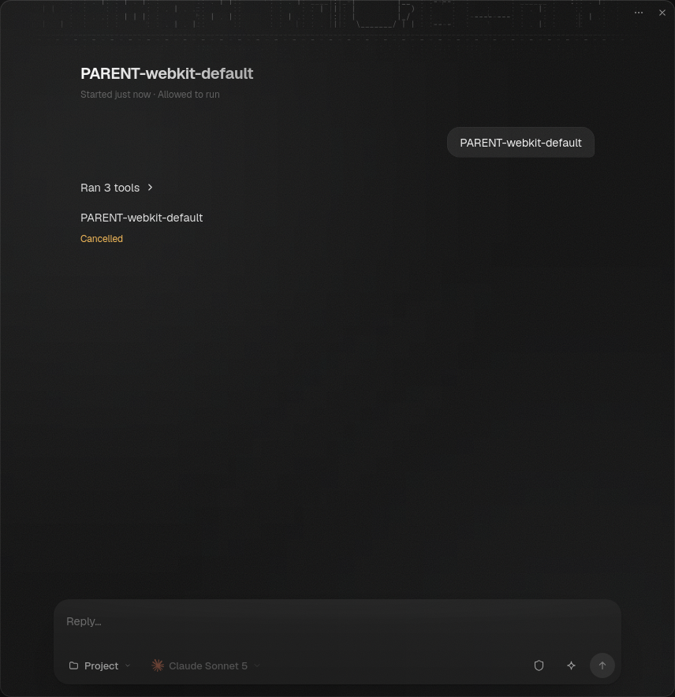
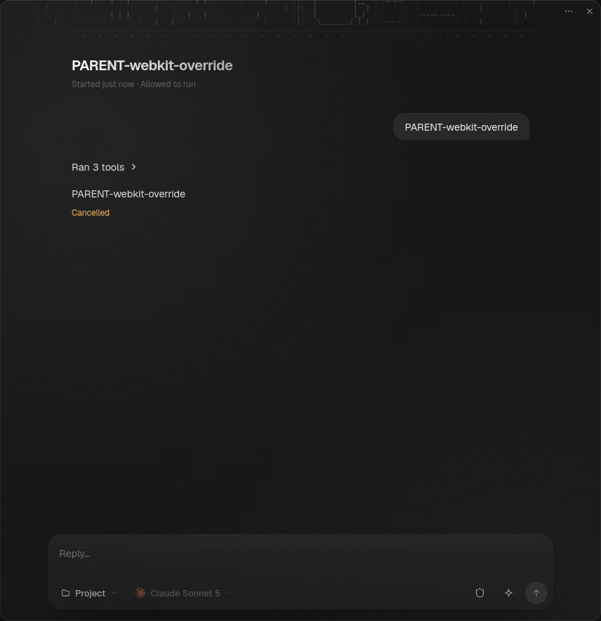
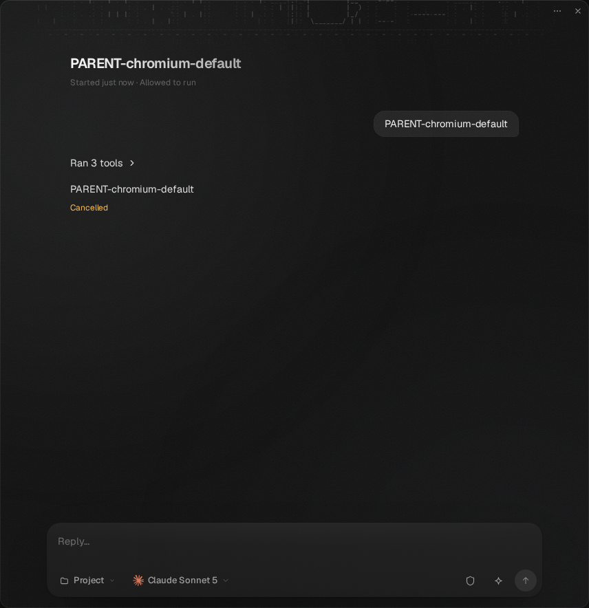
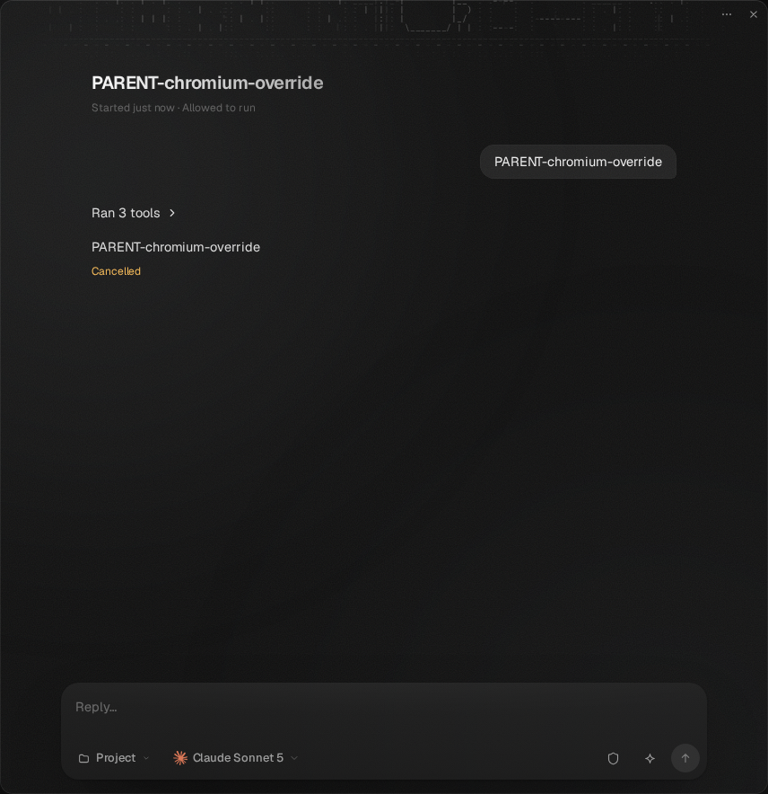
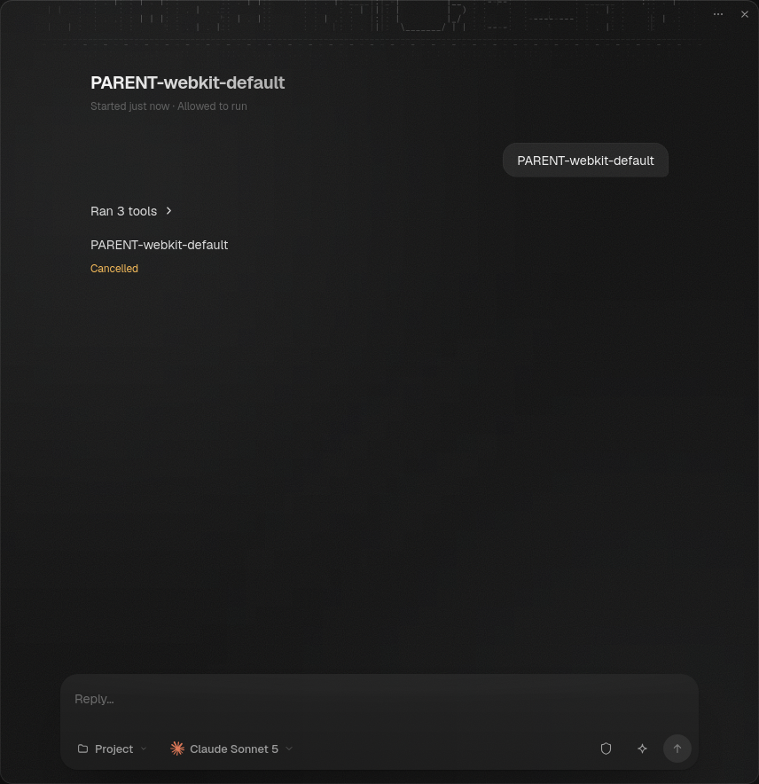
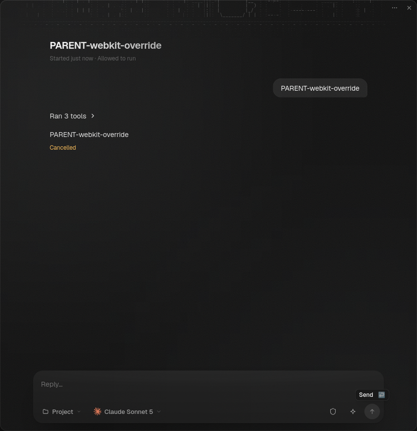

# Parent Stop browser evidence

The screenshots show the ordinary parent transcript after Stop, with the
cancelled turn and a usable reply composer, for the default and explicit
`subagents.stopChildrenOnParentStop: false` settings.

Captured in Chromium with the **dev frontend** and actual gateway executable at
runtime commit `ffec1c29758d7f79d92d438c653d6426ef1dce0a`. Earlier production
wording for these screenshots was inaccurate. They illustrate the surface;
scripted assertions prove the ownership and delivery behavior.

## Earlier runtime verification

Runtime source `fd0a02e680d6d5371718921e5badf5693ffcc95b`, including main
`db681dbbc1d9650201433bc7cdd6842d3aefc3dd`, was clean throughout verification.
The actual gateway executable used Cargo's dev profile, SHA256
`8b614b2b9fcc0fc7685a1ecbf7be33b96c917365b92e1783e39607f37bcf68bd`.

- Production frontend, Chromium and WebKit: window 11/11, permission/failure/
  cancellation scenarios 8/8, parent Stop 4/4; **23/23 passed**.
- Focused Codex capability profile, production frontend, Chromium and WebKit:
  **4/4 passed on repeat**. The first run passed 3/4; WebKit override
  failed initial conversation admission before Stop assertions. Its cause remains
  unresolved, and the failed run is retained with the verification logs. The retained
  ACP trace stops before WebKit's initial parent scenario, page opening, or Stop.
  The helper retained only a generic mutation message; no raw RPC cause/code or
  request identity survived, so create versus submit and the underlying cause
  cannot be determined. No Stop assertion ran in that failed scenario.
- MCP Apps requires dev sandbox metadata and is intentionally skipped by the
  canonical production runner. Its separate dev frontend run in Chromium and
  WebKit: **16/16 passed**.

The checks cover recursive default, explicit override, grandchildren, unrelated
active and queued executions, no immediate parent restart, and
retained report delivery after later person input. Commands use the existing
`verification/desktop/scripts/scripted-e2e.mjs --mode prod`,
`parent-stop.mjs --mode prod --agent codex`, and
`mcp-apps-gateway.mjs --scripted --mode dev` entry points.
The pull request includes their short result lines and final source provenance.

All gateway configurations and provider fixtures used isolated temporary CI
namespaces. Live configuration, security settings and credentials were unchanged.
Playwright WebKit coverage does not claim native macOS WKWebView or live-account
provider verification.

## Current-main verification — 2026-10-19

Runtime head `a6e3f5e993d45db2ccceba51bd5a61b9df1519e3`, based on
main `9e480fa018ae0b93b8897ae5d4c08d4ea933f8fe`, passed the following
unchanged browser checks in Chromium and Playwright WebKit:

- Canonical dev frontend: 43/43; canonical production frontend: 23/23.
- Production parent Stop with the scripted Codex capability profile: 4/4.
- Default stress: 64/64; raised parent stops: 68/68.
- Additional raised seed 3, exercising parent Stop after recovery: 66/66.

Default chaos passed seed 1 and **failed seed 2**: after 182 actions, a resumed
`stress watch` execution remained unresolved at the original 240-second
settlement deadline. All eight built-in reduction attempts passed; they do not
invalidate the original failure. SDK replay of a copy of the preserved state
confirms a complete, current stream and that execution still owed. Cause remains
under investigation. This is a failed verification gate.

The four `parent-stop-{chromium,webkit}-{default,override}.png` files below are
fresh production-frontend pane captures, individually inspected at original
detail: complete title and assistant marker, Cancelled status, usable Reply
composer, and no clipped or misattributed text. The earlier two screenshots above
remain historical dev evidence.

The actual Cargo-dev/default-feature gateway SHA256 was
`e32069744b2ded05049f522db7c91864d12ccbf2b06afeffa59b11c2aba32d82`.
All seven command groups joined and physically reaped their owned descendants;
the browser-process baseline remained 249, with zero new processes. Stress
retained every planned row, 12 same-target aside pairs, and 12 fresh ACP session
observations. These observations are not an independent raw receipt of the
runner's `checked` event.

Subsequent main `c0119e8b35b8b537b701638ee87a1a682c74cff8` adds only a
SDK record-writer test. Its integration at `23707631d1438e3907ce45c55fe04efb707dc7df`
has byte-identical production/frontend/browser inputs; the new test passed
separately, with SDK all-target Clippy and formatting. The browser runs above
were executed at a6, not rerun at that merge.

Required CI on a6 failed the Windows peer-forget test, tracked in
[#1032](https://github.com/nessalabs/nessa-agent/issues/1032); its cause is not
established. The distinct post-merge #1029 retained-read failures remain tracked
in [#1030](https://github.com/nessalabs/nessa-agent/issues/1030). Neither failure
has been waived or resolved by rerunning CI. Fresh source reviews cannot waive
these failed gates. No native WKWebView, live-provider or release-gateway result
is claimed.

## Latest current-main qualification — October 19, 20:40 UTC

Production-frontend captures named `current-parent-stop-*` were executed at
`166386bc2ccd49ff950330c379aa8577057164f2`, based on main `bd739304` (#975).
The Cargo-dev/default-feature gateway SHA256 is
`e07df299d2d274b69466971febffb40b1799b01eab2ad0d7847c28c3afa4757f`.
Canonical checks passed 43 dev / 23 production / 4 scripted Codex cases.
These are Chromium and Playwright WebKit results, not native WKWebView.

The earlier missing-glyph assessment was incorrect. Reinspection of the raw
retained PNG pixels and an enlarged crop shows complete assistant and Cancelled
text. Every non-space character has foreground pixels in all eight retained
current/diagnostic captures. Full-image display inspection had appeared clipped;
no product rendering or image rewrite is warranted. Controlled captures,
including the original pane capture before diagnostic layout reads, also contain
complete glyphs. All four diagnostic behavior cases passed.

At `f41e048394144b5aab0d304bbd699e671a121344`, default stress passed 66/66,
raised parent stops 68/68, recovery seed 5 passed 71/71, and default chaos
passed both seeds. Every planned step ran in both engines. Recovery has 64
steps and seven result rows for settlement/followers/console; Chromium emitted
no console row because it had no console lines. The selected seed retains
model steps and puts Stops before and after restart and native linking.
All owned browser/gateway processes were joined and reaped.

The initial raised run at `166386bc` failed on newly visible empty cancelled
history from an older report. Its complete ACP recording contains no provider
prompt for that report. The stress oracle now checkpoints the current native
parent session and rejects further provider prompts, even immediately cancelled
ones; missing or damaged recording evidence fails. Its omission probe failed,
the restored regression passed, and all 394 verification tests passed. This
follow-up changes verification only. SDK, server and product inputs are unchanged.

Full SDK 2,489 runtime tests / 58 doctests, server 3,414 tests, frontend 4,971,
strict seven-package all-target Clippy, formatting and strict SDK docs pass
with source-qualified records; existing ignores remain. `166386bc` hosted CI
finished 10 success / 2 failure: native macOS page-load acceptance and aggregate
failed; Windows server/local-auth and Linux passed. The native failure cause
is unresolved. Prior peer-rescan and WebKit recovery failures remain historical
evidence, not explained by new passing runs. Original chaos seed 2 remains
open in [#1034](https://github.com/nessalabs/nessa-agent/issues/1034); the current
chaos workload includes upstream model actions and does not close it.

Main `6811e40d` (#1037) was subsequently integrated. Its sandbox startup and
browser-default changes leave these explicitly selected `bundled` runs' browser
selection and all SDK/server/product inputs unchanged. Exact-head CI and fresh
complete independent reviews determine the final draft disposition.

## Confirmed Stop recovery and access-menu verification — October 19

The original #1034 watch has a durable exact Stop receipt settled as Cancelled,
but its Running turn history has no terminal after process loss. Resumption
waited on the captured Stop while recovery skipped the settled command.
Commit `3c911747a5084933646cb2c66247dc3adafb932d` makes the gateway Stop owner
finish that history through the existing SDK decline operation, under the
original actor, with no provider cancellation or successor.

A real process-kill regression fails on the prior runtime and passes with the
correction. It covers recursive/default and override selections, changed
settings, captured children, original caller attribution and later person work.
Accepted/Attempted controls remain uncertain. The complete server suite passes
3,416 tests with 12 existing/helper ignores. The complete original 182-action
chaos plan, with both restarts, original concurrency and 240-second settlement
limit, passes on the corrected gateway. This corroborates the causal regression;
a passing replay does not disprove the original failure.

The unchanged retained namespace cannot be reopened by current main: #975's
current metadata contract refuses its absent `model_requests` table. The fixture
was preserved unchanged; no migration or compatibility shim was introduced.
The original SDK history and exact command ledger supplied the diagnosis.

A controlled real menu-focus callback also reproduces the WebKit empty-composer
Send failure: focus restoration between field focus and native text insertion
produces no input event and expires the original 10-second Send assertion.
Restoring focus before input passes; waiting for the menu interaction to finish
also passes under the adverse ordering. The three original result/cleanup
traces are in [access-focus-controls.json](access-focus-controls.json). The
original uninstrumented failure lacks input events, so its exact scheduling
cannot be established retrospectively. The stress helper now asserts menu focus
restoration before the next field action, with no text retry, disabled-button
bypass or Send timeout change. Product UI and SDK APIs are unchanged by that
verification correction.

Published `f0694161150a6566647d9addf54949db30314591` CI attempt 1 completed
all 12 jobs successfully in [run 39323294415](https://github.com/nessalabs/nessa-agent/actions/runs/39323294415).
The subsequent recovery correction requires its own exact-head checks and fresh
complete review before merging. No historical failure is erased by later passes.
