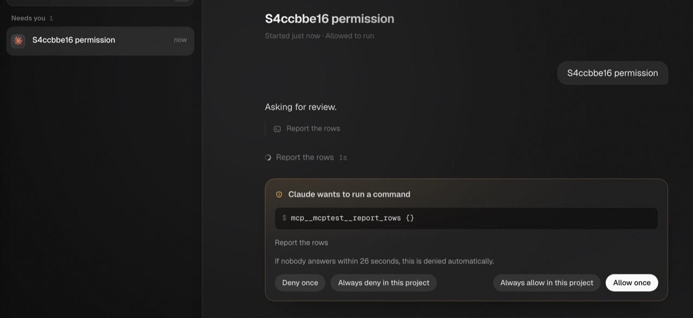
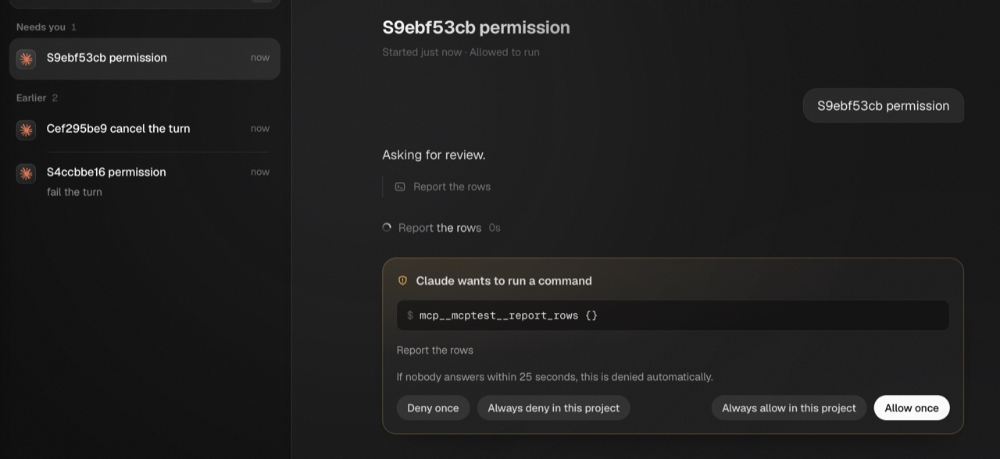
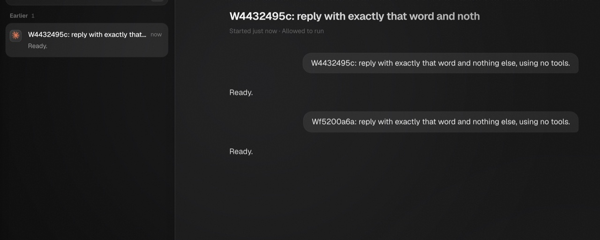
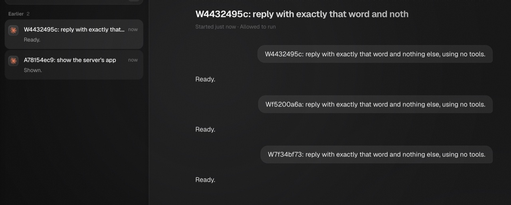
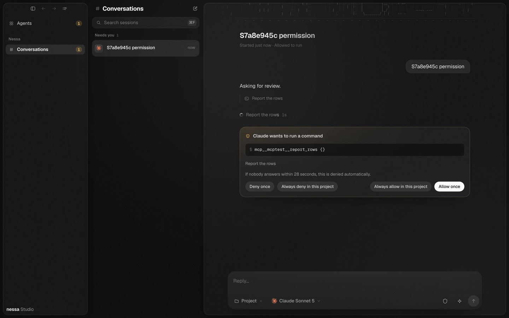
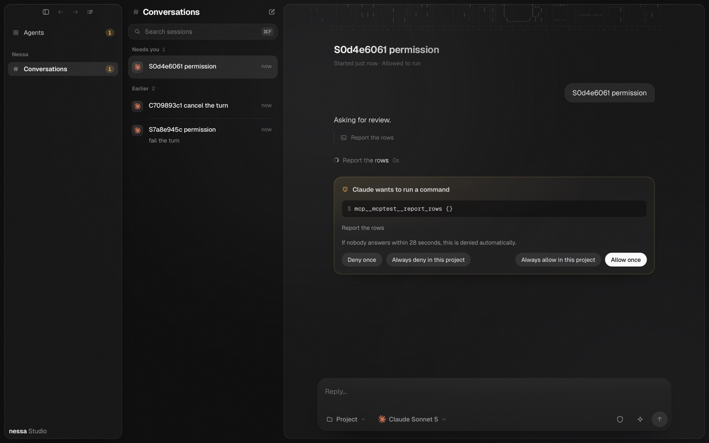
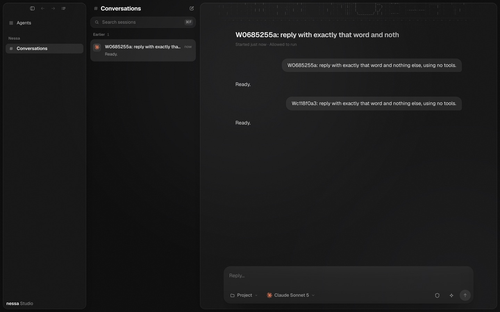
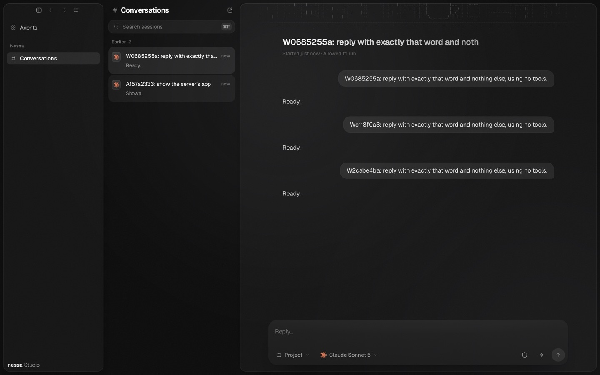

# Review-notice verification (#918, #920)

Semantic source: `8f2fd076ea1608bd925375584e2235a73cb9c79c`.
Environment: local macOS, Vite development mode, bundled Chromium and WebKit,
columns layout. The gateway was rebuilt from that source; `MCP_LIVE_NESSA`
selected the built executable. These captures are cropped and resized versions
of the scripted fixture's screenshots, saved as small JPEGs.

The run used `pnpm test:e2e:scripted -- --channel bundled --evidence <directory>`.
The script's three checks passed in both engines. Counts below are combined
across engines, including shared setup where the check has it.

| Check | Chromium | WebKit | Assertions |
| --- | --- | --- | --- |
| MCP Apps through the gateway | pass | pass | 16/16 |
| Gateway window | pass | pass | 13/13 |
| Permission, allow, failure and cancel scenarios | pass | pass | 8/8 |

```text
mcp-apps-gateway: 16/16 held
gateway-window: 13/13 held
ok    permission [chromium columns]
ok    permission [webkit columns]
scripted-scenarios: 8/8 held
Verdict: pass
```

The sole labelled harmless console line was a Chromium `/browser/check`
`net::ERR_ABORTED` after a 204 response, the existing #485 case. No performance
budget claim is made by this functional run.

## Permission notices

These show the permitted fixture recipient's waiting notice and review card.
Metadata correlation, policy refusal, and membership changes are exercised by
the Rust regressions and source reversals below.





## Gateway conversations





## Regression and reversal evidence

The fixed source passed `cargo test -p nessa-server --lib review`: 66 tests.
The complete Cedar access-policy suite passed 26 tests. The complete socket
suite passed 291 tests, with its existing multi-minute latency measurement
ignored. These suites overlap.

Each reversal below was applied separately to an isolated export of the exact
semantic source, with the applied hunk and SHA256 printed before execution.
Each produced a test assertion failure, rather than a compilation failure.
After each run the source was restored and given a fresh modification time.
The original checkout and the running browser gateway were not mutated.

| Rule reversed | Applied change | Observed assertion |
| --- | --- | --- |
| Metadata identity | Reader calls the raw repository instead of the checked loader | `refused.reviews.is_empty()` fails |
| Membership freshness | Read membership before awaiting metadata | `Member, Active`: actual `true`, expected `false` |
| Policy refusal | Add a Rust admin shortcut before the evaluator | Refused-policy snapshot unexpectedly contains a review |
| Owner identity | Invert Cedar's owner equality | Non-owner member is allowed |
| Admin membership | Change Cedar's admin role to member | Non-owner admin is refused |
| Organization boundary | Remove organization equality from the review permits | Foreign-organization admin is allowed |
| Live conversation | Remove deletion refusal from the review permits | Deleted conversation is allowed |

Short failure lines from the actual runs:

```text
metadata-identity: assertion failed: refused.reviews.is_empty()
membership-ordering: assertion `left == right` failed: Member, Active
policy-refusal: assertion failed: notice_snapshot(board.clone(), state, session).await.reviews.is_empty()
owner-identity: assertion `left == right` failed: Member, same org=true, owns=false, deleted=false
admin-membership: assertion `left == right` failed: Admin, same org=true, owns=false, deleted=false
same-organization: assertion `left == right` failed: Admin, same org=false, owns=false, deleted=false
live-conversation: assertion `left == right` failed: Admin, same org=true, owns=false, deleted=true
restored source: test result: ok. 65 passed; 0 failed
```

The repeated exported baseline and restored runs excluded only
`app_reviews_never_cost_the_agents_own_however_the_view_is_filled`, which had
already passed in the original 66-test run. No review-notice regression was
excluded.

## Main integration

Main `cad51811ab7049138c00ac2109b8c6f044bac991` added only method-classification
design documentation after review base `9812c3c`. A conflict-free merge-tree
integration produced `a00c5731a02b4c8f300c80b2be83741ce55c7ac6`; runtime, UI,
protocol, scripts, manifests, lockfiles and workflow blobs are identical to the
semantic source above.

## Integrated verification after the authority refresh correction

The gateway was rebuilt from local assembly `2f901190325d2b420e0e21f1cb5e6fbaa9db2e48`,
tree `8439093be5c5262ef89f9c34a93822224a23fa17`. It combines main
`4219790db1827ee841eacfaf73c00605eec6bc07`, notice source
`42f2c982dd3767fe11fb202ecdc6453b87e15000` (#925), and audit source
`c11524cb6693fe50784b97ed3e8a8f898e8f7966` (#928). Both merges were conflict-free.
The evidence-only commit that adds this section changes no executable source.

`MCP_LIVE_NESSA` selected that newly built gateway, with the bundled browser
channel in local macOS/Vite development mode. All three checks passed in both
Chromium and WebKit. Counts are combined across engines and shared setup.

```text
mcp-apps-gateway: 16/16 held
gateway-window: 13/13 held
ok    permission [chromium columns]
ok    allow [chromium columns]
ok    fail [chromium columns]
ok    cancel [chromium columns]
ok    permission [webkit columns]
ok    allow [webkit columns]
ok    fail [webkit columns]
ok    cancel [webkit columns]
scripted-scenarios: 8/8 held
Verdict: pass
```

The same assembled source passed the exact seven-package all-target CI Clippy
selection with `-D warnings`. Its normal build and Clippy emitted the existing
allowed long-running constant-evaluation advisory in the lease-protocol macro.
The browser console retained only the known harmless #485 aborted 204 response.

These JPEG captures at 1440 pixels wide show the permitted recipient and normal
gateway flow. The long-lived Rust wire regression proves revocation on the same
socket with unchanged board generation: authority revisions trigger replacement,
a new revision with the same role wakes it, stable revisions stay quiet, and disabled
membership closes with typed authorization loss. Fresh source review was clean.
The source passed 67 review tests, 26 policy tests and 292 socket tests (one existing
latency measurement ignored), plus formatting, architecture and package Clippy.

Four separate executed reversals failed their assertions, then exact source was
restored: removing authority invalidation, always invalidating a stable revision,
observing role instead of committed revision, and discarding authentication's
initial revision. These are distinct from the earlier seven baseline probes.








