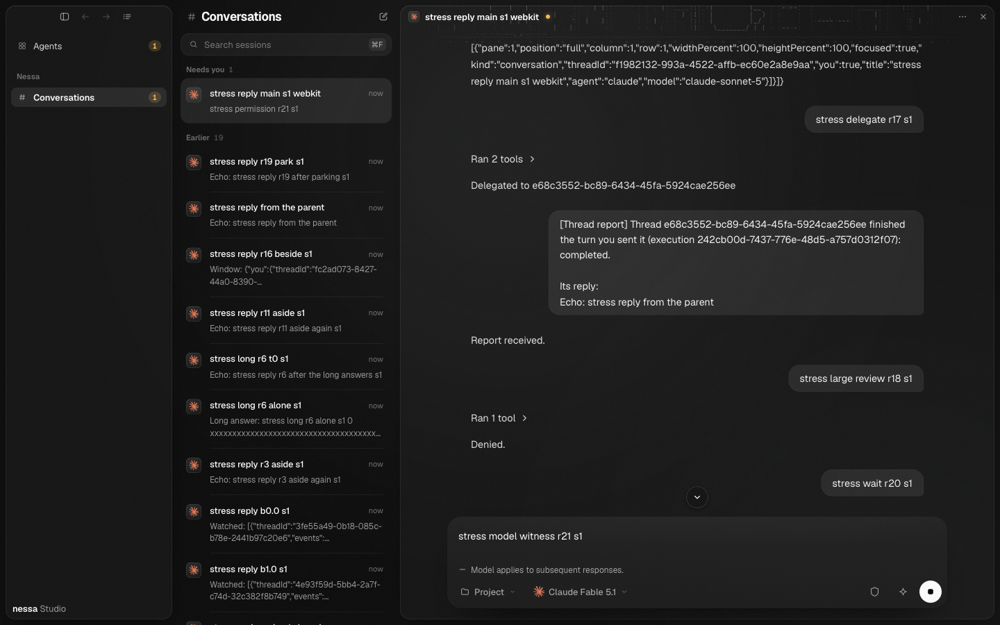
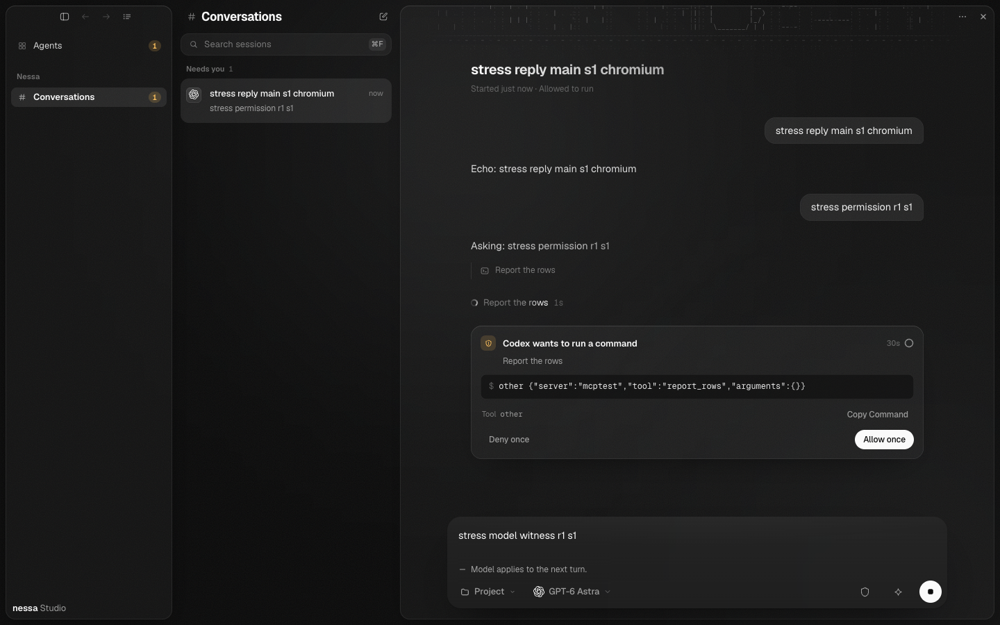
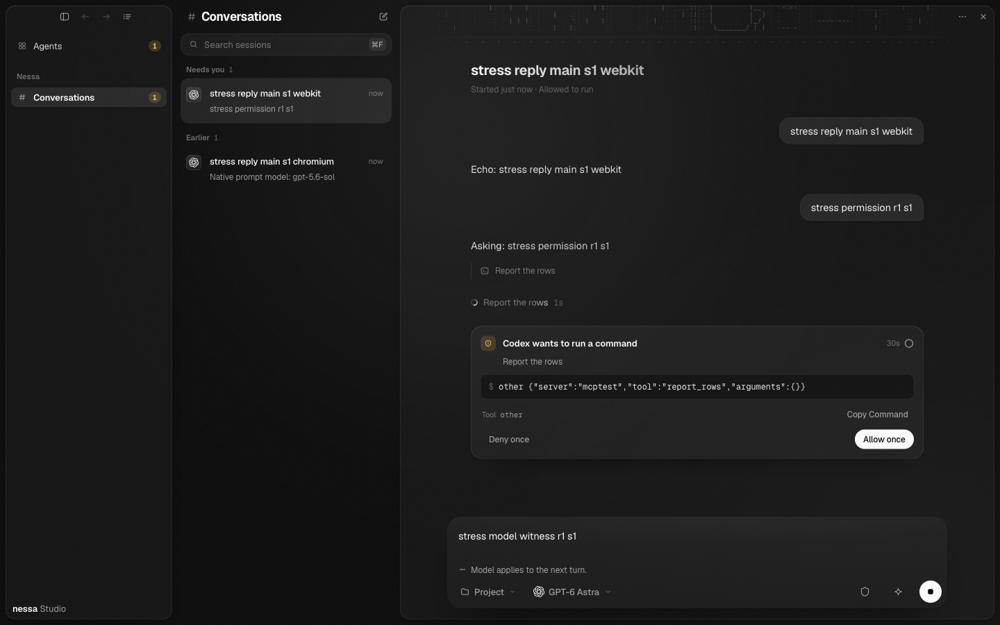

# Same-provider model control: source-scoped evidence

Earlier complete-journey runtime source `246765ad9fe4475cded0b5878cb66c55f1b07caa`, on immutable main
`5813f349a08e2f3ab1fd585d9ab775655d7e957b` (Native linking Settings); UI pin
`0794a41bb1482aa7e677fd2b7012874bcc3e29b2`. This update changes only evidence.
[Qualification](qualification.json) keeps exact source/artifact/photo hashes,
controls and historical limits; [canonical summary](canonical-summary.md) keeps
the current rebuilt gateway journeys.

The integration preserves model request/target/source confirmation, uncertain
Send fence, original review/draft/Stop, exact-ID window navigation, and incoming
window publication and Native linking/Cedar/config-lock/audit/self-exec ownership.
The existing generator derives **77 ready methods /78 including authentication**.
Full Claude retains **windows1/linkings1**; focused Codex explicitly uses **both0**.
Native settings tests touch only owned ephemeral ci configuration and an allocated
loopback native port; they never change the installed app or its configuration.

That assembly passed full frontend **4,936 tests /369 files**, normal checks
and build; native linking **11**, self-restart **9**, runtime-config selection
**16**, shared config MCP application **50**, pairing-audit **5**, actual native
owner routes **13**, model owner **12**, wire model **2**, cold preset **7**,
protocol **170+4+2 runtime /2 doctests**, strict four-package all-target Clippy
and format. Two zero-selection setup attempts are excluded from qualification.
Canonical **three programs ×both engines** ran on source813; the later delta
changes only ADR/CHECKLIST/Linked devices fixture, with production bytes unchanged.

The fixture originally failed **2/16** because it did not answer automatic
`workspace.publish`. Explicit per-connection publication support fixed it:
**16/16** both engines; sole admission omission **2/16** rejects; exact restored
**16/16**. Nine additional private-fixture socket controls are **synthetic**,
including unknown-method rejection and UUID/revision/stale/connection receipts.
No global catch, product policy relaxation or pairing assertion was removed.

Final normal tracked programs passed Claude default **53/53**, raised six
**62/62**, focused Codex one **8/8**, six **18/18**, both engines; chaos **2/2**.
Full Claude proves real Settings on/off config readback/same-PID self-exec and
subsequent window send, read_window, model prompt witness and preserved review.
The native owner-route integration build replaced the gateway executable before
stress: canonical and stress/chaos artifacts have **separate recorded hashes**.
They are both owned current-source builds; no byte-equality claim is made.

Older failed Linux CI39208371137, main281b local44/59,32/46,58/59 and the current
fixture2/16 remain failed historical records. Earlier restart identity and exact
held-console controls remain source-attributed; their classifier stays only in
`steps.restart`, never borrowed by the new Settings linking step. Controlled
outage evidence is not reconstruction of uncaptured original error times.
Parent cold3442/4docs and SDK53 fixtures remain separately source-qualified; no
new whole6838 run or performance claim is made. Fresh whole review and actual
Linux CI remain required before merge. No raw journals/auth/config/keys are included.

## R3 corrections and current qualification

P2 source `d7982f5f8` permits a deliberate source recovery check when a retained
Changing journal outlives its caller, including a fresh window. Local asking and
access changes still block another call; Send/draft/outbox remain fenced until
authoritative source reconciliation. Actual public-store before:2fail/17pass;
sole-rule omission:3fail/17pass; exact restored focused:32pass. Full frontend
**4,942 tests /369 files**, all normal stages, passed. Focused real Claude and
Codex model1 journeys each passed **8/8**, Chromium/WebKit, windows0/linkings0
and other knobs0; chaos **2/2**, actual model actions2/6. Prelaunch/post gateway
hash47d7ec4c remains exact. The retained-journal regression is proved at the public
store/source seam; no crashed-native browser reproduction is claimed.

Assembly `f9a1cbf5b` also groups11 Rust import paths, preserving expanded imports,
aliases, cfg(test) regions and behavior; SDK/server all-target strict Clippy and
scoped formatting pass. Earlier full journey/native/canonical evidence and the
photos below keep their original source attribution. Fresh whole review and actual
current-head Linux CI remain required.

## R4 normalization correction

Source `352f59b37` adds one equality check to the existing configuration
normalization owner, preserving native-hook policy across custom factory clones.
Public Agent before: **5 failures /1 positive pass**; fixed **6 pass**. A private
sole-check omission reproduced **5 failures /1 positive pass**; exact restoration
with fresh compilation passed **6**. Preflight, adjusted native ACK, approval,
effort and saved restoration retain typed refusal/uncertainty, attributed audit,
unchanged saved configuration and cleanup/admission behavior. Exact denied and
allowed hook clones preserve explicit and automatic attachment.

Affected checks passed **409 unique runtime tests /7 ignored**, **57 SDK
doctests**, exact seven-package all-target strict Clippy/format and strict SDK
docs. This SDK-only correction does not claim a new frontend/browser/full6838
run. Built-in factories already preserve the flag; no vendor or installed-app
failure is claimed. Fresh whole review and current-head CI remain required.

## R5 effort settlement correction

Source `ca898be66` routes the native effort outcome and local configuration result
through one bounded terminal audit attempt under the original scheduler/permit.
Known native ACK remains Applied even when storage or retention fails; the primary
failure and CleanupRequired remain returned, with a later audit error appended.
Post-ACK retention-factory panic uses the same settlement owner. No new audit,
configuration or policy owner was added.

Actual public before: **5 failures /3 positives**; fixed **8 pass**. Private
sole-terminal omission reproduces **5 failures /3 positives**; exact fresh
restoration passes **8**. Public faults cover storage, retention refusal/panic,
combined audit errors and unverified native results, preserving original actor,
levels/generation, durable-state meaning, fenced admission and cleanup once.
Affected **98 unique runtime tests**, **57 SDK doctests**, exact seven-package
all-target strict Clippy/format and strict SDK docs pass. Audit failure is an
attempt, not claimed delivery; runtime destruction can prevent future polling.
Earlier frontend/browser/native evidence retains its source scope. Fresh whole
review and actual current-head CI remain required.

## Earlier inspected screenshots

- **Claude/WebKit**, full default run: confirmed Fable5.1,
  subsequent-responses text, draft and Stop. Original review is offscreen;
  preservation/answer is asserted by the real window check.
- **Codex/Chromium**, one-switch run: original real ApprovalCard/actor, draft,
  confirmed GPT-6 Astra, next-turn text and Stop visible.
- **Codex/WebKit**, six-switch run, first-switch snapshot: the same visible
  original card/draft/model/Stop; six operations are proved by assertions.

These are actual desktop components with scripted native harness data, not
proof of installed-app frontend parity. All three photos were visually inspected.

