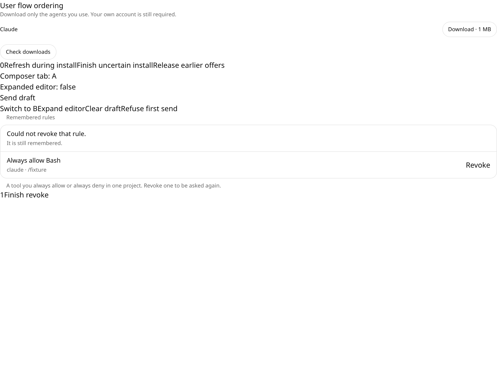
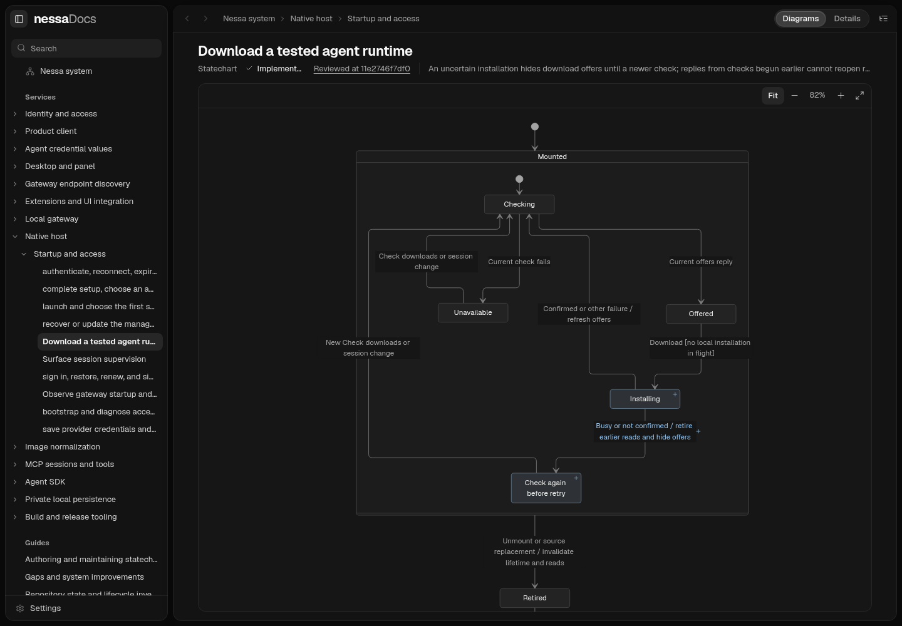

# Pending action ordering evidence (#1087)

Base: `0b8019cf45f99b285f10c41199875d474492c6d1`.
Source head: recorded in the PR/handoff after committing. Linux, Node 24.19.0,
Nessa UI pin `d550fac7a59b8f9b6c9d6f1e7dced07ca38ee35b`, development Vite,
installed `/usr/bin/chromium`, 1100×850 fixture viewport. No production accounts.

```sh
node verification/desktop/scripts/user-flow-ordering.mjs \
  --engine chromium --chromium-executable /usr/bin/chromium \
  --out /tmp/nessa-flow-browser-final.json \
  --shots verification/desktop/evidence/user-flow-ordering
```

Fixed run: **6/6 held** (four ordering checks plus two console records).

```text
ok    uncertain-install-busy [chromium]
ok    uncertain-install-not-confirmed [chromium]
ok    cross-tab-clear [chromium]
ok    old-refusal-new-send [chromium]
```

Both uncertain outcomes: **1 installation dispatch, 0 stale Download buttons,
1 button after a fresh check**. Cross-tab clear: B remains expanded. New B send
after old A refusal: B collapses when its own draft leaves.



Revert probes used the baseline source for only the owning hook while retaining
the new tests. Downloads: **2 failed / 9 passed**. Composer: **2 failed / 1 passed**.
Restoring both baseline hooks in the browser fixture: **2/6 held**, with all
four ordering checks failing (older offers restored Download for Busy and Not
confirmed; both composer checks failed their expected expansion state). Fixed
source restored afterward; the same browser command passed 6/6.

The fixture drives production AgentDownloads/useComposer through injected
ports. It does not establish backend duplicate physical installation, provider
completion, or real native window behavior.

WebKit is **unrun**. Playwright browser installation was denied by network
policy (`403 Domain forbidden` at `cdn.playwright.dev`); no alternate host was
used. System Chromium is a separately installed executable.
Gateway scripted E2E reported **could-not-run (exit 2)**: `cargo build -p
nessa-server` could not start because Cargo is absent. Default and raised
conversation stress, chaos, native macOS acceptance and live providers remain
unrun. Architecture scanning also cannot execute its Cargo metadata step.

The full frontend baseline's private-file acceptance failures are retained:
this sandbox reports `/` and `/tmp` owned by uid 65534, while the existing
private-file acquisition contract accepts root/current-user ancestors only.
Those tests and their security checks were not weakened.

Final source-tree checks: **129/129 targeted tests in 19 files**;
**401/401 verification-library tests**; TypeScript, changed-file ESLint,
source/fixture formatting and production build passed. Build retained its
existing large-chunk warning. Full frontend: **5130 passed, 2 failed in 390
files** (the same two unchanged private-file acceptance fixtures). Architecture:
**107 passed, 1 could not execute Cargo metadata**, reported by that test runner
as a failure. Required exact-head CI remains pending on GitHub.

Documentation slice: source/test checkpoint
`11e2746f7df088a1bd5ee3b2e579ad8a40b5cbd1`; unchanged linked-device and
sharing owners reviewed at mainline
`0b8019cf45f99b285f10c41199875d474492c6d1`. Navigation-only changes do not
advance unrelated checkpoints. Renderer/skill checkout:
`nessalabs/nessa-docs@c0bc0627611b100ab71a96cc6fe2fb65f1a014d8`.

From that renderer checkout:

```sh
npm run --silent validate:docs -- --project /workspace/nessa-agent
NESSA_DOCS_PROJECT=/workspace/nessa-agent PORT=4312 npm start
```

Final catalog: **125 pages, 0 issues** ([JSON](catalog.json)). Installed Chromium
rendered **24 diagrams across all 13 changed state pages**, opened **31 authored
node/edge detail bindings** and followed **10 drill-down paths**, with **0 page
errors** ([per-page and navigation evidence](statecharts.json)). All **173
relative Markdown links** in changed state pages resolve to existing files.
The viewer pass covered root → journey index → startup feature → session flow →
supervisor → client recovery; gateway observation and runtime downloads;
workspace → linked devices and sharing; and device → conversation sharing.



The explicit `--engine chromium,webkit` ordering invocation retained all six
Chromium results and then reported missing WebKit executable:
**6/7 held, exit 2/could-not-run**. This is not a two-engine pass. The full desktop
run-all gate remains unrun. No screenshot or docs renderer check replaces the
missing WebKit, gateway stress or native-platform gates.
## Revoke-focus follow-up and composer qualification

A separate focused commit after `11e2746f7df088a1bd5ee3b2e579ad8a40b5cbd1`
fixes the third independent finding. Permission-rule revoke now retains one
identified owner through command acknowledgement and its fresh read. Background
focus/visibility checks cannot replace it. Repeated callbacks are refused by
that synchronous owner; source/view retirement invalidates late continuations.
No server authorization rule changed.

Seven permission cases plus one actual Redux-store composer case bring this
work to **41 added tests**. The actual-store counterexample sends A and switches
to B in the **same task**; separate, ordinary human-click reachability remains
unverified. Controlled hook fixtures are not proof of that reachability.

Reverting only the permission component gives **6 failed / 6 passed**; reverting
the composer hook and running the actual-store file gives **1 failed / 7
passed**. The original permission component in Chromium permits a second
frontend revoke dispatch after focus and gives **6/7 held**. Fixed source
restored: **7/7 Chromium checks held**, including **one pending revoke dispatch**,
controls disabled through ownership, and recovery enabled after settlement.
The evidence makes no duplicate-physical-effect claim.

Updated source checks: **142/142 targeted tests in 20 files**, TypeScript,
changed-file ESLint, formatting and production build passed. Full frontend:
**5138 passed / 2 failed in 390 files**, retaining the same unchanged private-file
fixture failures. The initial source commit's evidence above remains historical.
System-Chromium overview/focus findings are being triaged separately and are
not attributed to these changes.
