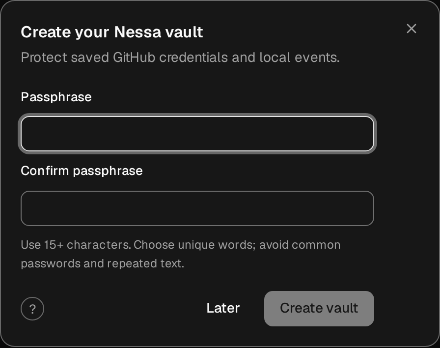
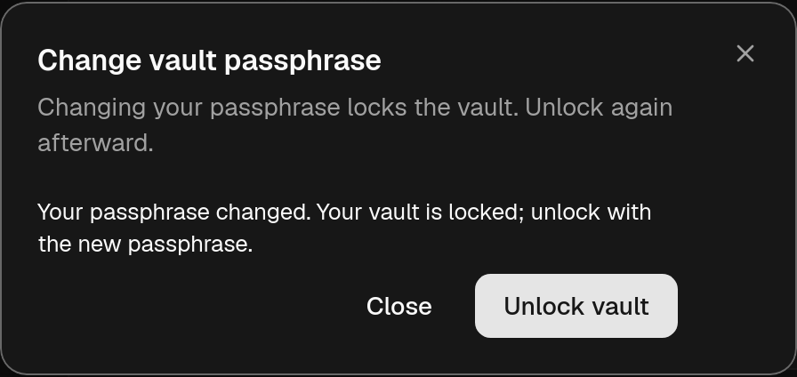
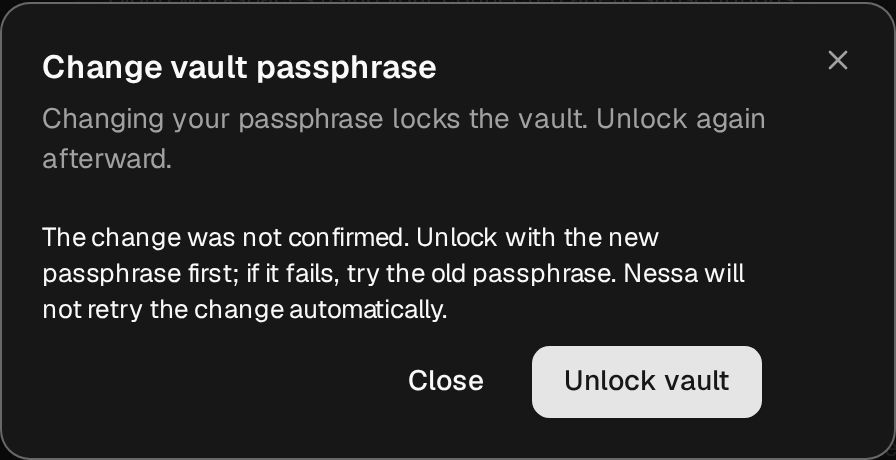

# Vault hardening qualification

Qualified locally on an uncommitted tree based on
`ba559e7e5b4fe6db332c1a65655cc3a3b2513b5a`. This is local evidence, not a hosted
CI or deployment result. The [vault design](../../../../docs/adr/todo/1152-local-vault.md)
and [security boundary](../../../../crates/nessa-vault/README.md#security-boundary)
distinguish implemented behavior from remaining architectural work.

Linux x86_64 (Debian 13), Rust 1.99.1, Node 24.19.0. Playwright Chromium
153.0.8010.12 and WebKit 26.6. Browser runtime libraries were extracted into the
workspace from verified Debian packages, without changing host packages. The
Playwright host-library catalog check was skipped because it ignores local
library overrides; both engines actually launched and executed the checks.
Product assertions, test deadlines and configured counts were preserved.

| Check | Result |
| --- | --- |
| Vault crate, including setup compatibility, namespace isolation and change fault matrix | 47 passed |
| Client-core all-target tests and doctests | 488 + 6 passed |
| Gateway vault socket tests, normal default-thread command | 10 passed |
| Rebuilt executable bootstrap and retained CLI bridge | 1 + 2 passed |
| Native Rust source/endpoint harness | 11 passed; full Tauri/platform build not claimed |
| Vault UI/adapters/controllers and client API | 55 passed |
| Settings catalogue | 26 passed |
| Plan tests | 11 passed |
| Protocol generation/grammar checks | 65 passed |
| Grouped affected CI-package Clippy, all targets, `-D warnings` | passed |
| TypeScript app/client typechecks, affected ESLint/formatting, architecture | passed |
| Nessa Docs catalog | 141 documents, zero issues |
| Vault browser flow | Chromium 2/2; WebKit 2/2 |
| Focused conversation passphrase stress, default count 1 | 8/8, both engines |
| Focused conversation passphrase stress, raised count 3 | 12/12, both engines |
| Production scripted suite | passed in both engines |

The full unselected conversation stress plan is **blocked before steps start**:
`inputFiles` requires `NESSA_PHONE_FILES_VERIFIER` from nessa-ios. Its package
uses an Apple XCFramework; that verifier is unavailable in this Linux workspace.
The baseline driver reaches the same unchanged prerequisite failure. Neither full
default nor full raised stress is claimed as passed.

Focused runs used `--only passphrase`, with all original knob values and deadlines
retained. Results explicitly carry `scope: selected:passphrase`; background turns,
followers and final settlement ran. Selection does not modify the complete plan, counts or deadlines. Unselected
steps receive no pass results.

Commands for those focused runs:

```sh
node verification/desktop/scripts/conversation-stress.mjs --only passphrase --engine chromium,webkit --channel bundled
node verification/desktop/scripts/conversation-stress.mjs --only passphrase --passphrases 3 --engine chromium,webkit --channel bundled
```

The first browser run exposed a normal unlock prompt covering lost-answer recovery;
foreground ownership and stale-source fencing fixed it. Deliberate code probes
also rejected removal of confirmation, Locked-only result validation, no-replay
classification, owner/generation fencing, scratch erasure, caller bounds,
temporary verification, publication/audit separation and transport retirement.
The original executable failed the new bootstrap/CLI acceptance; the rebuilt one
passes. Under competing independent memory-hard fixtures, an earlier parallel run had
three one-second response timeouts, including a pre-existing test. Test-only
fixture capacity now bounds independent gateways without changing those deadlines
or within-test concurrency. The rebuilt default
socket command passes 10/10.

Fresh independent source reviews report no remaining findings in implemented
scope. Non-Linux execution, a complete Tauri build and hosted CI remain unverified.
The existing lease constant-evaluation compiler warning remains unchanged.

## Production scripted summary

Verdict: pass

| Check | Chromium | WebKit |
| --- | --- | --- |
| resize-observers | pass | pass |
| mcp-apps-gateway | not run: dev server only | not run: dev server only |
| gateway-window | pass | pass |
| scripted-scenarios | pass | pass |

Relevant log lines: none.

## Screenshots







## Current-main reconciliation

The source was reconciled with `291910cb5d9e8221448f2082816a5c46ba6742b3`
and committed as `fa20cf23bf92392c91e1979ca0f03ffa37827331`.
Independent review confirmed the primary security source hashes still match the
reviewed implementation and the new-main device/stress changes remain intact.
Private findings and reproductions are excluded from the publication tree.

Repeated checks passed: vault 47; client-core 488 plus 6 doctests; focused
TypeScript/settings 81; stress-plan 11; protocol 65; app/client typechecks;
affected lint, repository formatting, architecture and 141-document validation.
The rebuilt executable bootstrap/retained-CLI checks passed 3/3 and the native
Rust source/endpoint harness passed 11/11. These are local results for the
reconciled source; the earlier table remains the original qualification record.

Current runtime/browser qualification and exact-head hosted CI outcomes are
recorded on the draft PR linked from [tracking issue #1223](https://github.com/nessalabs/nessa-agent/issues/1223).
The first rebuild exhausted the workspace disk; only disposable compiler caches
were cleared before rebuilding. Failed resource-constrained launches are not
counted as passes. The full local stress prerequisite and platform exclusions
above still apply.

### Subsequent Settings integration

Main advanced to `1c28c39e2` while qualification was running. Integration source
commit `87979c62ab6323ef32a1de6bc2cb9bd64e6056f0` preserves both the new MCP Settings flow and the vault controls.
Independent review checked the two conflict resolutions, host composition,
complete stress counts and selection/prerequisite handling. Primary vault/core
and native-vault source hashes remain unchanged; those Linux and harness results
carry across this frontend/native-composition integration. Current frontend,
browser and CI outcomes remain recorded on the linked draft PR, with their exact
head and scope. The state page checkpoint identifies this reviewed integration.

### CI compatibility qualification

Reviewed source checkpoint `59ed940ca1623b4f16f1874c5859608d6b6534f5` also includes the canonical SDK field
description and preserved ordinary-command correlation behavior at the existing
valid-notice limit. Strict frame validation and passphrase-change uncertainty /
connection retirement remain unchanged. Canonical CLI peer fixtures now include
their required event metadata; their adversarial cases and counts are preserved.
The direct new regression fails before the correlation fix and passes afterward.
Repeated client-core tests pass 489 plus 6 doctests; corrected real CLI tests pass
2/2; grouped CI-package Clippy passes. Independent review reports no findings.

The full local frontend attempt reached 5,571 passing tests and two private-file
fixture refusals. This sandbox reports the filesystem root owner as UID 65534;
the unchanged private-file acquisition policy accepts only root/current-user
ancestors. The same two positive fixtures fail on unmodified main. Those checks
were not relaxed. File-watcher fixtures separately require native `/tmp` here;
their existing 30-second checks pass 2/2 there. Local stage results and the final
canonical hosted frontend verdict are distinguished on the PR.
