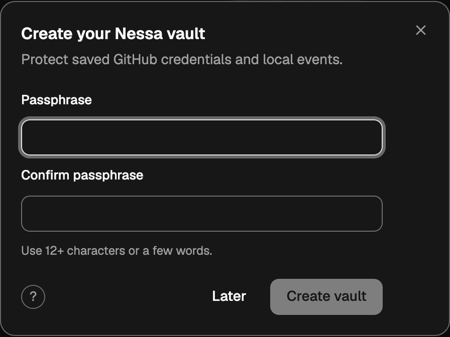
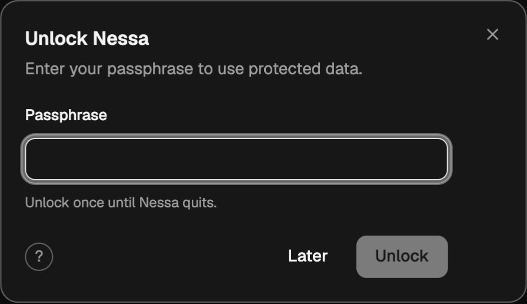

# Local vault verification

See the [Daybreak remediation and regression verification](daybreak-remediation.md)
for the latest provider-admission and relay hardening, updated fixtures, revert
probes, and independent closing review.

See the [final phone/main integration](phone-main-completion.md) for the current
worker, native/browser/provider checks and source-specific review limits.

See the [retention-gap wire follow-up](retention-gap-followup.md) for the late
automated finding, shared receipt regression, and fresh closing review.

See [mainline completion](completion.md) for the integration with current main,
matching worker publication, fresh reviews and separately tracked baseline limits.

See the [CI follow-up](ci-followup.md) for repairs and newer verification after the first hosted run.

Implementation source: `7307eb9d6a9d54f37026323ad7e35bae7c33039f`, stacked on
`834040bc12b0a3df08a56bbdd4c24626558842f5` (#1137). The final two source commits add CI/local package coverage and lint-only
corrections; runtime behavior is unchanged from `f5d055777`.
The screenshots below were captured against a freshly built `f5d055777` binary
and its frozen UI source in development mode on macOS. Both are cropped from
actual browser captures; the Settings check also asserts requester portal ownership.

## Passing focused checks

| Boundary | Evidence |
| --- | --- |
| Encrypted file, KDF compatibility, lifecycle, audit restoration | `cargo test -p nessa-vault`: 16 passed |
| GitHub/relay/product consumers, including same-session races | CI seven-package selection, `--lib github`: 64 passed |
| Vault product/migration routes | CI seven-package selection, `--lib vault`: 13 passed before final row validation; related final core/GitHub/browser checks also pass |
| CLI/local product transport | 20 passed before final GitHub-only race repair |
| Actual native host process/deadline adapters | 3 passed; blocked child, stale timeout, uncertain mutation delivery |
| SDK and UI vault components | 14 passed |
| Browser vault | `vault.mjs`: 3/3 held, Chromium and WebKit, 1000×800, columns |
| Browser live events | `github-live-events.mjs`: 3/3 held, Chromium and WebKit |
| Restart stress | Chromium: 9/9 held; 30 conversation turns, two GitHub connections, SIGTERM and SIGKILL restarts; traces/other scenarios disabled |
| Scripted E2E | Resize, MCP apps, gateway window, scripted scenarios: pass in both engines, before the final backend race/audit repair |
| CI aggregation and partition checks | 33 passed; both package-omission revert probes rejected |
| Desktop verification helpers | 402 passed |
| Source/API checks | Typecheck, lint, formatting, architecture, protocol and public SDK documentation pass |
| Documentation | 134 pages, zero errors; 26 existing renderer warnings that sourceRevision is not yet recognized; new chart parses |

Focused final core/server and native Clippy passed. The complete updated eight-package CI all-target Clippy selection also passes. These are supporting
checks, not a claim that every repository suite is green or that Windows/Linux
native behavior was executed on this macOS host.

## Adversarial review and revert probes

See [the final independent review](security-review.md) and
[ADR 1152](../../../../docs/adr/todo/1152-local-vault.md).
Earlier rounds found and corrected publication/close ordering, stale UI reads,
child timeout ownership, ordinary native secret strings, generation-bound GitHub
storage/cache cleanup, same-generation restore/disconnect ordering, retained-audit
validation and missing CI coverage. The GitHub transition design was revisited
before further repairs, rather than exempting restore from ordering.

Revert probes rejected removal of: closed-owner and explicit-lock fences;
passphrase minimum; scoped read/save/delete checks; fixed KDF profile;
GitHub cache-generation and lock-audit cleanup; native deadline/stale-timeout
ownership and mutation no-replay; stale UI-read checks; Settings portal ownership;
same-session restore ordering; audit restoration validation; local/matrix package
coverage. Source was restored and relevant checks rerun afterward. The first
pixel-only portal assertion and first matrix-coverage assertion did not catch
their mutations; both checks were strengthened and repeated successfully.

## Remaining failures and limits

- Full frontend run: **5314 passed, 1 failed**. Linked-device cancel pairing focus
  fails on isolated base `834040bc` too: [#1154](https://github.com/nessalabs/nessa-agent/issues/1154).
- Script suite: **454 passed, 2 failed, 2 skipped**. The deleted old token filename
  came from the uncommitted Git index; after committing the rename, its owning
  `documentation-only.test.mjs` passes **8/8**. The remaining macOS Chromium
  fallback `/private/var` versus `/var` assertion independently reproduces on the
  isolated base: [#1157](https://github.com/nessalabs/nessa-agent/issues/1157).
- Earlier full desktop run: **22/36 checks held, 13 failed, 1 could not run**.
  It was a development run with source edits, not frozen final verification.
  Failing suites: icon-buttons, focus, drag, responsive, safe-area, columns,
  committed-transcript, conversation-unread, linked-devices, share-dialog,
  mcp-apps, approval-deadline, turn-outcomes; widgets could not run. Some known
  issues exist, but this report does not classify every failure as pre-existing.
  A clean frozen full desktop baseline remains outstanding.
- Broad stress with traces disabled held 50/50 Chromium checks; WebKit stopped
  on keyboard assertions tracked by #1136. Trace-enabled stress also hit existing
  timing budgets. Only the focused final 9/9 sequence above is claimed at the
  final runtime revision.
- Native Tauri GUI E2E and the complete cross-platform CI matrix remain CI/review
  work. Browser UI checks use the real gateway and a private-pipe bridge; native
  process/deadline behavior is separately covered by host tests.

Cloudflare runtime, deployment and Free plan are unchanged. It can see incoming
webhook plaintext; this is not end-to-end encryption. Normal GitHub credentials
and the inbox key use the local vault. Existing provider API-key keychain storage
is outside this slice. Existing GitHub/inbox entries can require one final OS-store
unlock for verified import. A forgotten passphrase has no automatic recovery.
