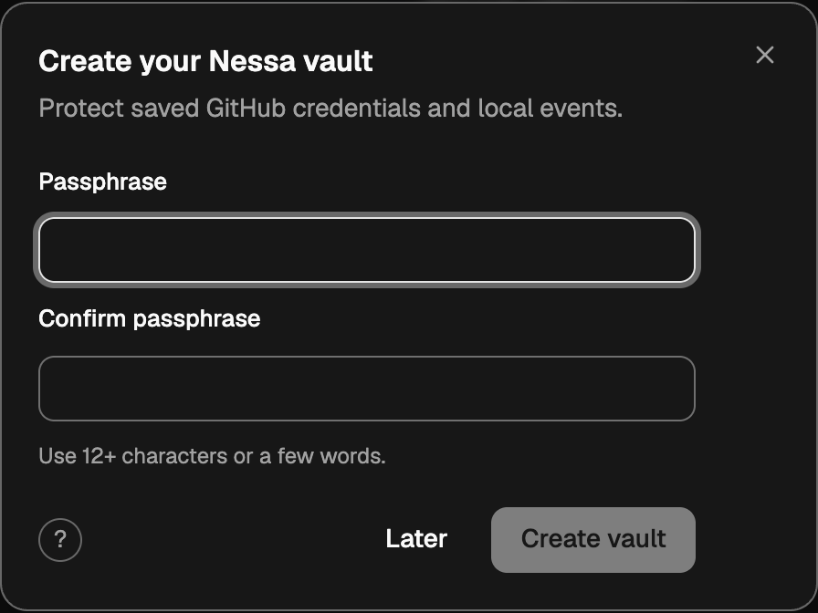
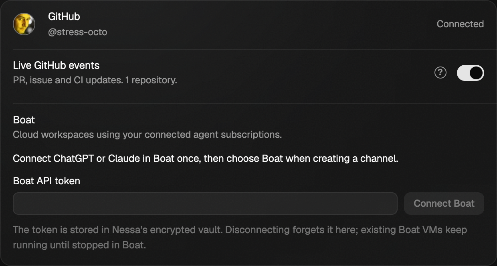
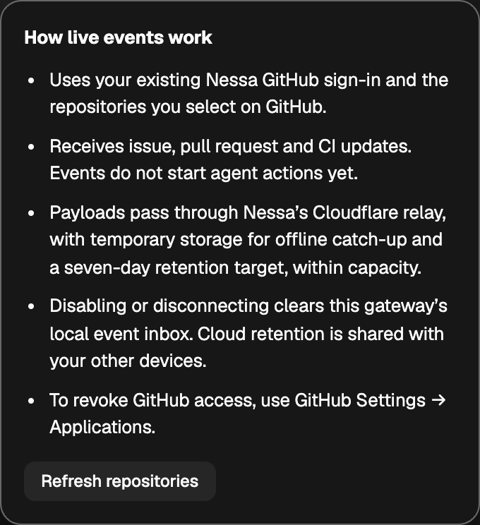

# Mainline completion of #1158

This is the first integration checkpoint. The [later phone/main integration](phone-main-completion.md)
records the newer runtime and worker; the source-specific results below remain historical.

Reviewed integration source: `29af2efb974ddb90a95c8921c4192a3603684af8`.
Release pin and shipping regression: `ada97db78` (full source checkpoint in the
state pages). The worker binary is built from the integration source; changing
the pin/test/documentation does not change its lease fingerprint.

The integration preserves current main's tunnel/file-drop/protocol contracts and
the relay/vault/Boat ancestry. It fixes the newer paired-list fixture's omitted
Local execution value and refreshes the worker after fingerprinted tunnel source
changed. The shipping regression failed with the old pin and passes with the
new published worker. See [publication receipt](worker-release-receipt.json).
All three owned publication VMs are provider-confirmed absent and their deletion
operations completed; this is not an independently attested secure-erasure claim.

## Completed checks

- Frontend: 422 files, 5,436 tests passed; typecheck and production build passed.
- Relay: 44 tests passed. CI/harness: 27 passed. Product protocol/generation: 61
  passed. Channel model/store/gateway: 29 passed. Stage rollout guards: 2 passed.
- Eight-package strict all-target Clippy passed. GitHub/relay/product: 67 passed.
  Vault tests: 16 passed; paired-list socket suite: 15 passed, including scoped
  channel grants and seeded load. Gateway rebuild passed after the worker pin.
- [Integration review](completion-integration-review.md),
  [security review](completion-security-review.md),
  [closing review](completion-final-review.md), and
  [worker publication review](worker-publication-review.md) closed with no open
  findings in their recorded scopes. These are source reviews, not an external
  penetration test.

Real-gateway vault checks passed 3/3 and live-event opt-in/failure/disconnect
checks passed 3/3 across Chromium and WebKit. The gateway uses the final worker
pin source. Captures below show the actual dialogs and concise settings row.
Real Boat checks passed: independent saved VMs, real subscription inference,
workspace files across restart/resume, cold coordinator startup, approved local
MCP access, connection-removal/session-close revocation, cross-VM delegation and
missing-VM refusal. All four owned E2E VMs are provider-confirmed absent. One
thread close remained unconfirmed after its VM was deliberately removed; this
is recorded separately from provider absence, not relabeled successful close.
See [provider checks](completion-boat-checks.json) and
[cleanup receipts](completion-boat-cleanup.json). Current-head hosted CI and the
scripted browser run are recorded on the PR when complete. Earlier source-specific evidence
in this folder remains historical; it is not replaced by a blanket green claim.

## Separate desktop baseline observations

The frozen broad desktop run has unrelated failures; it is not claimed green.
On an independent main-equivalent UI tree, fresh production previews reproduce
three tooltip-copy failures (Chromium columns, 3/4 contracts held), the WebKit
1000×700 sideways-top drag failure (0/1), and both-engine home-shape failures
(1/3). The known answer-card double-click failures are also tracked separately.
See #1162 and #1173 and the PR's final per-suite ledger. Other broad failures
remain unclassified until independently checked; they are not silently called
pre-existing. Full frontend aggregate also encounters the separately tracked
macOS cloud-startup fixture issue #1170.

Cloudflare deployment and the Free plan are unchanged. Future stages remain
disabled without a dev fallback. The relay sees incoming webhook plaintext;
local vault/inbox encryption does not provide end-to-end webhook encryption.
The separate Boat lifetime follow-up #1174 is outside this integration.
