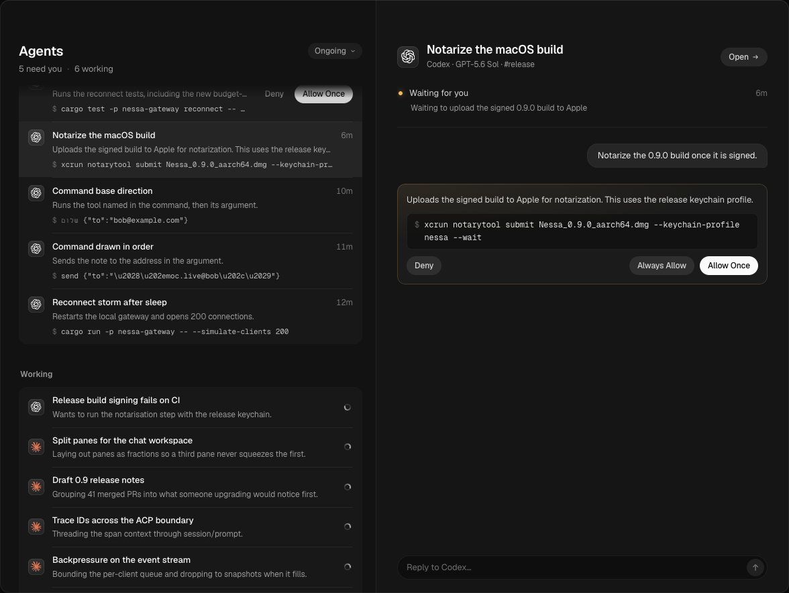
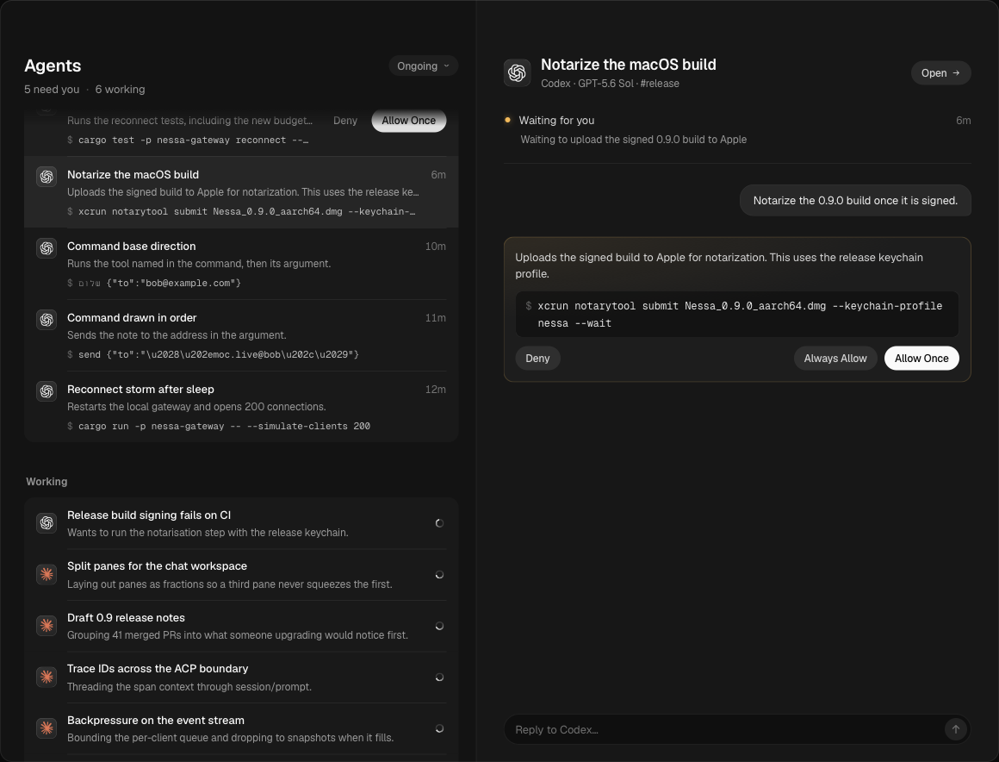
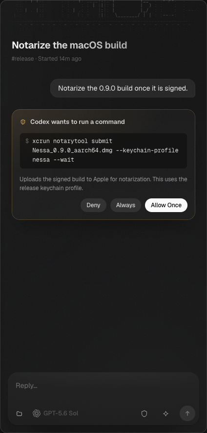
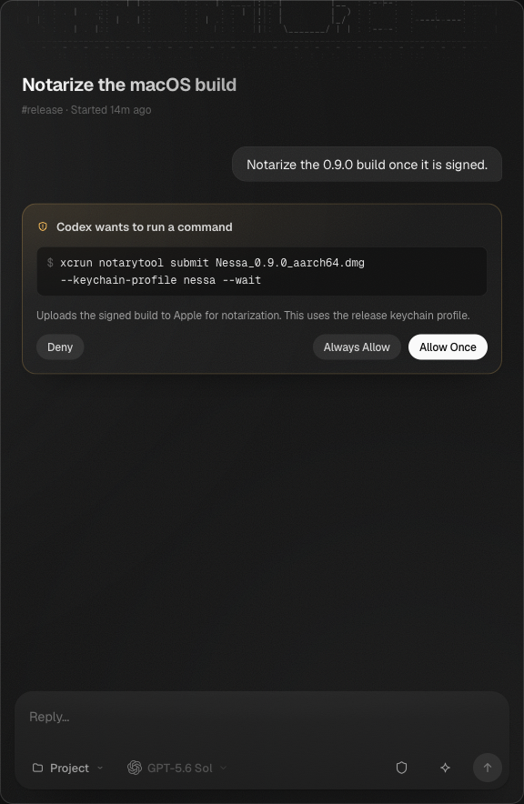
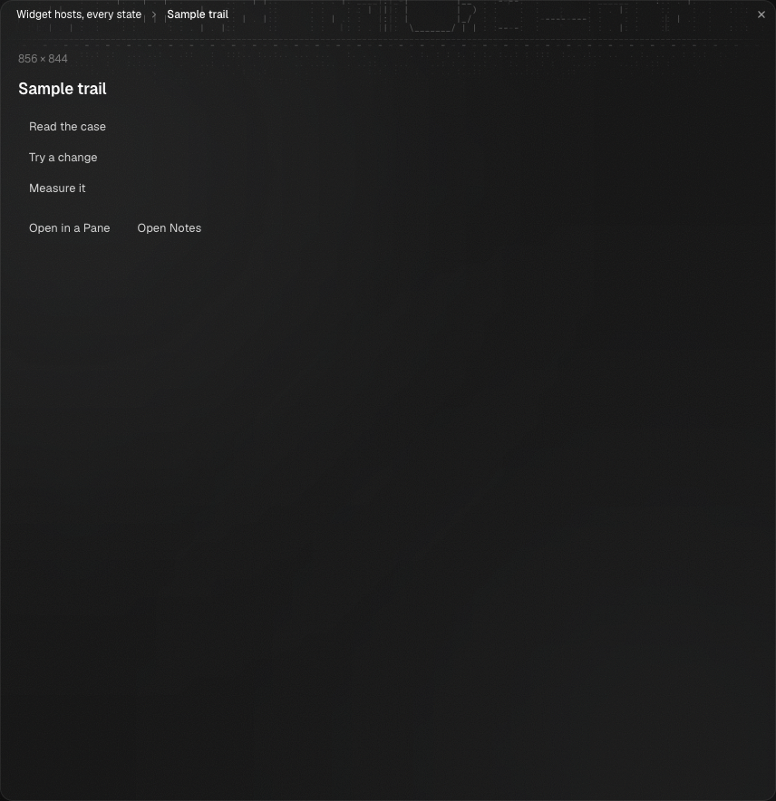
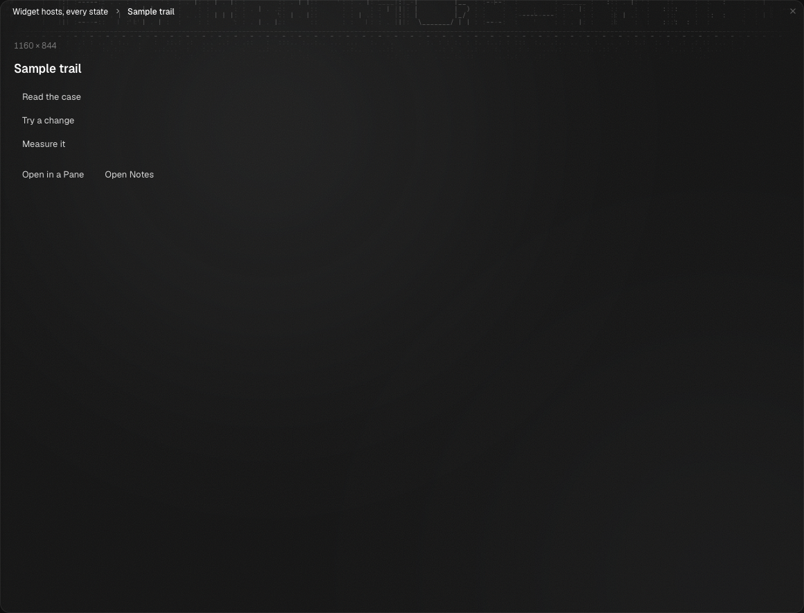
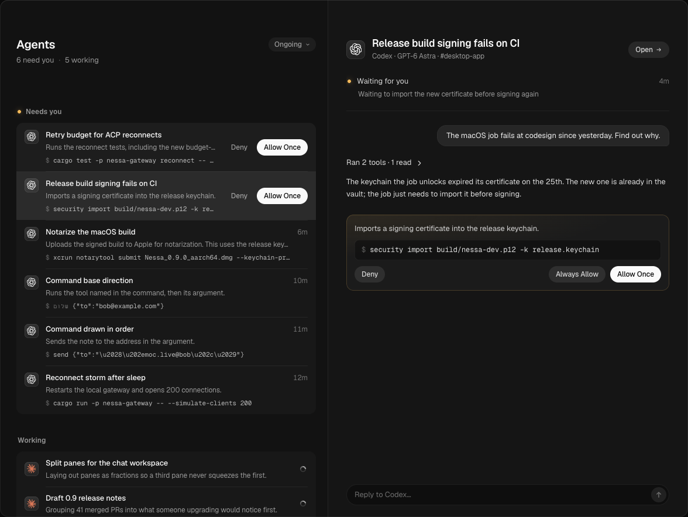
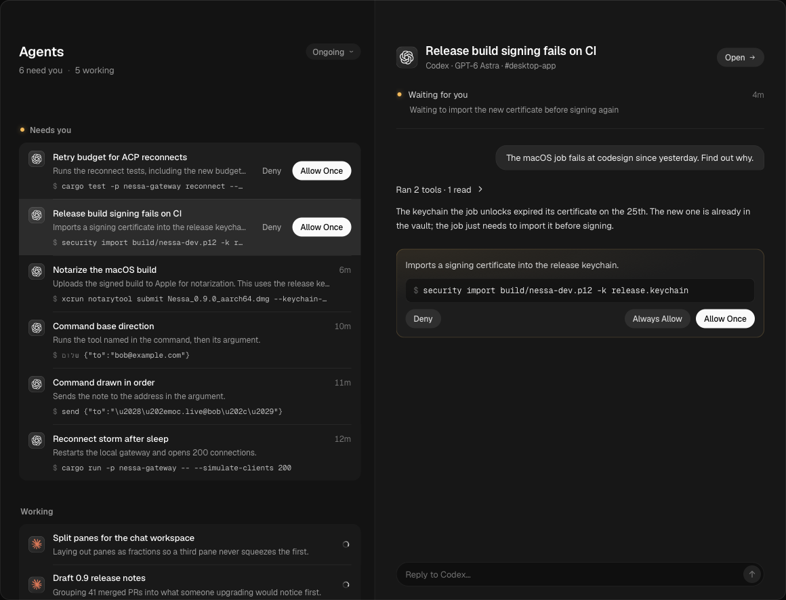

# Workspace visibility — #914

Captured and qualified on source `817ccbb46f1793eca608dfa95dadd663583d4187`, actual main base `b949034ec2d33eab425b513b2ba59b8aa9d15634`. These are fresh production screenshots from Chromium and Playwright WebKit, not installed AppKit/WKWebView. Pane, full-chat widget and answered peek captures follow two animation frames; screenshot transport can advance time. Existing samplers separately assert first-mounted cumulative ancestor opacity, header/body paint and unit transforms. Local-control shots show keyboard focus on one row while the pointer hovers another.

## Current qualification

- Full frontend: 359 Vitest files / 4770 tests, plus the complete chained frontend checks, exit 0.
- Actual-main own-gateway canonical wrapper: all three programs (`mcp-apps-gateway`, `gateway-window`, `scripted-scenarios`) passed Chromium and WebKit.
- Affected production programs: smoke 33/33; overview responsive 13/13; mounted content 13/13; widgets 13/13; focus 85/85; safe area 91/91; stationary drag 17/17. Total 265/265. Ordinary functional runs had disclosed isolated SDK test contention; no performance claim uses that interval.
- Full production headed Chromium budget: `perf-budget: 35/35 held`, 33 interaction rows, five runs each, both layouts, unchanged 4× throttle, windows and unrounded 50 ms decision. Calibration 22→64 ms (ratio 2.93); known 120 ms frame measured 120.700 ms and was LoAF-attributed. All interaction samples have zero over-budget frames.
- All 4785 source hashes and 878 production artifact hashes unchanged after the run. Sorted-map SHA256: source `ebc4ff8cc6b0484e1fb867253ee9c060ab559e844c9647bfcd328e4589e9185d`; artifact `c4ea62f9428acfefdcdc03108f273036ba20c22ec9b9ea467b746637b19bf6ec`. Own preview processes retired and port 51747 closed.

Actual local-rule regression before: all four engine/layout cases rejected the new shown-row/time-opacity property; fixed 9/9. Independently restoring the actions ancestor guard rejected only shown-row identity; restoring the time guard rejected only time opacity. Exact restoration and fresh build passed 9/9. These premerge checks apply to byte-identical feature source/artifacts; the full current run above is a separate assembled-source execution.

Historical failed calibrations, overview matrices, headless drag samples and rejected focus/scoping experiments remain in the retained investigation packet. They are not relabelled current passes or explained solely by this later result. The original requested-80-ms rapid-answer observation was unmeasured; the replacement queued-event property explicitly uses synthetic DOM inputs, while native repeat coverage remains. Raw current budget samples retain trusted input timestamps and rAF gaps. No bounds, window or guard relaxation.

## Fresh screenshots

## Full headed budget

| Layout | Action | Maximum ms | Median ms | Frames >50 ms |
| --- | --- | ---: | ---: | ---: |
| columns | split-right | 27.900 | 25.900 | 0 |
| columns | split-down | 29.000 | 25.800 | 0 |
| columns | move | 22.400 | 19.800 | 0 |
| columns | close | 38.300 | 32.700 | 0 |
| columns | sidebar | 28.500 | 22.100 | 0 |
| columns | session-list | 24.600 | 19.900 | 0 |
| columns | send-home | 40.600 | 37.100 | 0 |
| columns | typing | 24.300 | 21.100 | 0 |
| columns | stream-1-of-4 | 28.400 | 27.200 | 0 |
| columns | drag-drop | 38.900 | 28.900 | 0 |
| columns | drag-cancel | 28.800 | 27.200 | 0 |
| columns | thinking-walk | 22.800 | 19.600 | 0 |
| columns | thinking-drag | 19.300 | 19.100 | 0 |
| columns | overview-open | 30.000 | 27.000 | 0 |
| columns | overview-select | 26.600 | 25.500 | 0 |
| columns | overview-answer | 41.400 | 41.000 | 0 |
| columns | overview-leave | 23.400 | 19.500 | 0 |
| sidebar | split-right | 29.200 | 28.100 | 0 |
| sidebar | split-down | 26.700 | 26.500 | 0 |
| sidebar | move | 20.100 | 19.200 | 0 |
| sidebar | close | 35.600 | 30.200 | 0 |
| sidebar | sidebar | 29.200 | 27.000 | 0 |
| sidebar | send-home | 45.500 | 35.900 | 0 |
| sidebar | typing | 25.300 | 21.600 | 0 |
| sidebar | stream-1-of-4 | 30.600 | 28.000 | 0 |
| sidebar | drag-drop | 29.700 | 27.100 | 0 |
| sidebar | drag-cancel | 28.700 | 27.300 | 0 |
| sidebar | thinking-walk | 21.100 | 19.500 | 0 |
| sidebar | thinking-drag | 19.400 | 19.100 | 0 |
| sidebar | overview-open | 29.700 | 26.700 | 0 |
| sidebar | overview-select | 27.400 | 24.700 | 0 |
| sidebar | overview-answer | 42.600 | 39.300 | 0 |
| sidebar | overview-leave | 24.600 | 21.000 | 0 |
